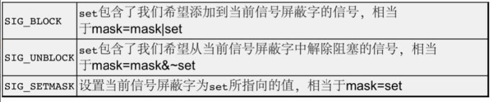
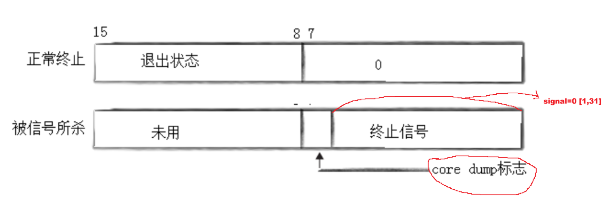
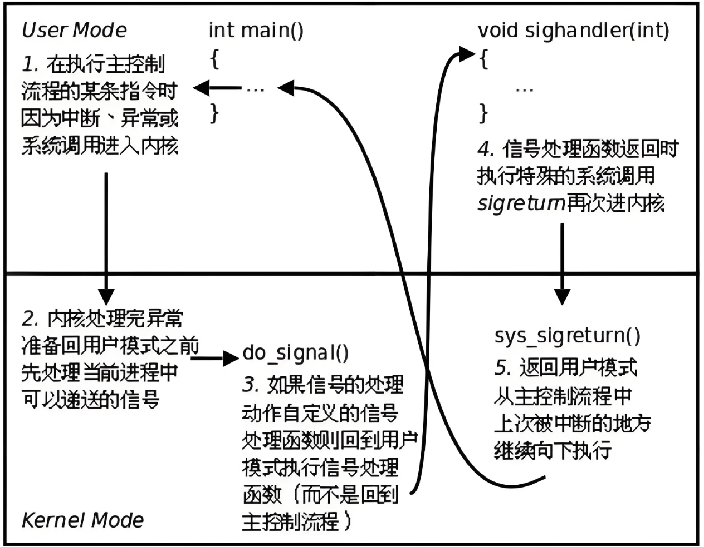
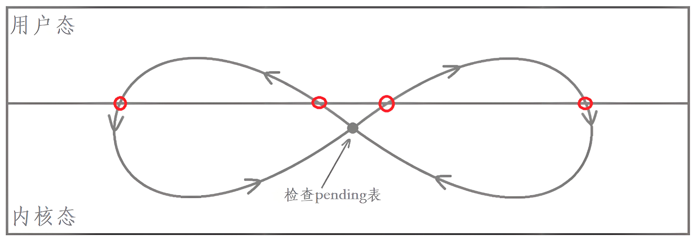
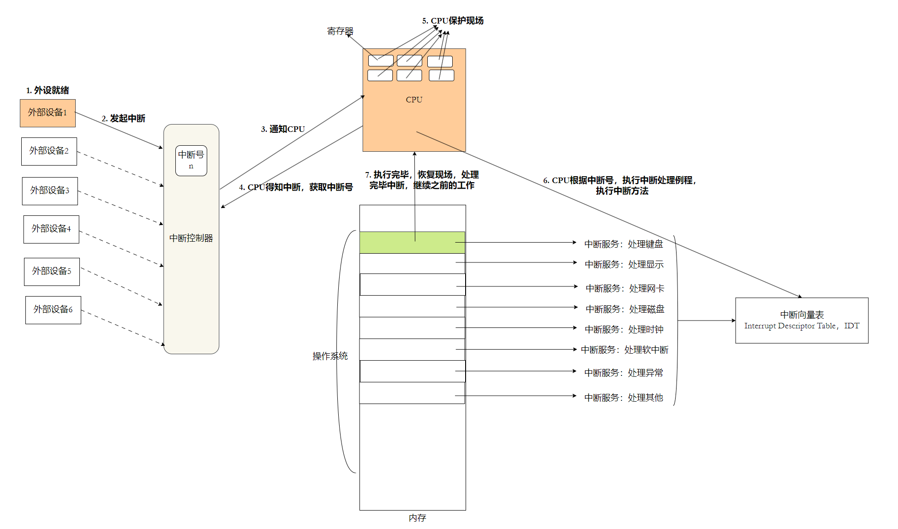
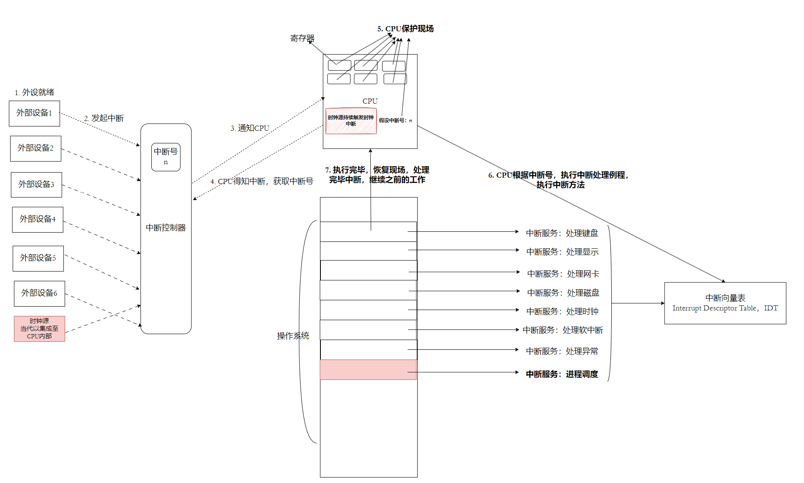
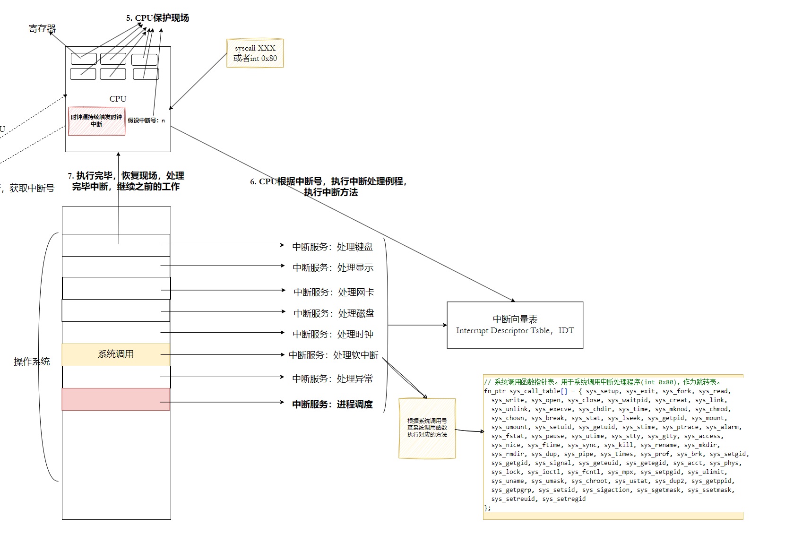
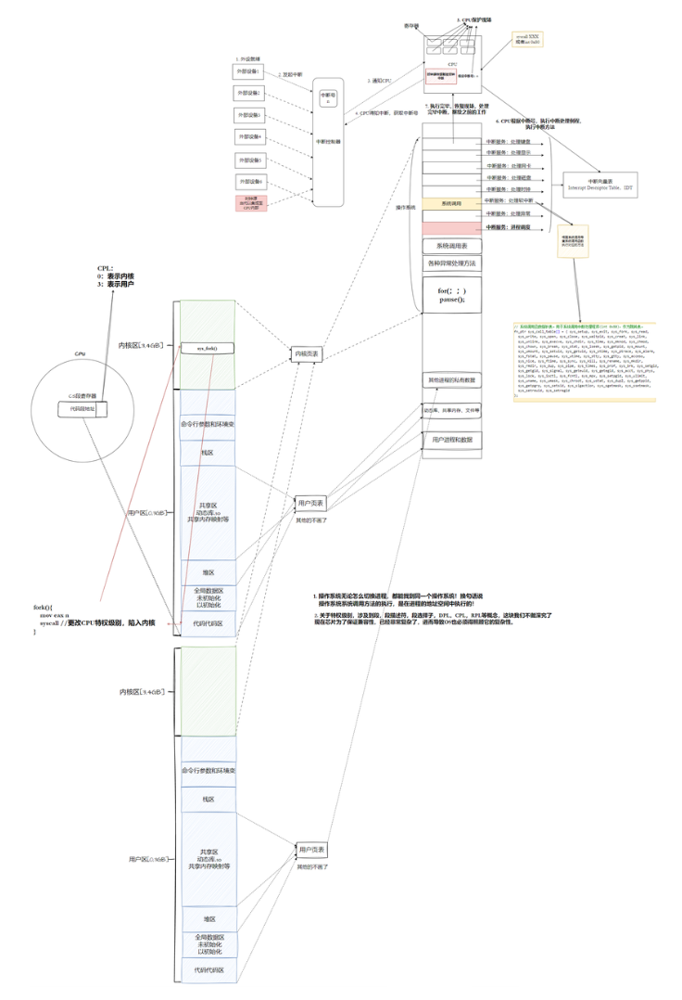
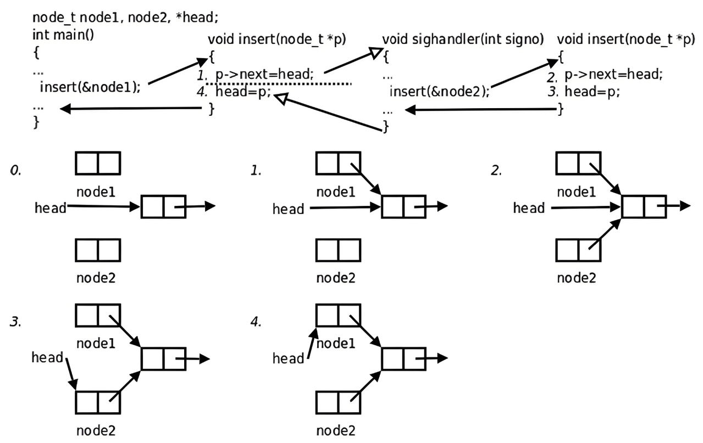

# Linux 进程信号

> 主题：信号的产生 · 保存 · 捕捉 · 可重入 · volatile · SIGCHLD

## 目录

- [一、前置：什么是信号](#一前置什么是信号)
- [二、信号的产生](#二信号的产生)
- [三、信号的保存](#三信号的保存)
- [四、信号的捕捉](#四信号的捕捉)
- [五、可重入函数](#五可重入函数)
- [六、volatile](#六volatile)
- [七、SIGCHLD 与子进程回收](#七sigchld-与子进程回收)
- [八、小结](#八小结)

---

## 一、前置：什么是信号

> **信号（signal）与信号量（semaphore）毫无关系。** 信号量是进程/线程间同步的工具，本章讲的是信号。

信号是**内核向进程发送的一种异步事件通知**：它可能在任意时刻打断进程当前正在做的事，让进程去执行预先登记好的处理动作。

先把两个容易混的词说清楚：

| 概念 | 含义 |
| --- | --- |
| 同步 | 事件之间存在**确定的先后次序**，后一件事需要等前一件事完成（有依赖、要等待） |
| 异步 | 事件之间**没有依赖**，各自独立发生，谁也无法预知对方何时到来 |

**信号的产生相对于进程的运行是异步的**：进程正在执行 `main` 里的代码时，键盘、内核、另一个进程都可能随时给它发来信号。

对每个信号，进程有三种处理方式：

| 处理方式 | 说明 | 如何设置 |
| --- | --- | --- |
| 默认处理 | 按内核规定的动作执行：终止、核心转储、停止、继续或忽略 | `SIG_DFL` |
| 忽略 | 递达后什么也不做 | `SIG_IGN` |
| 自定义捕捉 | 递达时执行用户提供的函数 | 传入函数指针 |

大部分信号的默认动作是**终止进程**；`SIGKILL`(9) 和 `SIGSTOP`(19) 是例外，它们**不能被捕捉、阻塞或忽略**。

### 结论

- **进程在信号产生之前就“认识”这些信号了**：每个信号在 PCB 中都对应一个默认处理动作，进程不需要为没见过的信号临时准备代码。
- **信号产生后不会立即处理**：内核先把信号记在进程的 pending 表里，等进程从内核态返回用户态时再处理——这就是所谓“合适的时候”。
- **操作系统内置了对信号的识别与处理机制**，用户能改的只是“处理动作”这一栏。
- **信号的来源非常多**：键盘、系统调用、硬件异常、软件条件、其他进程……

---

## 二、信号的产生

信号主要有四个来源：键盘、系统调用、硬件异常、软件条件。**不管哪一种，真正把信号写进目标进程 PCB 的都是内核。**

### 1. 键盘产生

`Ctrl + C` 就是给目标进程发送信号，而相当一部分信号的默认动作就是**让自己终止**。

那么 `Ctrl + C` 到底发的是哪个信号？用 `kill -l` 可以查看全部信号：

```text
$ kill -l
 1) SIGHUP	 2) SIGINT	 3) SIGQUIT	 4) SIGILL	 5) SIGTRAP
 6) SIGABRT	 7) SIGBUS	 8) SIGFPE	 9) SIGKILL	10) SIGUSR1
11) SIGSEGV	12) SIGUSR2	13) SIGPIPE	14) SIGALRM	15) SIGTERM
16) SIGSTKFLT	17) SIGCHLD	18) SIGCONT	19) SIGSTOP	20) SIGTSTP
21) SIGTTIN	22) SIGTTOU	23) SIGURG	24) SIGXCPU	25) SIGXFSZ
26) SIGVTALRM	27) SIGPROF	28) SIGWINCH	29) SIGIO	30) SIGPWR
31) SIGSYS	34) SIGRTMIN	35) SIGRTMIN+1	36) SIGRTMIN+2	37) SIGRTMIN+3
38) SIGRTMIN+4	39) SIGRTMIN+5	40) SIGRTMIN+6	41) SIGRTMIN+7	42) SIGRTMIN+8
43) SIGRTMIN+9	44) SIGRTMIN+10	45) SIGRTMIN+11	46) SIGRTMIN+12	47) SIGRTMIN+13
48) SIGRTMIN+14	49) SIGRTMIN+15	50) SIGRTMAX-14	51) SIGRTMAX-13	52) SIGRTMAX-12
53) SIGRTMAX-11	54) SIGRTMAX-10	55) SIGRTMAX-9	56) SIGRTMAX-8	57) SIGRTMAX-7
58) SIGRTMAX-6	59) SIGRTMAX-5	60) SIGRTMAX-4	61) SIGRTMAX-3	62) SIGRTMAX-2
63) SIGRTMAX-1	64) SIGRTMAX
```

- 信号就是一组**编号**，每个编号有一个宏名（如 2 号叫 `SIGINT`）；代码里用宏名，`kill` 命令里编号和名字都能用。
- `[1, 31]` 是**普通信号**（标准信号），产生后不要求立即处理。
- `[34, 64]` 是**实时信号**，通常要求立即处理，而且支持排队（普通信号不排队）。
- 编号 32、33 被 NPTL（glibc 的线程库）占用，所以 `kill -l` 的输出里看不到它们。
- 本笔记只讨论普通信号。

**`Ctrl + C` 发送的是 2 号信号 `SIGINT`。** 三个常用的终端组合键对应关系如下：

| 组合键 | 信号 | 编号 | 默认动作 |
| --- | --- | --- | --- |
| `Ctrl + C` | `SIGINT` | 2 | Term，终止进程 |
| `Ctrl + \` | `SIGQUIT` | 3 | Core，终止并核心转储 |
| `Ctrl + Z` | `SIGTSTP` | 20 | Stop，暂停进程 |

> `Ctrl + Z` 和 `Ctrl + \` 的编号很容易记反（一个 20、一个 3），拿不准时就现场 `kill -l` 对照一下。

自定义处理方式要用 `signal`：

```c
typedef void (*sighandler_t)(int);
sighandler_t signal(int signum, sighandler_t handler);
```

- `sighandler_t` 是一个**返回值为 `void`、参数为 `int`** 的函数指针类型，参数就是收到的信号编号。
- `signal` 在收到 `signum` 信号时调用 `handler`；成功时返回旧的处理方式，失败返回 `SIG_ERR`。
- 例如 `signal(SIGINT, handler);` 之后，再按 `Ctrl + C` 就不会终止进程，而是去执行 `handler`。

`signal` 在不同 UNIX 实现上的语义并不统一（System V 会在处理一次后把动作重置为默认，BSD 不会），所以**可移植的代码更推荐 `sigaction`**，后面会详细讲。

`man 7 signal` 可以查看每个信号的完整信息和默认动作：

| 编号 | 名称 | 典型触发方式 | 默认动作 |
| --- | --- | --- | --- |
| 1 | `SIGHUP` | 终端挂断 / 控制进程退出 | Term |
| 2 | `SIGINT` | `Ctrl + C` | Term |
| 3 | `SIGQUIT` | `Ctrl + \` | Core |
| 4 | `SIGILL` | 非法指令 | Core |
| 5 | `SIGTRAP` | 断点 / `int3` 指令 | Core |
| 6 | `SIGABRT` | `abort()` | Core |
| 7 | `SIGBUS` | 总线错误（如未对齐访问） | Core |
| 8 | `SIGFPE` | 整数除 0 / 算术异常 | Core |
| 9 | `SIGKILL` | `kill -9` | Term（不可捕捉、阻塞、忽略） |
| 11 | `SIGSEGV` | 非法内存访问 | Core |
| 13 | `SIGPIPE` | 向无读端的管道写 | Term |
| 14 | `SIGALRM` | `alarm()` 到期 | Term |
| 15 | `SIGTERM` | `kill` 的默认信号 | Term |
| 17 | `SIGCHLD` | 子进程终止、停止或继续 | Ign |
| 18 | `SIGCONT` | 让停止的进程继续 | Cont |
| 19 | `SIGSTOP` | 停止进程 | Stop（不可捕捉、阻塞、忽略） |
| 20 | `SIGTSTP` | `Ctrl + Z` | Stop |

> **`SIGKILL` 和 `SIGSTOP` 不能被捕捉、阻塞或忽略**，这是内核对用户的最后保障：无论进程怎么写代码，系统总有办法终止或暂停它。

#### 前台进程与后台进程

键盘产生的信号**只会发给前台进程**，这跟终端的作业控制有关。

| 启动方式 | 身份 | 能读键盘 | 能写屏幕 |
| --- | --- | --- | --- |
| `./prog` | 前台进程 | 能 | 能 |
| `./prog &` | 后台进程 | 不能（读终端会收到 `SIGTTIN` 而被暂停） | 能 |
| shell 本身 | 前台 | 能 | 能 |

为什么？**键盘只有一个，输入数据必须交给确定的进程**，所以同一时刻只能有一个前台进程，后台可以有多个。

更准确的说法是：终端把键盘输入交给**前台进程组**；后台进程组去读终端时会收到 `SIGTTIN` 而被暂停（如果终端设置了 `TOSTOP`，后台写入也会收到 `SIGTTOU`）。

**前台进程的本质，就是“要从键盘获取数据的那个进程”。**

作业控制常用命令：

| 命令 | 作用 |
| --- | --- |
| `jobs` | 查看当前 shell 的后台任务 |
| `fg %任务号` | 把后台任务提到前台 |
| `bg %任务号` | 让暂停的后台任务继续运行 |
| `Ctrl + Z` | 暂停当前前台进程，并放入后台 |

#### 理解“给进程发送信号”

信号产生之后并不是立即处理，这就要求进程必须先把信号**记录下来**，等合适的时候再处理。

- **PCB 中有一个位图结构，用来表示“收到了哪些信号”**。因此发送信号的本质，就是向目标进程的 pending 位图写 1。
- PCB 是内核数据结构，修改位图就是修改内核数据，而**能修改内核数据的只有操作系统自己**。
- 所以无论信号怎么产生，**最终都必须由内核代为发送**；用户态只能通过系统调用请求内核去做。

这也就解释了 `kill` 系统调用存在的意义——它是用户态请求内核“替我发个信号”的入口。

### 2. 系统调用产生信号

| 接口 | 作用 |
| --- | --- |
| `int kill(pid_t pid, int sig);` | 给指定进程或进程组发送 `sig` 信号 |
| `int raise(int sig);` | 给自己发送信号，等价于 `kill(getpid(), sig)` |
| `void abort(void);` | 异常终止自己，实际发送 `SIGABRT`(6) |

`kill` 的 `pid` 参数有四种含义：

| `pid` 取值 | 含义 |
| --- | --- |
| `> 0` | 发给进程号为 `pid` 的进程 |
| `== 0` | 发给与调用者同一进程组的所有进程 |
| `< -1` | 发给进程组号为 `-pid` 的所有进程 |
| `== -1` | 发给调用者有权限发送的所有进程（init 除外） |

- `kill` 成功返回 0，失败返回 -1 并设置 `errno`（常见 `ESRCH` 进程不存在、`EPERM` 权限不足）。
- **`kill` 命令是 shell 提供的程序，`kill()` 是系统调用**，两者同名但层次不同；`kill -9 pid` 就是命令行版的“发送 9 号信号”。
- `raise` 在单线程程序里等价于 `kill(getpid(), sig)`，在多线程程序里发给**当前线程**。

`abort()` 的细节：它会先解除对 `SIGABRT` 的阻塞，再发送 6 号信号；**如果自定义的 handler 返回了，`abort()` 会恢复默认处理并再发一次**，从而保证进程一定终止。

**`SIGKILL`(9) 和 `SIGSTOP`(19) 不能被自定义捕捉**，这样可以防止有人把所有信号都接管，做出“杀不死的进程”。

### 3. 硬件异常

程序里的很多崩溃，本质都是**硬件异常被内核翻译成了信号**：

| 现象 | 信号 | 编号 |
| --- | --- | --- |
| 整数除以 0、取模 0 | `SIGFPE` | 8 |
| 野指针、越界访问、写只读内存 | `SIGSEGV` | 11 |
| 非法指令 | `SIGILL` | 4 |
| 总线错误（如未对齐访问） | `SIGBUS` | 7 |

过程是这样的：

1. CPU 执行指令时发现除数为 0，或 MMU 报告地址非法；
2. CPU 通过异常机制陷入内核，并留下错误码；
3. 内核判断是哪个进程闯的祸，于是**向该进程发送相应信号**；
4. 进程的默认动作是 Core 或 Term，于是崩溃退出。

内核怎么知道出了什么错？CPU 里有很多寄存器，包括状态寄存器 `EFLAGS`，它记录了当前指令执行的状态（比如溢出标志、零标志）；内核在异常入口处读取这些信息，就能判断异常类型。

> **注意**：浮点数除以 0 **不会**产生 `SIGFPE`，而是得到 `inf`/`nan`；`SIGFPE` 主要来自整数除零和溢出。

还有一个容易忽略的点：**handler 返回后会重新执行那条出错的指令**。如果只是记录一下再返回，指令会再次异常、再次递达，形成死循环。所以 `SIGFPE`、`SIGSEGV` 即使捕捉了，也通常只能在 handler 里 `_exit()` 或 `siglongjmp()` 跳走。

### 4. 软件条件

“软件条件”指由内核中的软件事件触发的信号，典型代表是**定时器到期**；此外还有管道读端关闭（`SIGPIPE`）、子进程状态变化（`SIGCHLD`）。

```c
unsigned int alarm(unsigned int seconds);
int pause(void);
```

- `alarm(seconds)`：设置一个秒级闹钟，到期时给进程发送 `SIGALRM`(14)；返回**上一个闹钟剩余的秒数**，`alarm(0)` 表示取消闹钟。
- `pause()`：挂起进程，直到有信号递达才返回；它**总是返回 -1**，`errno` 为 `EINTR`。

内核里定时器的数据结构大致如下（示意图，不同内核版本的字段有差异）：

```c
struct timer_list {
    struct list_head entry;
    unsigned long expires;              /* 到期时间（以 jiffies 计） */
    void (*function)(unsigned long);    /* 到期后调用的函数 */
    unsigned long data;                 /* 传给 function 的参数 */
    struct tvec_t_base_s *base;
};
```

- 定时器可以用**最小堆**管理，保证堆顶总是最早到期的那个。
- 但 Linux 实际使用的是**时间轮**（timer wheel），高精度定时器（`hrtimer`）则用红黑树。时间轮把定时器按到期时间散列到不同槽位，插入和到期检查都接近 O(1)。
- 定时器到期后由内核调用 `function`，最终给进程发送信号——这就是“软件条件”。

**`alarm` + `pause` 有经典竞态**：假设已经为 `SIGALRM` 注册了 handler。如果 `alarm(3)` 之后、`pause()` 之前闹钟就到期并执行完了 handler，那么 `pause()` 会一直睡到下一个信号到来。正确做法是用 `sigsuspend` 把“解除阻塞”和“睡眠”合并成一个原子操作：

```c
sigset_t mask, oldmask;

/* 假设此前已经 signal(SIGALRM, handler); */

sigemptyset(&mask);
sigaddset(&mask, SIGALRM);
sigprocmask(SIG_BLOCK, &mask, &oldmask);   /* 先阻塞 SIGALRM */

alarm(3);
/* 到这里之前，即使闹钟到期，SIGALRM 也只是未决，不会丢失 */
sigsuspend(&oldmask);                      /* 原子地恢复 oldmask 并挂起 */

sigprocmask(SIG_SETMASK, &oldmask, NULL);  /* 恢复原来的屏蔽字 */
```

`sigsuspend` 的行为是：**原子地**把信号屏蔽字设为参数，然后挂起进程；等有信号递达并执行完 handler 后返回，屏蔽字恢复为调用前的值。

---

## 三、信号的保存

### 1. 三个核心概念

- **信号递达（delivery）**：内核实际执行该信号处理动作的过程。
- **信号未决（pending）**：信号已经产生，但还没有递达，处于“等待处理”的状态。
- **信号阻塞（block）**：进程可以选择暂时屏蔽某个信号，被阻塞的信号产生后保持未决，直到解除阻塞才递达。
- **忽略（ignore）**：一种处理动作，信号**已经递达**，只是什么也不做。

> **阻塞和忽略是两回事**：阻塞是“先别送来”，信号还没递达；忽略是“送来了但不处理”，信号已经递达。用 `sigprocmask` 设置阻塞，用 `SIG_IGN` 设置忽略。

### 2. 内核中的三张表

一个信号在进程中的完整状态，要结合三张表来看：

| 表 | 内容 | 谁来修改 |
| --- | --- | --- |
| block（阻塞 / 信号屏蔽字） | 位图，某位为 1 表示该信号被阻塞 | 用户：`sigprocmask` |
| pending（未决） | 位图，某位为 1 表示信号已产生但未递达 | 内核：产生时置 1，递达时清 0 |
| handler（处理动作） | 函数指针数组，每个信号一项 | 用户：`signal` / `sigaction` |


内核在**从内核态返回用户态之前**，会检查 `pending & ~block`：如果有未决且未被阻塞的信号，就挑一个递达（普通信号按编号从小到大处理），把 pending 对应位清 0，再执行处理动作。

### 3. `sigset_t` 与信号集操作

`sigset_t` 是信号集类型，未决信号集和阻塞信号集都用它来表示。

教材里常把它画成一个位图：

```c
struct bits {
    int bitmap[10];   /* 每个 int 32 位，10 个共 320 位 */
};
```

> 这只是帮助理解的**示意结构**。glibc 中 `sigset_t` 的真实定义是 `unsigned long int __val[16]`（1024 位），实际只用到前 64 位；而且**不应该直接操作内部位图**，要用下面这组函数。

| 函数 | 作用 |
| --- | --- |
| `int sigemptyset(sigset_t *set);` | 清空信号集 |
| `int sigfillset(sigset_t *set);` | 把信号集填满（包含所有信号） |
| `int sigaddset(sigset_t *set, int signo);` | 把 `signo` 加入信号集 |
| `int sigdelset(sigset_t *set, int signo);` | 把 `signo` 从信号集中删除 |
| `int sigismember(const sigset_t *set, int signo);` | 判断 `signo` 是否在集合中（在返回 1，不在返回 0） |

这些函数成功返回 0，失败返回 -1。使用前**必须**先 `sigemptyset` 或 `sigfillset` 初始化，不能拿未初始化的 `sigset_t` 直接用。

### 4. `sigprocmask` 与 `sigpending`

```c
int sigprocmask(int how, const sigset_t *set, sigset_t *oldset);
```

`sigprocmask` 读取或修改当前进程的**信号屏蔽字**（阻塞信号集）：

| `how` | 含义 |
| --- | --- |
| `SIG_BLOCK` | 把 `set` 中的信号加入屏蔽字（原有 + 新增） |
| `SIG_UNBLOCK` | 从屏蔽字中移除 `set` 中的信号 |
| `SIG_SETMASK` | 直接把屏蔽字设为 `set` |

- `set` 为 `NULL` 时只读取，不修改。
- `oldset` 是输出型参数，返回修改前的屏蔽字（不需要可传 `NULL`）。



```c
int sigpending(sigset_t *set);
```

`sigpending` 读取当前进程的**未决信号集**，通过 `set` 传出。注意它**只读**，不能用来修改未决状态。

> **9 号 `SIGKILL` 和 19 号 `SIGSTOP` 既不能被捕捉，也不能被阻塞或忽略。** 对它们调用 `sigprocmask` 屏蔽不会生效。

**递达时，内核会先把 pending 中对应的位由 1 清 0**，再执行处理动作。所以如果在 handler 执行期间同种信号再次产生，pending 会再次置 1，等 handler 返回后可以再递达一次——这也是普通信号“不排队、会合并”的原因。

#### 示例：阻塞、未决、递达

```c
#include <stdio.h>
#include <signal.h>
#include <unistd.h>

static void handler(int signo)
{
    (void)signo;
    write(STDOUT_FILENO, "catch signal 2\n", 15);
}

static void show_pending(const sigset_t *set)
{
    for (int i = 1; i <= 31; ++i) {
        if (sigismember(set, i))
            printf("%d ", i);
    }
    printf("\n");
}

int main(void)
{
    signal(SIGINT, handler);

    sigset_t block, pending, old;
    sigemptyset(&block);
    sigaddset(&block, SIGINT);

    sigprocmask(SIG_BLOCK, &block, &old);   /* 1. 阻塞 2 号信号 */
    raise(SIGINT);                          /* 2. 产生信号：被阻塞，停在未决 */
    sigpending(&pending);
    printf("pending: ");
    show_pending(&pending);                 /* 输出 2 */
    fflush(stdout);                         /* 保证在 handler 的 write 之前输出 */

    sigprocmask(SIG_SETMASK, &old, NULL);   /* 3. 解除阻塞：立即递达 */
    printf("done\n");
    return 0;
}
```

预期输出：

```text
pending: 2
catch signal 2
done
```

第 3 步解除阻塞后，内核从 `sigprocmask` 返回用户态之前检查到未决信号，于是调用 handler；handler 返回后才继续执行 `printf("done")`。

### 5. Core 与 Term

`man 7 signal` 的 Action 列里常见 `Term` 和 `Core`，它们的区别在于**进程异常退出时要不要留下“现场”**：

| 动作 | 含义 |
| --- | --- |
| `Term` | 直接终止进程 |
| `Core` | 终止进程，并在当前目录生成核心转储文件（core dump），保存进程崩溃时的内存、寄存器等现场 |
| `Stop` | 暂停进程 |
| `Cont` | 让暂停的进程继续 |
| `Ign` | 忽略 |

**核心转储的目的就是支持事后调试**：开启 core dump 后运行会崩溃的程序，再用 gdb 加载 core 文件：

```bash
ulimit -c unlimited      # 解除 core 文件大小限制（默认常常是 0，即不生成）
./a.out                  # 崩溃，当前目录出现 core 或 core.<pid>
gdb ./a.out core         # 进入 gdb 后也可以执行 core-file core
(gdb) bt                 # 直接看到出错时的调用栈
```

- `ulimit -c 0` 表示关闭核心转储，`ulimit -c unlimited` 表示不限制大小。
- 很多云服务器和发行版默认把 `ulimit -c` 设为 0，**core dump 是关闭的**；此外 `core_pattern` 可能把 core 文件交给 `systemd-coredump` 或 apport 处理，而不是留在当前目录。
- 核心转储文件可能很大，调试完记得删除。



---

## 四、信号的捕捉

### 1. 捕捉流程

前面反复说“合适的时候处理信号”，这个时刻就是**进程从内核态返回用户态之前**。



完整流程：

1. 进程因**中断、异常或系统调用**进入内核态；
2. 内核处理完这件事，准备返回用户态；
3. 返回前检查 `pending & ~block`，如果有未决信号，就按 handler 表决定怎么处理；
4. 如果是**自定义 handler**：内核把返回地址改成 handler 的入口，切回用户态执行 handler；
5. handler 返回时执行特殊的系统调用 `sigreturn`，再次进入内核，恢复被打断时的上下文，然后回到用户态继续原来的代码。

- **handler 在用户态执行**，但进入 handler 的路径由内核安排，这样用户代码没有机会在内核态乱来。
- **默认动作**：内核按默认动作直接处理（终止、停止等），不会回到用户态。
- **忽略**：内核把 pending 位清 0，直接返回用户态，什么也不做。



### 2. 用户态与内核态

要理解 handler 为什么能“插队”执行，得先理解操作系统是怎么被“叫醒”的。

#### 硬件中断



外部设备（键盘、网卡、磁盘）完成工作后，通过中断控制器向 CPU 发中断信号，CPU 暂停当前指令流，跳转到内核注册的中断处理函数。

**信号和中断非常相似，但信号是纯软件实现的**——本质是**用软件来模拟中断**，由内核在合适的时机“注入”给进程。

#### 时钟中断

**没有中断到来时，CPU 执行 idle 循环（`hlt` 指令）让出 CPU**，并不是操作系统主动“暂停”。



时钟源以固定频率向 CPU 发送中断，内核就在时钟中断的驱动下完成调度，所以**操作系统本质上是一个由中断驱动的事件循环**。

- 早期的时钟源是主板上的独立芯片，后来被集成进 CPU，CPU 的时钟频率（主频）本身就能作为计时基准。
- 内核启动时从 RTC 读取一次准确时间，之后靠**时钟中断计数**（`jiffies`）推算当前时间；即使不联网，时间也能正常走。
- 每个进程的 PCB 中记录着**时间片**，每次时钟中断递减，减到 0 就触发调度，切换到下一个进程。

#### 软中断、异常与陷阱

这三类“中断”经常被混着叫，严格区分如下：

| 类型 | 例子 | 特点 |
| --- | --- | --- |
| 硬件中断（外中断） | 键盘、网卡、时钟 | 异步，来自 CPU 外部 |
| 异常（exception） | 除 0、野指针、缺页 | 同步，由当前指令触发，必须处理完才能继续 |
| 陷阱（trap） | `int 0x80`、`syscall` | 程序**故意**触发的，用于进入内核 |

- 程序执行出错（除 0、野指针、重复释放等）时，CPU 的 `EFLAGS` 标志位或 MMU 会报告异常，内核据此发送信号。
- **缺页异常**是“异常”而不是错误：虚拟页还没有建立映射，或映射的物理页不在内存时，内核会分配物理页、建立映射，然后重新执行那条指令，进程毫无感知。
- 没有硬件参与、纯粹由软件触发的中断，习惯上也叫“软中断”；不过 Linux 内核里还有个专门的 `softirq` 机制，和这里的“软中断”不是一回事，别混淆。

CPU 也可以主动进入内核。x86-64 上用 `syscall` 指令（32 位是 `int 0x80`）：

```asm
; x86-64：write(1, msg, 6) 的调用约定
mov rax, 1        ; 系统调用号 SYS_write
mov rdi, 1        ; fd = STDOUT_FILENO
lea rsi, [msg]    ; buf
mov rdx, 6        ; count
syscall           ; 进入内核
```

#### 系统调用是怎么发生的

内核里有一张**系统调用表**（函数指针数组），每个系统调用占一个下标，这个下标就叫**系统调用号**。



以 x86-64 为例，调用过程是：

1. 把系统调用号放进 `rax` 寄存器；
2. 把参数依次放进 `rdi`、`rsi`、`rdx`、`r10`、`r8`、`r9`；
3. 执行 `syscall` 指令进入内核；
4. 内核用 `rax` 里的号去系统调用表里查函数并执行；
5. 返回值放回 `rax`，执行 `sysret` 返回用户态。

> **校正一个常见说法**：操作系统并非不提供系统调用接口，而是**以系统调用号 + 寄存器约定**的形式提供入口，没有 C 函数形态的接口。我们平时写的 `open`、`fork`、`write` 都是 **glibc 封装的库函数**，它们负责把参数放进寄存器、执行 `syscall` 指令，再把内核返回值转成 C 的返回值并设置 `errno`。

- 不论哪种方式进入内核，最终都会走中断/异常入口，**内核就是“躺在中断处理路径上的代码”**。
- `int 0x80`、`syscall` 这类主动触发的叫**陷阱**；除 0、野指针这类被动触发的叫**异常**。

### 3. 用户态与内核态的权限

操作系统也是软件，也要占用内存。**用户页表每个进程一份，内核页表只有一份，所有进程共享**——这样无论调度到哪个进程，都能找到内核。



以 32 位地址空间为例：

| 区域 | 范围 | 用途 |
| --- | --- | --- |
| 用户空间 | `[0, 3GB)` | 进程自己的代码、数据、堆、栈 |
| 内核空间 | `[3GB, 4GB]` | 内核代码、内核数据、页表等 |

> 64 位系统不是这个划分：内核空间在高地址（如 x86-64 的 `0xffff8000_00000000` 以上），用户空间在低地址，中间有大段空洞。

问题来了：如果用户程序拿到一个内核空间的虚拟地址，不就可以随便读写内核数据了吗？

所以引入了**用户态和内核态**两种 CPU 运行级别：

| 状态 | CPU 特权级（CPL） | 能访问的地址 |
| --- | --- | --- |
| 用户态 | 3 | 只能访问自己的用户空间 |
| 内核态 | 0 | 可以访问全部地址空间，包括内核空间 |

- CPU 的 `cs` 寄存器最低两位（CPL）表示当前特权级：**`00` 是内核态（ring 0），`11` 是用户态（ring 3）**。
- 页表项里也有权限位（U/S 位），标记为“内核页”的页面在 ring 3 下访问会触发缺页异常，最终变成 `SIGSEGV`。
- 用户程序想访问内核，只能通过**系统调用**这个受控入口：把系统调用号放进 `eax`/`rax`，执行 `syscall` 指令，CPU 切到 ring 0，跳到内核预先注册的入口。
- 未开启 KPTI 时，内核就映射在每个进程地址空间的高端，所以系统调用的过程可以看作**在同一地址空间内从用户区跳到内核区**，并不需要切换页表。

> 补充：现代 CPU 有 Meltdown 漏洞，Linux 默认开启 **KPTI**（内核页表隔离），用户态运行时页表里不再映射完整的内核地址，切换内核态时再换一套页表。所以“内核页表只有一份”在开启 KPTI 后要理解为“内核页表的**内容**所有进程共享”，但用户态执行时会切换到不含内核映射的那一份。

### 4. `sigaction`

`signal` 功能有限，`sigaction` 可以精确控制处理方式：

```c
int sigaction(int signum, const struct sigaction *act, struct sigaction *oldact);

struct sigaction {
    void     (*sa_handler)(int);                        /* 处理函数 */
    void     (*sa_sigaction)(int, siginfo_t *, void *); /* 带更多信息的处理函数 */
    sigset_t   sa_mask;                                 /* 处理期间额外屏蔽的信号 */
    int        sa_flags;                                /* 行为选项 */
    void     (*sa_restorer)(void);                      /* 内部使用，不要自己填 */
};
```

- `act` 为 `NULL` 时只查询当前处理方式，结果放在 `oldact`。
- `sa_handler` 和 `sa_sigaction` 二选一：用 `sa_sigaction` 时要加 `SA_SIGINFO` 标志。
- **信号处理期间，当前信号会被自动屏蔽**（加入屏蔽字），handler 返回后再恢复。这就是为了防止同种信号在 handler 执行期间嵌套递达；对应到三张表就是：递达时 pending 位由 1 变 0，handler 执行期间 block 位由 0 变 1，返回后再恢复。
- 想额外屏蔽其他信号，把它们加进 `sa_mask`。

常用 `sa_flags` 如下：

| 标志 | 作用 |
| --- | --- |
| `SA_RESTART` | 被该信号中断的慢系统调用自动重启 |
| `SA_SIGINFO` | 使用三参数 handler，可通过 `siginfo_t` 拿到发送者、附加数据等 |
| `SA_NODEFER` | 处理期间**不**自动屏蔽当前信号（允许嵌套） |
| `SA_NOCLDSTOP` | 子进程停止/继续时不发 `SIGCHLD`，只在终止时发 |
| `SA_RESETHAND` | handler 执行一次后恢复默认动作 |

`sigaction` 比 `signal` 更可靠：不会出现“处理一次后动作被重置”的历史遗留行为，还能控制屏蔽字和 flags，是**推荐写法**。

### 5. 写信号处理函数的几条纪律

信号 handler 是在进程正常执行流之外“插进来”的，写错了很容易埋下难查的 bug。

**① 只调用异步信号安全（async-signal-safe）的函数**

`printf`、`malloc`、`iostream`、`syslog` 等内部有锁或全局状态，在 handler 里调用可能死锁或破坏数据。安全的选择有 `write`、`_exit`、`waitpid`、`kill`、`sigaction` 等（完整列表见 `man 7 signal-safety`）。

```c
/* 不推荐：printf 不是异步信号安全的 */
void handler(int signo) { printf("got %d\n", signo); }

/* 推荐一：只置标志，真正的输出放到主流程 */
static volatile sig_atomic_t got_signal = 0;
void handler(int signo) { (void)signo; got_signal = 1; }

/* 推荐二：用 write 输出固定字符串 */
void handler(int signo)
{
    (void)signo;
    const char msg[] = "got signal\n";
    write(STDOUT_FILENO, msg, sizeof(msg) - 1);
}
```

> 连 `snprintf` 都不在异步信号安全列表里。演示时图方便可以接受，但生产代码的 handler 最好只做“置标志”或 `write` 固定字符串。

**② 保存并恢复 `errno`**

handler 可能覆盖主流程正在使用的 `errno`，出来之后判断就错了。

```c
void handler(int signo)
{
    int saved_errno = errno;
    /* ... */
    errno = saved_errno;
}
```

**③ 用 `volatile sig_atomic_t` 标志与主流程通信**

handler 里只置标志，真正的处理放在主循环里做（见下一节）。

**④ 慢系统调用会被信号打断（EINTR）**

`read`、`write`、`wait` 等“慢系统调用”在等待期间收到信号，handler 执行完后会返回 -1，`errno` 为 `EINTR`；`sleep` 会提前返回没睡够的秒数，`nanosleep` 返回 -1 并把剩余时间写进 `rem`。处理方式有两种：

```c
/* 方式一：注册时加 SA_RESTART，让内核自动重启 */
sa.sa_flags |= SA_RESTART;

/* 方式二：自己重试 */
while (read(fd, buf, sizeof(buf)) == -1 && errno == EINTR)
    continue;
```

注意 `SA_RESTART` 只对部分系统调用有效（`read`、`write`、`wait` 等），`nanosleep`、`poll`、`select` 等不会被自动重启，需要自己处理。

---

## 五、可重入函数



### 一个例子

`main` 执行流调用 `insert` 往链表里插入节点 A，刚改完 `head->next`、还没来得及更新 A 的 `next`，此时信号到来，handler 又调用了 `insert` 插入节点 B。等 handler 返回、`main` 继续执行，链表结构已经被破坏，B 或者 A 就丢了。

像 `insert` 这样**被两个执行流交错进入**的情况，就叫“重入”。

### 可重入与不可重入

> **可重入函数**：被多个执行流（包括信号 handler）交错调用，仍然能保证结果正确的函数。
> **不可重入函数**：交错调用可能导致数据错乱的函数。

只需满足以下**任意一条**，函数就是不可重入的：

- 使用了**全局变量或静态变量**（多执行流共享同一份数据）；
- 调用了 `malloc`/`free`（内部用全局链表管理堆）；
- 调用了**标准 I/O 库函数**（很多实现以不可重入方式使用全局缓冲区，如 `printf` 的 stdout 缓冲）；
- 返回指向静态数据的指针（如 `asctime`、`getpwnam`）。

反过来，**只使用自己栈上的临时变量、且不调用任何不可重入函数**的函数，是可重入的。

**大部分库函数都是不可重入的**，所以信号 handler 里能做的事非常有限——这也是上一节“纪律”的由来。

### 补充：`errno` 与可重入

`errno` 本质上是一个全局变量，早期的 C 库确实不可重入；现代 glibc 把 `errno` 做成了**线程局部存储**，每个线程一份。但信号 handler 和主流程在**同一个线程**里，所以 handler 修改 `errno` 仍然会影响主流程——这就是为什么要手动保存/恢复。

---

## 六、volatile

```c
volatile int flag = 0;
```

`volatile` 告诉编译器：**这个变量可能被程序之外的因素（信号 handler、硬件、其他线程）修改，每次使用都必须老老实实从内存读写，不许缓存到寄存器、不许优化掉。**

### 一个典型陷阱

```c
int flag = 0;

void handler(int signo) { flag = 1; }

int main(void)
{
    signal(SIGINT, handler);
    while (!flag)
        ;            /* 编译器可能把 flag 读进寄存器，循环变成死循环 */
    return 0;
}
```

编译优化后，`while (!flag)` 可能只在循环外读一次 `flag`；handler 里改的是内存，主流程看不见，于是永远跳不出去。

改成 `volatile` 就没问题：

```c
volatile sig_atomic_t flag = 0;

void handler(int signo) { flag = 1; }

int main(void)
{
    signal(SIGINT, handler);
    while (!flag)
        pause();     /* 顺便让出 CPU，避免空转 */
    return 0;
}
```

- `sig_atomic_t` 是标准保证“读写不会被信号打断”的整型，信号 handler 与主流程通信**必须**用它（或 `volatile sig_atomic_t`）。
- **`volatile` 不保证原子性**：`volatile long long` 在 32 位机器上的读写在汇编层面可能是两条指令，仍可能被中断。多个线程共享的计数要用原子操作或锁。
- **`volatile` 也不是内存屏障**：它只约束编译器，不约束 CPU 的重排序。跨 CPU 核的同步需要 `atomic`/`mutex`。

---

## 七、SIGCHLD 与子进程回收

### 1. 基本事实

- 子进程**终止、停止、继续**时，内核都会给父进程发 `SIGCHLD`(17)（加 `SA_NOCLDSTOP` 后停止/继续不发）。
- `SIGCHLD` 的默认动作是 `SIG_DFL`，其行为是**忽略（Ign）**。
- 忽略的只是“通知”，**子进程的退出状态仍然会保留**，直到父进程调用 `wait`/`waitpid` 回收。父进程不回收，子进程就变成**僵尸进程（zombie）**——PCB 还在，只是已经不运行了。

### 2. 信号会合并，回收要循环

考虑这个场景：父进程一次性创建 50 个子进程，它们几乎同时退出。

- 每个子进程退出都会发一次 `SIGCHLD`；
- 但 **pending 位图只有一位**：前一个 `SIGCHLD` 还没递达时，后一个来了也只是把同一位再置 1；
- 于是 50 次通知被合并成少数几次递达。如果 handler 里只调用一次 `waitpid`，就会漏掉大部分子进程，留下僵尸。

```c
/* 错误：一次信号只回收一个子进程 */
void handler(int signo)
{
    (void)signo;
    waitpid(-1, NULL, 0);   /* 还可能阻塞卡住 */
}
```

正确写法是用 `WNOHANG` **循环回收，直到没有已退出的子进程**：

```c
/* 正确：循环回收所有已退出的子进程 */
void handler(int signo)
{
    (void)signo;
    int saved_errno = errno;
    pid_t pid;

    while ((pid = waitpid(-1, NULL, WNOHANG)) > 0)
        ;                       /* 回收一个再试下一个 */
    /* pid == 0 表示还有子进程在运行；pid < 0 表示没有子进程了（ECHILD） */

    errno = saved_errno;
}
```

### 3. 完整示例

```c
#include <stdio.h>
#include <stdlib.h>
#include <signal.h>
#include <errno.h>
#include <unistd.h>
#include <sys/wait.h>

static volatile sig_atomic_t reaped = 0;   /* handler 与主流程共享，必须 volatile */

static void handler(int signo)
{
    (void)signo;
    int saved_errno = errno;
    pid_t pid;

    while ((pid = waitpid(-1, NULL, WNOHANG)) > 0)
        ++reaped;

    errno = saved_errno;
}

int main(void)
{
    struct sigaction sa = {0};
    sa.sa_handler = handler;
    sigemptyset(&sa.sa_mask);
    sa.sa_flags = SA_RESTART | SA_NOCLDSTOP;
    sigaction(SIGCHLD, &sa, NULL);

    for (int i = 0; i < 5; ++i) {
        pid_t pid = fork();
        if (pid == 0) {
            sleep(1);
            _exit(0);          /* 子进程用 _exit，避免刷新父进程的缓冲区 */
        }
    }

    for (int i = 0; i < 5 && reaped < 5; ++i)
        sleep(1);              /* 被 SIGCHLD 打断会提前返回，下一轮继续等 */

    printf("reaped = %d\n", (int)reaped);
    printf("剩余子进程（正常应无 Z 状态）：\n");
    fflush(stdout);
    system("ps -o pid,ppid,stat,comm --ppid $PPID");
    return 0;
}
```

- 子进程退出用 `_exit` 而不是 `exit`：`exit` 会刷新 stdio 缓冲区，在 fork 之后可能把父进程缓冲区里的内容重复输出。
- `system("ps ... --ppid $PPID")` 里的 `$PPID` 由 `system` 启动的 shell 展开，正好是当前进程的 PID，所以能列出“我的子进程”。
- 如果 handler 只 `waitpid` 一次，`ps` 里大概率能看到状态为 `Z` 的僵尸；改成循环回收后就没有了。

### 4. 更省事的办法：显式设置 `SIG_IGN`

```c
signal(SIGCHLD, SIG_IGN);
```

这样设置后，**子进程终止时内核直接自动回收，根本不会产生僵尸进程**，父进程也收不到通知。代价是**拿不到子进程的退出状态**。

这个行为在 Linux 上可用，但 POSIX 不保证所有 UNIX 都支持，可移植性要求高时不要依赖它。

### 5. 为什么默认是“忽略”，还要显式设成 `SIG_IGN`？

这是一个很好的问题。关键在于：**`SIG_DFL` 的“忽略”与 `SIG_IGN` 的“忽略”在内核里不是同一件事。**

- `SIGCHLD` 的默认动作 `SIG_DFL` 对应“忽略通知”：内核**不通知**父进程，但子进程退出后仍然保留 PCB 和退出状态，等父进程 `wait`——**不 wait 就是僵尸**。
- 显式设置 `SIG_IGN` 时，内核在子进程退出时发现父进程明确表示“不关心”，于是**直接自动回收**（autoreap），连僵尸都不产生。

换句话说：默认设置下内核只是“不打扰你”，并没有替你收尸；显式 `SIG_IGN` 才是“这孩子我不要了，你直接处理掉”。

---

## 八、小结

### 1. 概念速查

| 术语 | 含义 |
| --- | --- |
| 递达 | 内核执行该信号的处理动作 |
| 未决 | 信号已产生但尚未递达 |
| 阻塞 | 屏蔽字中对应位为 1，信号暂不递达 |
| 忽略 | 一种处理动作：递达了但什么也不做 |
| 捕捉 | 自定义 handler，由内核在返回用户态前调用 |
| 可重入 | 被多个执行流交错调用仍能保证正确 |

### 2. 函数速查

| 函数 | 作用 | 备注 |
| --- | --- | --- |
| `signal(signo, handler)` | 注册处理方式 | 语义不统一，推荐 `sigaction` |
| `sigaction(signo, act, oldact)` | 注册处理方式 | 可控制 `sa_mask` 与 `sa_flags` |
| `kill(pid, sig)` | 向进程/进程组发信号 | `pid` 取值见第二节 |
| `raise(sig)` | 给自己发信号 | 多线程下发给当前线程 |
| `abort()` | 异常终止 | 发送 `SIGABRT`，保证终止 |
| `alarm(sec)` | 秒级定时器 | 返回上次剩余秒数 |
| `pause()` | 等待信号 | 总是返回 -1/`EINTR`，有竞态 |
| `sigsuspend(mask)` | 原子地改屏蔽字并挂起 | 修复 `alarm`+`pause` 竞态 |
| `sigprocmask(how, set, oldset)` | 读/写阻塞信号集 | 多线程用 `pthread_sigmask` |
| `sigpending(set)` | 读未决信号集 | 只读 |
| `sigemptyset` / `sigfillset` / `sigaddset` / `sigdelset` / `sigismember` | 操作信号集 | 不要直接操作内部位图 |
| `waitpid(-1, &status, WNOHANG)` | 回收子进程 | 配合 `SIGCHLD` 循环调用 |

### 3. 自测

1. 信号是在什么时刻被处理的？为什么不能在产生的那一刻立刻处理？
2. 阻塞和忽略有什么区别？分别用什么手段设置？
3. 为什么 `SIGKILL` 和 `SIGSTOP` 不能被捕捉？
4. 信号 handler 里为什么不能调用 `printf`？应该用什么代替？
5. `SIGCHLD` 为什么会“丢”？怎样保证不遗漏子进程？
6. `volatile` 解决了什么问题，又没有解决什么问题？
