# 网络基础

> **本篇要回答三个问题**
>
> 1. 协议是什么？为什么要分层？
> 2. 一条数据，从 A 主机上的进程，怎样走到 B 主机上的进程？
> 3. 在动手写 Socket 代码之前，必须先建立哪些概念（IP / 端口 / 字节序 / `sockaddr`）？
>
> **配套代码**：`linux-network-programming` 仓库的 `UDP/`、`TCP/` 目录，本篇出现的代码片段均摘自其中。
> **后续篇章**：[UDP Socket 编程](../2UDPSocket/UDPSocket.md) · [TCP Socket 编程](../3TCPSocket/TCPSocket.md) · [应用层自定义协议与序列化](../4应用层自定义协议与序列化/应用层协议与序列化.md)

# 一、初识协议

## 1.1 协议是一种约定

协议本质是一种约定，可以减少通信成本，用于快速形成共识。

两个人对话，要先约定"说中文还是英文、谁先说、说完怎么表示结束"；网络中的通信双方（两台主机上的两个进程）同样要先约定"数据用什么格式、每个字段什么含义、先发什么后发什么"。**约定的目的只有一个：让双方对同一串字节做出一致的解释。**

一门语言、一份接口文档、一个 HTTP 报文格式，本质上都是这种约定。

通常把协议拆成三个要素来记：

| 要素 | 含义 | 在报文中的体现 |
| --- | --- | --- |
| 语法 | 数据的结构与格式 | 报文 = 报头 + 有效载荷；字段的顺序与长度 |
| 语义 | 字段的含义与对应动作 | IP 头 `protocol = 17` 表示"载荷是 UDP" |
| 时序 | 收发的先后顺序 | 先建立连接，再传数据，最后断开（TCP） |

## 1.2 协议为什么要分层

协议本质也是软件，在设计上为了更好地进行模块化、解耦合，要设计成层状结构。

所有软件都是层状结构的。

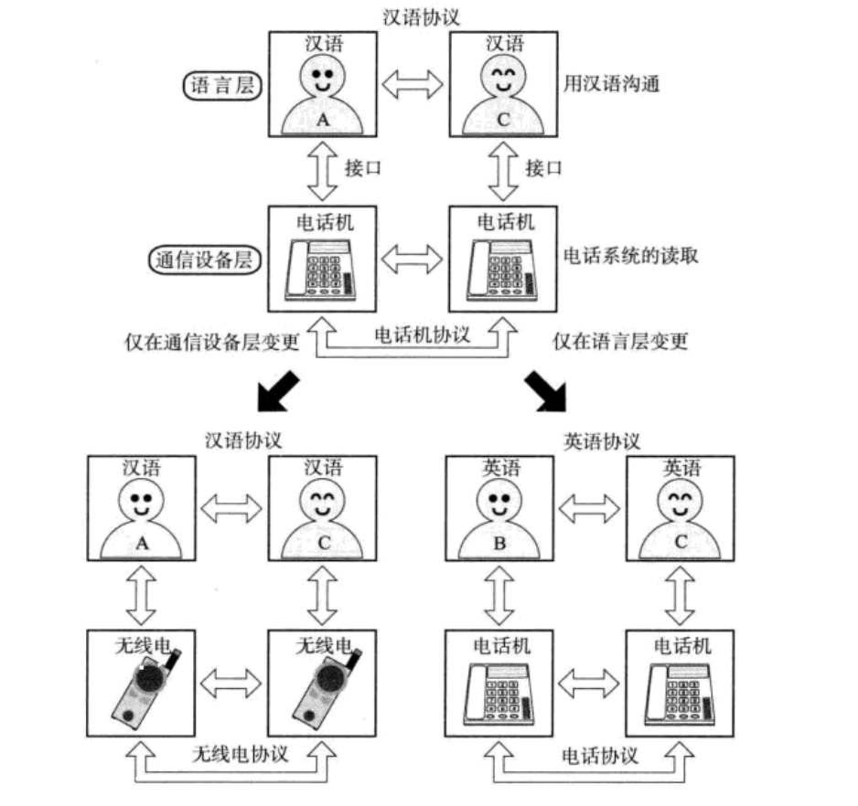

- **两种视角**：普通用户视角（只关心上层应用）与工程师视角（关注底层实现）。
- **同层通信**：在逻辑上，同层之间是在直接进行通信。
- **分层解耦**：分层之后，可以无障碍替换任意一层，极大地降低了系统维护与演进的成本。

比如把以太网换成 Wi-Fi，只要驱动和链路层实现变一变，上层的 IP、TCP、HTTP 完全不用改；这就是分层带来的"可替换性"。

分层的两条"铁律"（后面会反复用到）：

1. 每一层**只使用下一层提供的服务**，并且**只对上一层提供服务**，不跨层调用；
2. 对等层之间"逻辑上"直接通信，实际数据必须**穿过整条协议栈**，每层加上自己的报头。

## 1.3 了解 OSI 七层协议

OSI（Open System Interconnection，开放系统互连）七层网络模型称为开放式系统互联参考模型，是一个逻辑上的定义和规范。

把网络从逻辑上分为了 7 层，每一层都有相关、相对应的物理设备，比如路由器、交换机。

| 层次 | 主要职责 |
| --- | --- |
| 应用层 | 为应用程序提供网络服务（HTTP、DNS、FTP…） |
| 表示层 | 数据的表示、编码、加密与压缩 |
| 会话层 | 建立、管理和终止会话 |
| 传输层 | 端到端（进程到进程）的数据传输，负责可靠性与流量控制 |
| 网络层 | 地址管理与路由选择，把数据从源主机送到目的主机 |
| 数据链路层 | 相邻设备之间的数据帧传送与差错检测 |
| 物理层 | 光/电信号的传输，比特流的搬运 |

OSI 是一种框架性的设计方法，其最主要的功能就是帮助不同类型的主机实现数据传输；它的最大优点是将服务、接口和协议这三个概念明确地区分开来，概念清楚，理论也比较完整。通过七个层次化的结构模型，使不同的系统、不同的网络之间实现可靠的通讯。

但是，它既复杂又不实用；==**所以我们按照 TCP/IP 四层模型来讲。**==

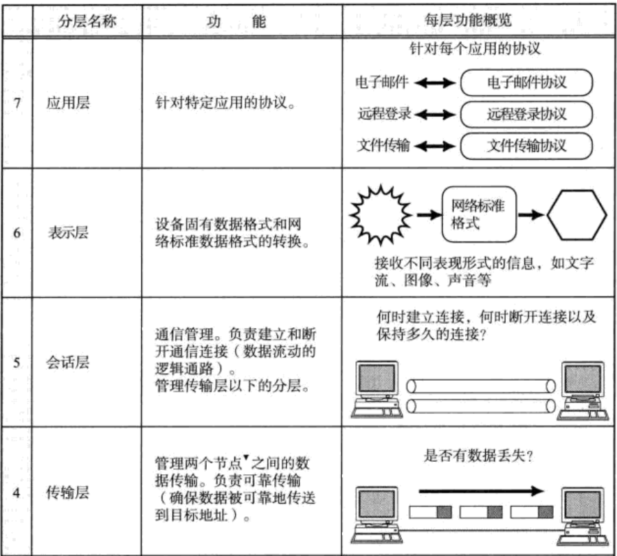

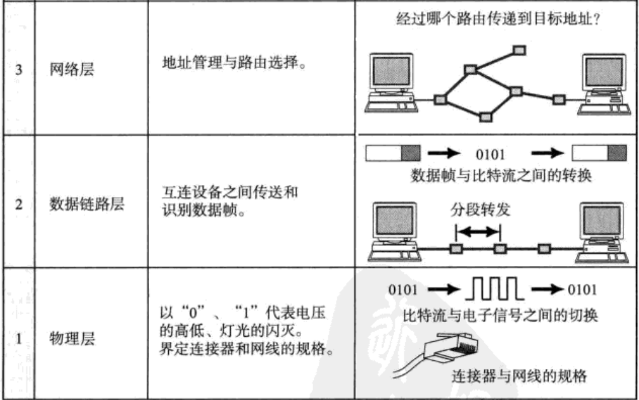

## 1.4 TCP/IP 五层（或四层）模型

TCP/IP 是一组协议的代名词，它还包括许多协议，组成了 TCP/IP 协议簇。TCP/IP 通讯协议采用了 5 层的层级结构，每一层都呼叫它的下一层所提供的网络来完成自己的需求。

- ==**物理层**==：负责光/电信号的传递方式。集线器（Hub）工作在物理层。
- ==**数据链路层**==：负责设备之间的数据帧的传送和识别。交换机（Switch）工作在数据链路层。
- ==**网络层**==：负责地址管理和路由选择。路由器（Router）工作在网络层。
- ==**传输层**==：负责两台主机之间的数据传输。
- ==**应用层**==：负责应用程序间沟通。我们的网络编程主要就是针对应用层。

把"层次 / 数据单元 / 设备 / 地址 / 代表协议"放在一张表里对照，是理解分层最有效的方式：

| 层次 | 数据单元（PDU） | 典型设备 | 靠什么标识 | 代表协议 |
| --- | --- | --- | --- | --- |
| 应用层 | 报文（请求 / 应答） | — | 应用自己定义 | HTTP、DNS、SSH |
| 传输层 | 段（TCP Segment）/ 数据报（UDP Datagram） | — | **端口号** | TCP、UDP |
| 网络层 | 分组 / 数据报（Packet） | 路由器 | **IP 地址** | IP、ICMP、ARP\* |
| 数据链路层 | 帧（Frame） | 交换机、网桥 | **MAC 地址** | 以太网 |
| 物理层 | 比特（Bit） | 集线器、中继器 | — | — |

> \* ARP 负责"IP → MAC"的解析，横跨网络层与链路层，多数教材把它归入网络层。

# 二、再识协议

## 2.1 本地通信与网络通信

本地通信：所有设备都是通过"线"连接起来。所以计算机内部，冯·诺依曼体系本身就是一个网络结构。

网络通信：多台主机，通过网络通信，本质是设备到设备，与本地通信唯一的区别：**距离变长**。

"距离变长"三个字背后，是本地通信不会遇到的一堆问题：

| 问题 | 本地通信（共享内存 / 管道 / 文件） | 网络通信 |
| --- | --- | --- |
| 寻址 | 内存地址、文件描述符、路径 | 需要 IP + 端口来定位"哪台主机的哪个进程" |
| 数据丢失 | 基本不会（内存可靠） | 链路噪声、拥塞、缓冲溢出都可能丢 |
| 顺序与重复 | 天然有序、不重复 | 可能乱序、重复、出错 |
| 传输介质 | 由 CPU/内存总线保证 | 共享介质，需要竞争（碰撞） |

于是就需要一整套机制来解决这些问题：编址、成帧、差错检测、确认重传、路由、拥塞控制……**这就是协议栈存在的理由。**

==**TCP/IP 协议本质是一种网络长距离通信问题的解决方案。**==

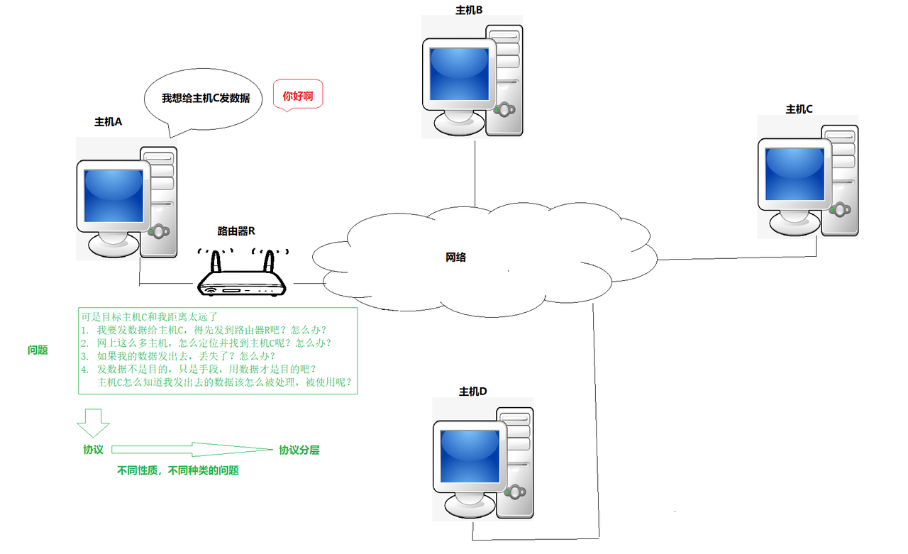

## 2.2 协议与操作系统的关系

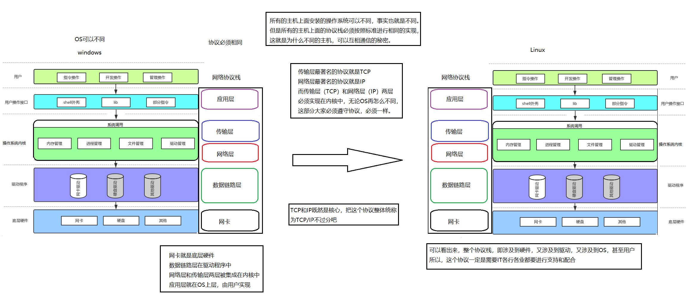

协议并不是悬在空中的规范，它是**实实在在运行在操作系统内核里的代码**（TCP/IP 协议栈），通过系统调用（`socket`、`bind`、`sendto`…）向上层暴露能力。这也是为什么我们写的网络程序，最终都是在"调用内核"。

## 2.3 协议的本质：双方都认识的结构化数据类型

协议本质：就是约定好的结构体。

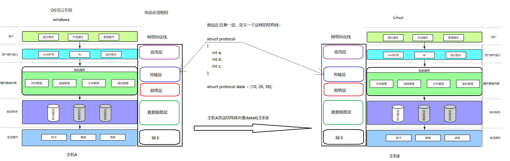

问题：主机 B 能识别 `data`，并且准确提取 `a = 10, b = 20, c = 30` 吗？

回答：答案是肯定的！因为双方都有同样的结构体类型 `struct protocol`。也就是说，用同样的代码实现协议，用同样的自定义数据类型，天然就具有"共识"，能够识别对方发来的数据，这不就是约定吗？

**关于协议的朴素理解：所谓协议，就是通信双方都认识的结构化的数据类型。**

**因为协议栈是分层的，所以每层都有双方的协议，同层之间，互相可以认识对方的协议。**

由此可以推出三个对写代码非常重要的结论：

1. **协议只关心字节布局，不关心语言**。只要双方对"第几个字节是什么"的理解一致，C 写的一端和 Go 写的一端也能通信——这也是"字节序"必须统一的原因。
2. **报头必须能和有效载荷分离**。要么定长头 + 长度字段，要么用分隔符，否则收到一串字节根本不知道边界在哪。
3. **报头必须说明"载荷交给谁"**。以太网帧的 `type` 字段、IP 头的 `protocol` 字段、UDP 头的目的端口，都是干这件事的，这个过程叫**分用**。

# 三、网络传输基本流程

## 3.1 局域网（以以太网为例）内的传输

### 3.1.1 认识 MAC 地址

在局域网中，每台主机必须拥有唯一的标识来保证其身份的唯一性，这个标识就是 **MAC 地址**（Media Access Control Address）。

**MAC 地址 / 物理地址 / 硬件地址（MAC Address / Physical Address / Hardware Address）是该网卡固化的全球唯一硬件识别码。**

**MAC 地址长度为 6 个字节（48 bit），通常用 16 进制数字加冒号分隔的形式表示（例如：`08:00:27:03:fb:19`）。**

**网卡里面有一段特定的区域，用来存放 MAC 地址，未来我们的系统可以使用网卡驱动，来获取网卡中的这个 MAC 地址。**

补充两点：

- 前 3 个字节是 **OUI**（厂商编号），由 IEEE 分配给厂商；后 3 个字节由厂商自行分配，所以"全球唯一"是由 OUI + 厂商分配共同保证的。
- 全 `FF:FF:FF:FF:FF:FF` 是**广播地址**，表示"本局域网内所有主机都要收"。

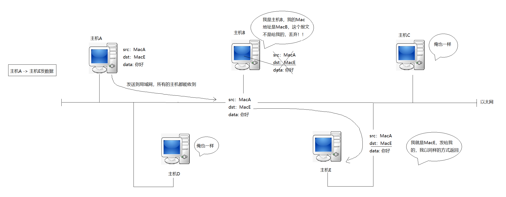

### 3.1.2 一次同网段通信的完整过程

当主机 A 向主机 E 发送数据时：

1. **数据包构建**：主机 A 将数据封装为结构体形式，其中包含源 MAC 地址（`src: MacA`）、目标 MAC 地址（`dst: MacE`）以及具体数据内容。
2. **广播发送**：主机 A 将报文发送到共享的局域网物理介质上，此时局域网内的所有主机（B、C、D、E）都会收到该数据帧。
3. **MAC 地址校验与过滤**：主机 B 收到后比对目标 MAC，发现 `dst: MacE` 与自己的 `MacB` 不匹配，直接丢弃；C、D 同理。
4. **接收与响应**：主机 E 校验后发现 `dst: MacE` 正是自己，遂接收该报文，并可以采用相同的方式向主机 A 进行响应。

> 这种"发出去的消息大家都可以听到"的方式叫**广播**；共享介质上这是唯一的发送方式。交换机会在此基础上做优化：它把"目的 MAC 未知 / 广播帧"发往所有端口的行为叫**泛洪**，而把已知 MAC 的帧只发往对应端口（见下一节）。

### 3.1.3 以太网是共享资源：碰撞域

- 以太网中，任何时刻，只允许一台机器向网络中发送数据。
- 如果有多台机器同时发送，会发生数据干扰，我们称之为**数据碰撞**。
- 在没有交换机的情况下，一个以太网就是一个**碰撞域**。
- 所有发送数据的主机都要进行碰撞检测和碰撞避免（CSMA/CD）。

因此，以太网本质就是共享的资源！它就是**临界资源**，所谓的碰撞检测、碰撞避免就是维护临界资源的互斥属性。

> **交换机做了什么？** 交换机工作在数据链路层，会记录"哪个 MAC 在哪个端口"，从而把帧**只转发到目的端口**，而不是泛洪到所有端口。于是每个端口都成为一个独立的碰撞域，冲突被大幅减少。但要注意：交换机只认 MAC，**它不关心 IP**。

看看同一网段中两个主机的通信：

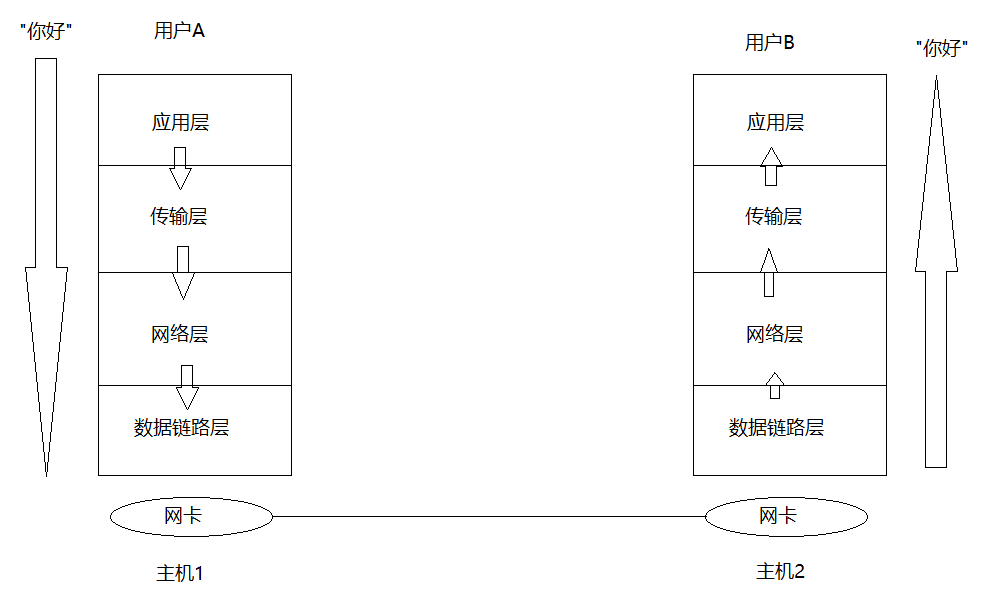

而其中每层都有协议，所以当我进行上述传输流程的时候，要进行封装和解包。

**主机之间的通信，本质是协议栈进行通信。**

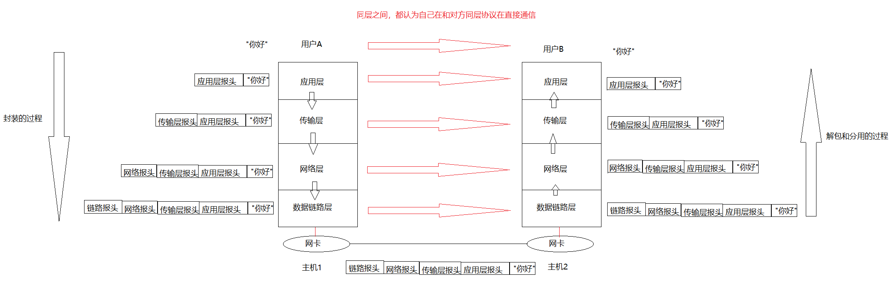

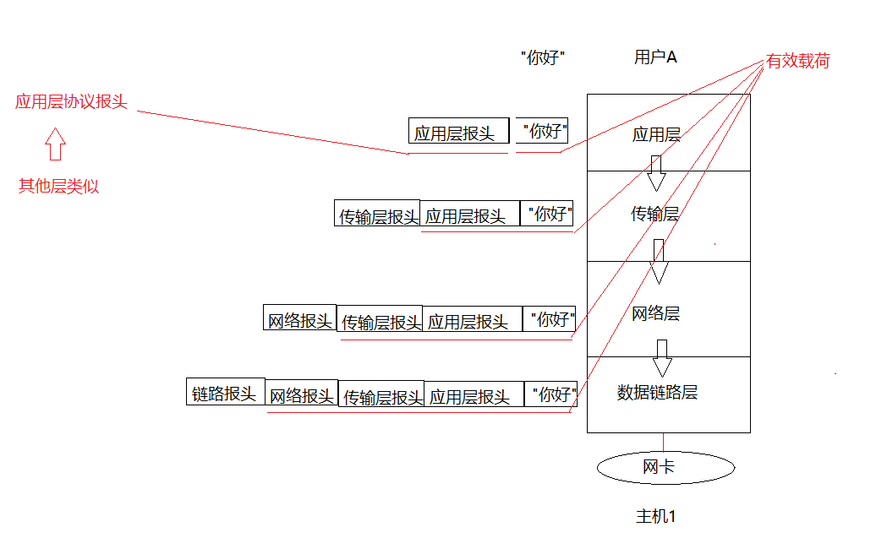

对端同层，要先解包：**报头和有效载荷进行分离。**

1. 不考虑应用层，任何协议都要满足：
   - 报头必须能做到和有效载荷分离的能力；
   - 报头中必须包含"如何将自己的有效载荷交付给上层的哪一个协议"的信息。这个交付的过程就是**分用**。
2. 底层收到报文，但该报文不是发给我的，数据链路层会直接丢弃。

**数据封装**：

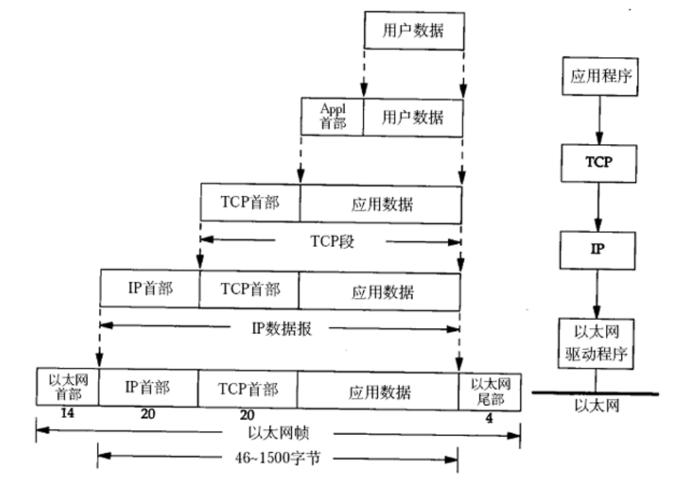

**数据分用**：

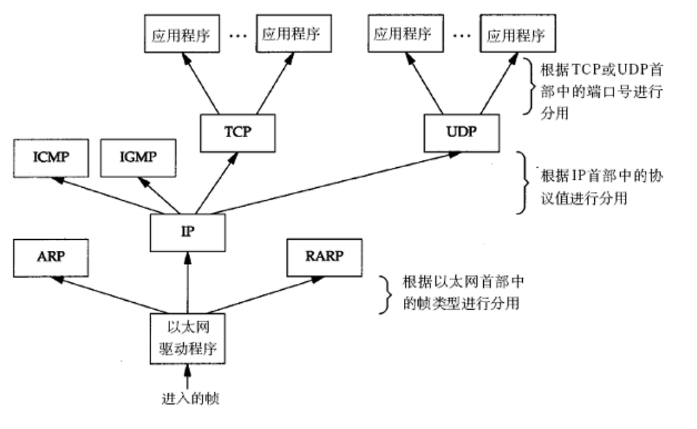

| 层次 | 数据单元 |
| --- | --- |
| 应用层 | 请求与应答 |
| 传输层 | 数据段 |
| 网络层 | 数据报 |
| 数据链路层 | 数据帧 |

- 报文除了报头剩下的都是有效载荷，**报文 = 报头 + 有效载荷**。

总结：

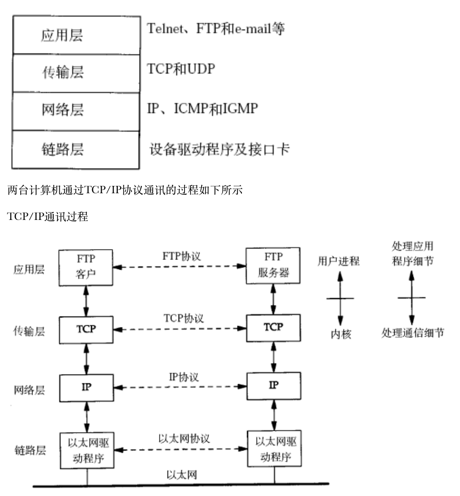

### 3.1.4 一帧以太网帧长什么样

这是理解"报头与载荷分离"最具体的例子：

| 目的 MAC | 源 MAC | 类型 | 数据 | FCS |
| --- | --- | --- | --- | --- |
| 6 字节 | 6 字节 | 2 字节 | 46 ~ 1500 字节 | 4 字节 |

- **类型**：`0x0800` 表示载荷是 IPv4，`0x0806` 表示是 ARP。这就是链路层的"分用信息"。
- **FCS**：帧校验序列，用于差错检测，出错就整帧丢弃。
- 数据字段最大 1500 字节，这正是常说的 **MTU**；加上 14 字节帧头和 4 字节 FCS，最小帧长为 64 字节（数据字段不足 46 字节时要填充）。

> 后续笔记中提到的"IP 分片"、"UDP 单包不宜超过 1472 字节"等结论，都源自主流以太网的 MTU = 1500。

### 3.1.5 ARP：只知道 IP，怎么找到 MAC？

主机 A 知道主机 E 的 IP，但封装以太网帧必须填 MAC，怎么办？

1. A 在局域网内**广播**一个 ARP 请求："谁是 192.168.1.5？请把你的 MAC 告诉我。"
2. 只有 E 会**单播**应答自己的 MAC。
3. A 把结果缓存到**ARP 表**中，后续直接查表；表项会老化，过期后重新询问。

命令行可以用 `arp -a` 或 `ip neigh` 查看本机的 ARP 表。

### 3.1.6 混杂模式

当网卡被设置为**混杂模式**时，网卡关闭物理层的过滤开关。此时，**无论数据帧的目标 MAC 地址是否指向自己，只要是在该局域网物理介质上传播的数据帧，网卡都会接收并向上层递交。**

`tcpdump` 之所以能抓到"不是发给本机"的包，靠的就是这个机制——这也是同一广播域内明文协议（如 HTTP、Telnet）不安全的原因之一。

## 3.2 跨网络传输

### 3.2.1 认识 IP 地址

**IP 协议**（网际协议）目前主要有两个版本：**IPv4** 与 **IPv6**。在未经特殊说明的情况下，通常默认指代的是 **IPv4** 协议。

IP 地址用来表示全球范围内主机的唯一性。

对于 IPv4 而言，IP 地址是一个 4 字节、32 位的整数。

我们通常用点分十进制的字符串表示 IP 地址，例如：`192.168.0.1`。用点分割的每一个数字表示一个字节，范围是 0–255。

再补三个必知概念：

- **子网掩码**：用来区分"网络号"和"主机号"。`192.168.1.10/24` 表示前 24 位是网络号，`192.168.1.0` 这个网段内的主机可以直接通信。
- **默认网关**：目的地址不在本网段时，把数据交给谁——通常是本网段路由器的接口地址。
- **私有地址**：`10.0.0.0/8`、`172.16.0.0/12`、`192.168.0.0/16` 只在局域网内有效，出公网要靠 NAT 转换。

### 3.2.2 如何判断"在不在同一网段"

主机 A 要发数据给某个 IP，先用**自己的子网掩码**和对方 IP 做一次按位与：

- 结果等于自己的网络号 → **同网段**，直接查 ARP，拿到对方 MAC 后封装成帧发出；
- 结果不等于自己的网络号 → **不同网段**，交给默认网关，让路由器去转发。

跨网段主机传输：

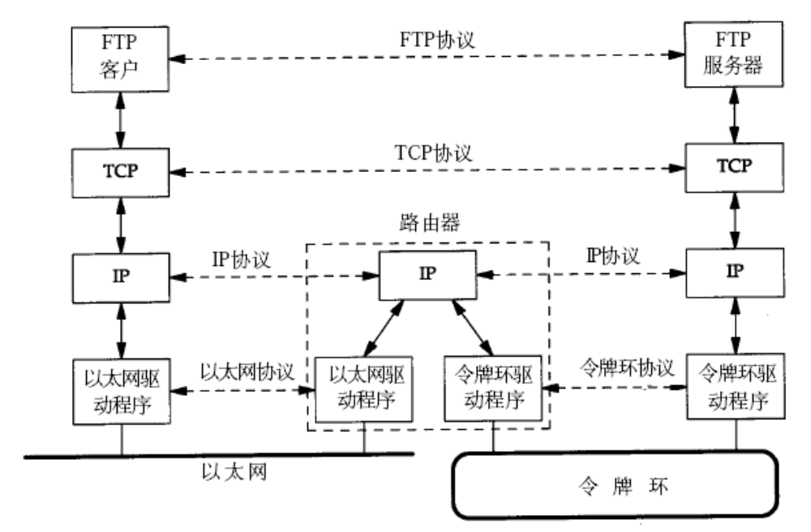

目的 IP 的意义：

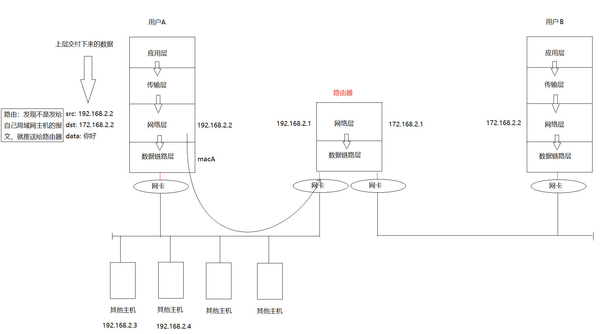

主机 A 不知道 172 主机在哪，但是它一定知道**不是本地的**，因此就发给路由器。

### 3.2.3 路由是逐跳转发

路由器收到一个 IP 分组后，查自己的**路由表**，找到下一跳，然后把分组重新封装成新的以太网帧发出去。

关键点在于：**路由过程中，IP 地址不变，MAC 地址一直在变，MAC 地址只会在本局域网内生效。**

- 源 MAC / 目的 MAC：每一跳都会被改写，因为它们只描述"这一段链路"；
- 源 IP / 目的 IP：端到端保持不变，因为它们描述"最终的两台主机"；
- **TTL**：每经过一个路由器减 1，减到 0 就丢弃并回一个 ICMP 超时——这既防止了环路里的分组无限打转，也是 `traceroute` 的实现原理。

**网络层 + IP 的本质：给网络加了一层虚拟化层，用统一的 IP 地址屏蔽最底层网络的差异。**

结合起来看：

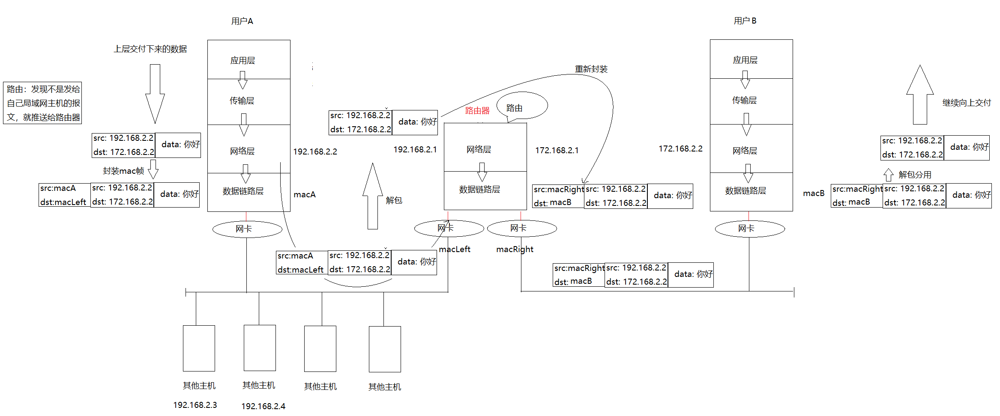

### 3.2.4 两条必须记住的结论

| 结论 | 原因 |
| --- | --- |
| IP 地址端到端不变，MAC 地址逐跳改变 | IP 标识"最终的两台主机"，MAC 标识"当前这一跳" |
| 一个数据包要经过"封装 → 转发 → 解包"多次 | 每换一段链路，就要换一次链路层封装 |

## 3.3 宏观流程回顾

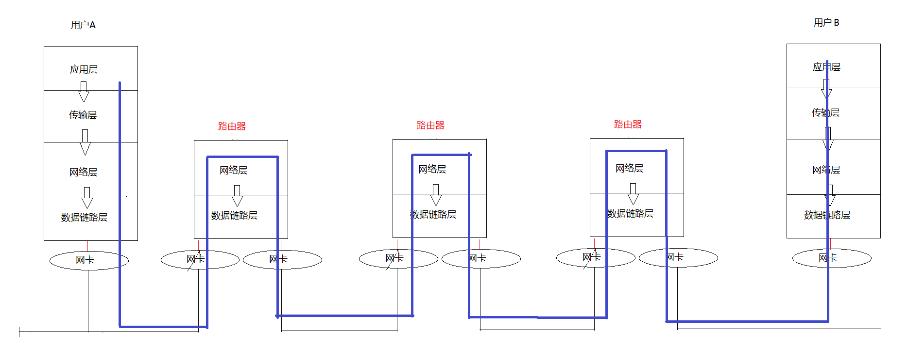

把整条路径压缩成一句话：

> **发送端自上而下逐层加报头（封装），网络中的路由器逐跳转发（只改链路层头），接收端自下而上逐层剥报头（解包 + 分用），最终把数据交给正确的进程。**

# 四、Socket 编程预备

## 4.1 理解源 IP 地址和目的 IP 地址

IP 地址在网络中用于标识主机的唯一性。

上网的行为可以概括成两种：

1. 从远端服务器获取数据；
2. 将本地数据上传到远端。

而这两种行为都是：

> 进程（内存）<——> 网卡 <——> 网络

网络通信的本质就是两个不同主机上的进程在进行数据交互，因此**网络通信本质上就是进程间通信**。

数据交给主机不是目的，而是手段；数据到达主机后，再交给主机内的进程才是目的。系统中会存在非常多的进程，我们就需要标识进程的唯一性。

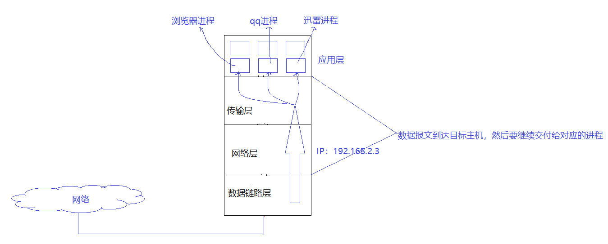

## 4.2 认识端口号

**端口号**（port）是传输层协议的内容。

- 端口号是一个 **2 字节**、**16 位**的整数。
- 端口号用来标识一个进程，告诉操作系统当前的数据要交给哪一个进程来处理。
- **IP 地址 + 端口号** 能够标识网络上的某一台主机的某一个进程。
- **一个端口号默认只能被一个进程占用**（使用 `SO_REUSEADDR` / `SO_REUSEPORT` 可以让多个 socket 共享端口，属于特殊情况）。

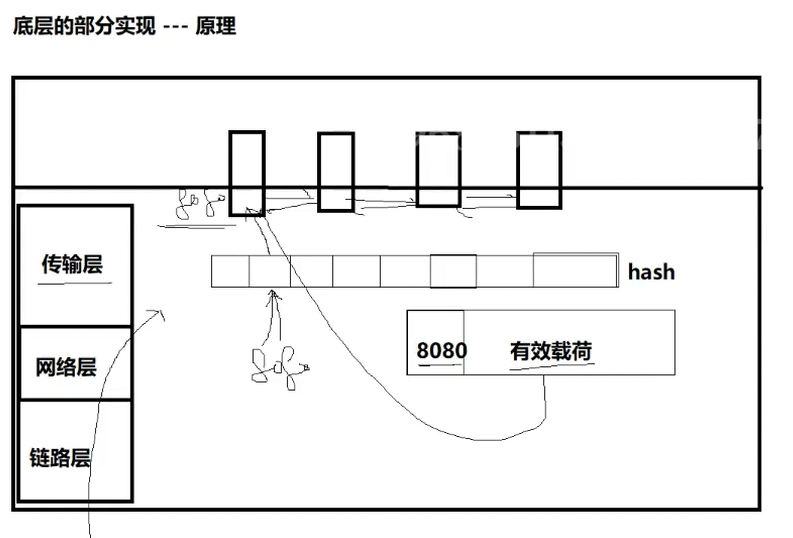

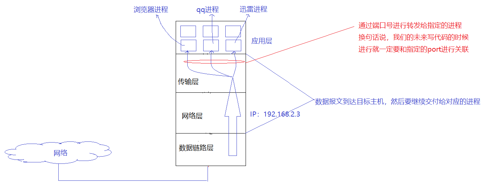

也可以标识进程唯一性，那为什么还要搞个端口号呢？

1. 不是所有的进程都要进行网络通信；
2. 从技术角度，`pid` 可行，但是 `pid` 是一个**系统的概念**，端口号是**网络的概念**，可以和系统解耦。

**IP 是全网内唯一的主机，port 表示主机内唯一的进程；IP + port = 全网内唯一的进程。**

网络通信，就是全网内唯二的两个进程之间通信。我们用对方的 IP 和 port 标识对方的唯一性。==**IP + port = Socket**==。

> 顺带记住一个为第 3 篇埋下伏笔的结论：TCP 用**四元组**（源 IP、源端口、目的 IP、目的端口）来唯一标识一条连接，所以同一台主机的同一个端口可以同时服务多个客户端——这正是"端口只能被一个进程占用"却不影响并发的关键。

**端口号范围划分**：

| 范围 | 名称 | 说明 |
| --- | --- | --- |
| `0 – 1023` | 知名端口号 | HTTP、FTP、SSH 等广泛应用的应用层协议，端口号固定；Linux 下绑定需要 root 权限 |
| `1024 – 49151` | 注册端口 | 用户可静态分配给自己的服务（IANA 注册） |
| `49152 – 65535` | 动态 / 临时端口 | 内核分配给客户端（Linux 常见临时端口范围是 `32768–60999`，见 `/proc/sys/net/ipv4/ip_local_port_range`） |

## 4.3 传输层典型代表

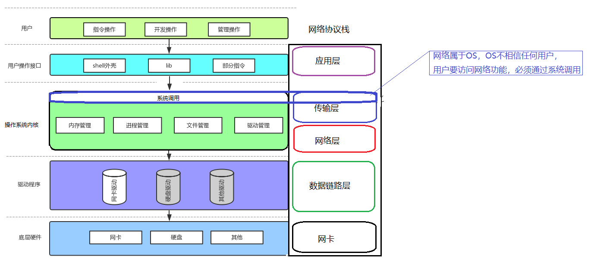

### 认识 TCP

**TCP 即传输控制协议**，具有以下关键特性：

- 传输层协议：工作于 TCP/IP 模型的传输层；
- 有连接：通信前双方必须建立连接（三次握手）；
- 可靠传输：提供数据包确认、重传机制，保证数据准确无误到达；
- 面向字节流：数据以无边界的字节流形式传输（所以存在"粘包"问题，需要应用层自己划分边界）。

### 认识 UDP

**UDP 即用户数据报协议**，具有以下关键特性：

- **传输层协议**：工作于 TCP/IP 模型的传输层；
- **无连接**：发送数据前无需建立连接，直接发送；
- **不可靠传输**：尽力而为交付，不保证数据是否丢失或按序到达；
- **面向数据报**：以独立的数据报文为单位进行传输，保留数据边界（收发快递，就是面向数据报）。

一句话选型：**要可靠、有序、不丢，用 TCP；要快、要简单、允许丢一点，或需要广播/组播，用 UDP。**

| 对比项 | TCP | UDP |
| --- | --- | --- |
| 连接 | 面向连接 | 无连接 |
| 可靠性 | 确认 + 重传 + 排序 | 尽力而为 |
| 数据边界 | 字节流，无边界 | 保留边界，一次发对应一次收 |
| 头部开销 | 最少 20 字节 | 固定 8 字节 |
| 广播 / 组播 | 不支持 | 支持 |
| 典型场景 | 网页、文件传输、SSH | DNS、视频/音频、游戏、局域网发现 |

## 4.4 网络字节序

内存和磁盘文件中的多字节数据均有大端（**big-endian**）与小端（**little-endian**）之分。

判断口诀：**低权值位（小）的字节放在低地址位（小）就是小端**——"小小同边"是小端，反之是大端。

- 大端（网络字节序）：`0x12345678` 在内存中是 `12 34 56 78`；
- 小端（主机字节序，x86 常见）：内存中是 `78 56 34 12`。

网络数据流同样需要明确定义字节存储与传输的顺序。

> ==**规定：凡是发送到网络中的数据，必须是大端。**==

- **发送端**：通常将发送缓冲区中的数据按内存地址从低到高的顺序发送；
- **接收端**：把从网络上接收到的字节依次保存到接收缓冲区中，同样按内存地址从低到高的顺序保存；
- **网络数据流规定**：先发送的数据是**低地址**，后发送的数据是**高地址**（大端）。

所以才有了下面这四个函数（`h` = host，`n` = network，`s` = short 16 位，`l` = long 32 位）：

```c
uint16_t htons(uint16_t hostshort);  // 主机序 → 网络序，16 位（端口）
uint16_t ntohs(uint16_t netshort);   // 网络序 → 主机序，16 位（端口）
uint32_t htonl(uint32_t hostlong);   // 主机序 → 网络序，32 位（IP）
uint32_t ntohl(uint32_t netlong);    // 网络序 → 主机序，32 位（IP）
```

> 一个容易踩的坑：`inet_addr()` / `inet_pton()` 返回的 `in_addr` **已经是网络字节序**，不需要再 `htonl` 一次；而自己填 `sin_port` 时**必须** `htons`。

## 4.5 Socket 编程接口

以下是 Socket 常用 API：

```c
// 创建 socket 文件描述符 (TCP/UDP，客户端 + 服务器)
int socket(int domain, int type, int protocol);

// 绑定端口号 (TCP/UDP，服务器)
int bind(int socket, const struct sockaddr *address, socklen_t address_len);

// 开始监听socket (TCP，服务器)
int listen(int socket, int backlog);

// 接收请求 (TCP，服务器)
int accept(int socket, struct sockaddr* address, socklen_t* address_len);

// 建立连接 (TCP，客户端)
int connect(int sockfd, const struct sockaddr *addr, socklen_t addrlen);
```

> 注意：UDP 只需要 `socket` + `bind` + `sendto` / `recvfrom`，**没有 `listen` / `accept` / `connect`**——因为它无连接。第 2 篇会详细展开。

## 4.6 sockaddr：一套接口，两种通信

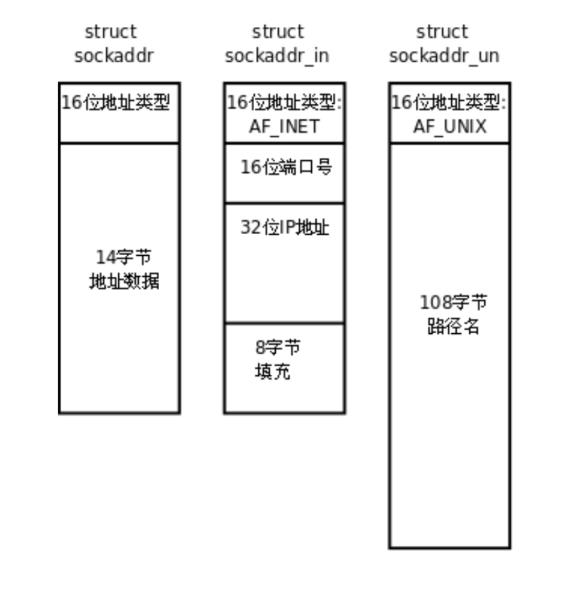

Socket 的设计者为了只使用一套接口就能完成本地通信与网络通信，设计了 `sockaddr` 的两个子类：**`sockaddr_in` 和 `sockaddr_un`**。使用套接字接口时，我们根据不同的通信场景定义具体的结构体，再强制类型转换为 **`struct sockaddr *`** 传给 Socket API：

- 网络通信（IPv4）：使用 **`struct sockaddr_in`**
  - 前 16 位：地址类型（`AF_INET`）
  - 16 位端口号
  - 32 位 IP 地址
  - 8 字节填充
- 本地通信（Unix Domain Socket）：使用 **`struct sockaddr_un`**
  - 前 16 位：地址类型（`AF_UNIX`）
  - 108 字节路径名

**这就是实现了多态。**

> 为什么可以强转？因为所有 `sockaddr_*` 结构体的**前 16 位都是 `sa_family`**，内核先读这 2 个字节判断"这是哪种地址"，再按对应的结构体去解释后面的字节。这与"报头先说明载荷类型，再解释载荷"是同一个思想。

# 五、小结

## 5.1 一页纸小结

| 问题 | 结论 |
| --- | --- |
| 协议是什么 | 双方都认识的结构化数据类型（约定） |
| 为什么分层 | 模块化、解耦、可替换；代价是封装开销 |
| 数据怎么走 | 封装（自上而下加头）→ 逐跳转发 → 解包分用（自下而上剥头） |
| 谁标识主机 | IP 地址（端到端不变） |
| 谁标识进程 | 端口号（16 位） |
| 谁标识"这一跳" | MAC 地址（每跳改写） |
| 为什么必须大端 | 不同主机字节序不同，必须统一约定 |
| 怎么写代码 | `socket` → `bind` / `connect` → `send` / `recv`（UDP 用 `sendto` / `recvfrom`） |

## 5.2 自测题

1. 为什么说"同层之间是在直接通信"，但数据实际上要穿过整条协议栈？
2. 以太网帧里的 `type` 字段、IP 头里的 `protocol` 字段，分别解决了什么问题？
3. 数据从 A 发到 E，中间经过 3 个路由器，源 IP、目的 IP、源 MAC、目的 MAC 各自变了几次？
4. 为什么 `recvfrom` 拿到的是"客户端 IP + 端口"，而服务端自己只需要 `bind` 一个端口？
5. `htons` 只对 16 位有意义，那 IP 地址为什么不用 `htonl` 处理？
6. IPv4 用 4 个字节、端口用 2 个字节，那么 `sockaddr_in` 为什么是 16 字节而不是 8 字节？
7. 为什么 TCP 需要 `listen` / `accept`，UDP 不需要？

<details>
<summary>参考答案（点击展开）</summary>
    1. "直接通信"是逻辑视角：对等层只关心对方的同层报头；物理上数据必须逐层封装/解包。
    2. 前者回答"链路层载荷交给哪个网络层协议"，后者回答"网络层载荷交给哪个传输层协议"，都是**分用**信息。
    3. IP 地址 0 次（端到端不变）；源/目的 MAC 各被改写 4 次——中间 3 个路由器把它分成 4 段链路，每段重新封装一次。
    4. 服务端绑定的是众所周知的端口；客户端地址由内核在 `recvfrom` 时通过 `peer` 输出型参数填入。
    5. 因为 `inet_addr` / `inet_pton` 返回的 `in_addr` 已经是网络字节序，无需再转。
    6. 需要把 `sockaddr_in` 与通用的 `sockaddr`（16 字节）对齐，多出的 8 字节作为 `sin_zero` 填充。
    7. 因为 UDP 无连接，没有"建立连接"这一步；内核只看目的端口就把数据报投递给对应 socket。

</details>

