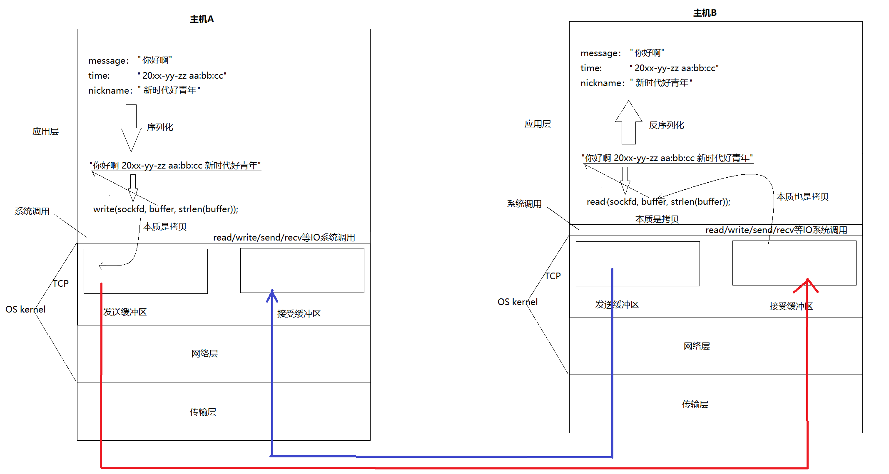
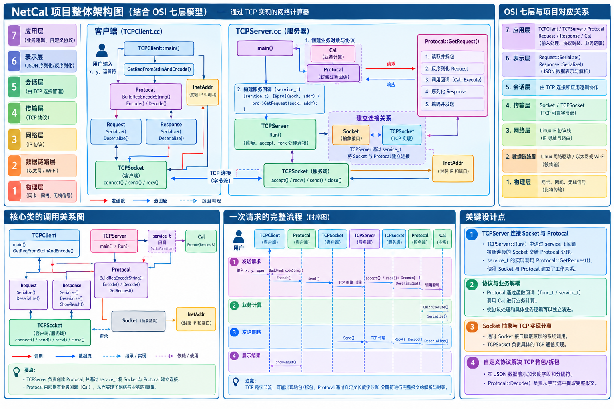

# 应用层协议

## 再谈协议

之前TCP UDP的代码都是传递字符串，如果我们要传递其他类型呢？我们就要设计应用层协议。

它需达成两个核心目标：

> - 提供完备的序列化与反序列化机制，确保结构化数据在字节流与内存**对象间无损转换。**
> - 解决因TCP字节流无边界特性**导致的报文读取不完整问题**


## 网络版计算器

例如，我们需要实现一个服务器版的加法器。我们需要客户端把要计算的两个加数发过去，然后由服务器进行计算，最后再把结果返回给客户端。

- 1.3.1约定方案一：
    - 客户端发送一个形如“1+2”的字符串；
    - 这个字符串中有两个操作数，都是整形；
    - 两个数字之间会有一个字符是运算符，运算符只能是 +；
    - 数字和运算符之间没有空格；
- 1.3.2约定方案二：
    - 定义结构体来表示我们需要交互的信息；
    - 发送数据时将这个结构体按照一个规则转换成字符串，接收到数据的时候再按照相同的规则把字符串转化回结构体；
    - 这个过程叫做“序列化”和“反序列化”。

## 序列化与反序列化

无论我们采用方案一，还是方案二，还是其他的方案，只要保证，一端发送时构造的数据，在另一端能够正确的进行解析，就是ok的。这种约定，就是 **应用层协议**

- 我们采用方案2，我们也要体现协议定制的细节。
- 我们要引入序列化和反序列化，只不过我们直接采用现成的方案–jsoncpp库。
- 我们要对socket进行字节流的读取处理。

## 理解read / write / recv / send

### 为什么 TCP 支持全双工



在任何一台主机上，TCP连接既有发送缓冲区，又有接受缓冲区，**所以，在内核中，可以在发消息的同时，也可以收消息，即全双工。**
  **这就是为什么一个tcp sockfd读写都是它的原因。**
  实际数据什么时候发，发多少，出错了怎么办，由TCP控制，**所以TCP叫做传输控制协议。**

### read / write的本质——数据拷贝

我们之前使用的read/write/send/recv等等接口实际上**不经过网络**，它们的核心功能是**在应用层缓冲区与内核缓冲区之间进行数据的内存拷贝**。

- ==**read/write的本质是数据拷贝**==
    - **`write`只负责将数据拷贝到发送缓冲区**，TCP自主决定数据的发送。
    - **OS把数据发到网络中本质也是拷贝，通信即拷贝！**
    - **`read`本质是检测接收缓冲区里有没有数据**，如果没有，`read`就会阻塞；如果有，`read`就会将数据拷贝到用户缓冲区

- **主机间通信的本质：把发送方的发送缓冲区内的数据，拷贝到对端的接收缓冲区。**
- **为什么TCP是全双工的？因为任意两主机都有发送缓冲区和接收缓冲区。**

**系统往缓冲区写入/读取数据，用户从缓冲区读取/写入数据，构成生产者消费者模型。**

总结：我们为了定制的协议：

- 结构化的字段，要提供好序列和反序列化方案
- 解决因为字节流问题，导致读取报文不完整的问题（只处理读取）

# 网络版本计算器

## 1. socket的封装——模板方法模式


## 2. 自定义协议

### 序列化与反序列化工具：jsoncpp库

#### 序列化（结构体->字符串）


```cpp
#include <jsoncpp/json/json.h>
#include <string>
#include <memory>
#include <iostream>
#include <sstream>

int main()
{
    Json::Value root;
    root["name"] = "zhangsan";
    root["age"] = 18;
    root["addr"] = "Beijing";
    Json::StreamWriterBuilder builder;
    std::shared_ptr<Json::StreamWriter> writer(builder.newStreamWriter());
    std::stringstream ss;
    writer->write(root, &ss);
    std::cout << ss.str() << std::endl;
}
```

结果：

```
{
        "addr" : "Beijing",
        "age" : 18,
        "name" : "zhangsan"
}
```

起手式：定义`Json::Value`对象。

使用`StreamWriterBuilder`定义`StreamWriter`工厂，`builder`用于创建`StreamWriter`对象。

使用`StreamWriter`对象对`stringstream`对象进行写入。

#### 反序列化（字符串->结构体）

```cpp
#include <jsoncpp/json/json.h>
#include <string>
#include <memory>
#include <iostream>
#include <sstream>

int main()
{
    std::string json_string = "{\"name\":\"zhangsan\", \"age\":18, \"addr\":\"Beijing\"}";
    Json::Value root;
    Json::Reader reader;
    bool readflag = reader.parse(json_string, root);
    if (!readflag)
    {
        std::cerr << "Json read err" << std::endl;
        return 1;
    }
    std::cout << "name: " << root["name"].asString() << std::endl;
    std::cout << "age: " << root["age"].asInt() << std::endl;
    std::cout << "addr: " << root["addr"].asString() << std::endl;
}
```

结果：

```
name: zhangsan
age: 18
addr: Beijing
```

起手式：定义`Json::Value`对象。与序列化相同。

定义`Json::Reader`对象使用`parse`对`json`串进行读取，并反序列化到传入的`Json::Value`对象`root`中，成功返回`true`，失败返回`false`。

## 3. 设计服务器


==**完美符合OSI七层协议**==

上三层无法写入到内核中，因为这三次主要受用户的需求影响，无法合并到内核中，一旦合并到内核中，所有的操作就都一样了。因此TCP/IP工程只能实现四层。

## 4.守护进程化

见下章

## 5. 技术架构图

