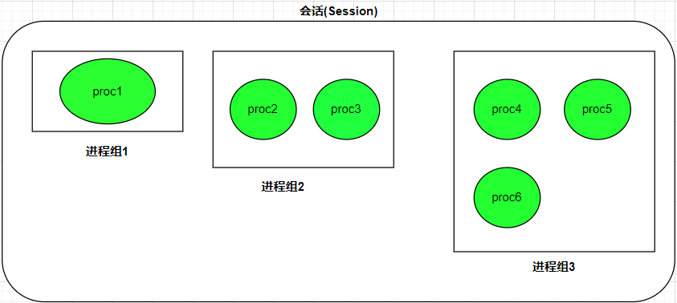
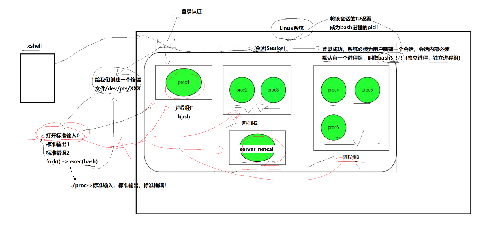
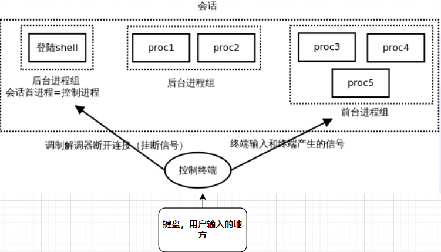
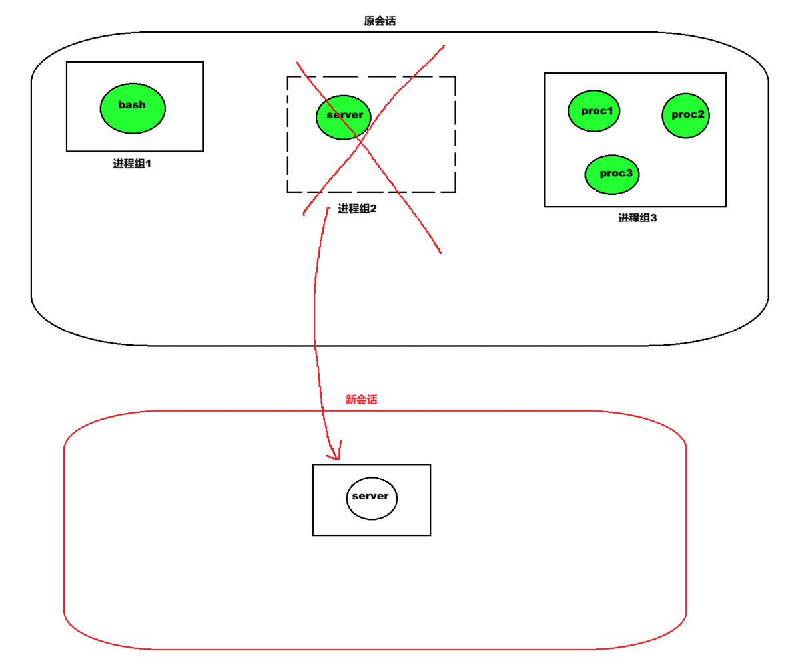

# 一、进程组

## 1. 什么是进程组

每一个进程除了拥有唯一的进程ID（PID）之外，还属于一个**进程组**。
  **进程组是一个或多个进程的集合**，它们通常协同工作以完成特定的任务。每个进程组都有一个唯一的进程组ID（Process Group ID, **PGID**），PGID 的数据类型同样是 `pid_t`。

```bash
$ ps -eo pid,pgid,ppid,comm | grep test

# 结果如下：
  PID  PGID  PPID COMMAND
 2830  2830  2259 test

# -e表示输出每一个进程的信息（every）。
# -o表示按自定义格式输出指定的列，多个列之间用逗号隔开。
```

管道操作符 `|` 连接多个命令时，系统会为这些命令创建相应的进程，**并将其归为一个进程组共同执行任务。**

## 2. 组长进程

每个进程组都有一个**组长进程**（Process Group Leader）。组长进程的标识极其直观：**其 PID 等于 PGID**。

```bash
[node@localhost code]$ ps -o pid,pgid,ppid,comm | cat

# 输出结果：
  PID  PGID  PPID COMMAND
 2806  2806  2805 bash
 2880  2880  2806 ps
 2881  2880  2806 cat

```

`ps` 进程的 PID（2880）与其 PGID（2880）一致，因此 `ps` 进程就是该进程组的组长进程，而 `cat` 进程则是该组内的成员进程。

- 组长进程的主要职责在于**创建新的进程组**或者**在当前组中创建新进程**。

- 进程组的生命周期：从它被创建开始，直到**其中最后一个进程离开**为止。
- **主要某个进程组中还有一个进程存在，该进程组就依然存在，这与其组长进程是否已经终止无关**。组长进程的退出不会直接导致进程组的销毁或者说PGID改变。

# 二、会话

## 1. 什么是会话

 **会话可以看成是一个或多个进程组的集合**。在一个会话中，可以包含多个不同的进程组。每一个会话都有一个唯一的会话ID（Session ID, **SID**）。



```bash
[node@localhost code]$ proc2 | proc3 &
[node@localhost code]$ proc4 | proc5 | proc6 &
# & 表示将进程组放在后台运行

```

上述命令运行后，`proc2` 和 `proc3` 会构成一个进程组，`proc4`、`proc5` 与 `proc6` 会构成另一个进程组，而它们都同属于当前的会话。

 我们可以通过 `ps axj` 命令来观察会话与进程组的关系：

```bash
# 用管道和 sleep 组成一个进程组放在后台运行
[node@localhost code]$ sleep 100 | sleep 200 | sleep 300 &

# 查看进程信息
[node@localhost code]$ ps -axj | head -1&& ps -axj |  grep sleep | grep -v grep

# 结果如下：
PPID   PID  PGID   SID TTY      TPGID STAT   UID   TIME COMMAND
2806  4223  4223  2780 pts/2    4229 S     1000   0:00 sleep 100
2806  4224  4223  2780 pts/2    4229 S     1000   0:00 sleep 200
2806  4225  4223  2780 pts/2    4229 S     1000   0:00 sleep 300

```

## 2. 创建会话



1. 完成登录认证后，Linux 系统会为该次连接创建一个全新的虚拟终端文件。
2. 随后，操作系统必须为用户新建一个会话（Session）。在新建的会话内部，默认会启动一个进程组，其中运行着该用户的登录 Shell（通常是 `bash`）。
3. 此后，用户在命令行中输入并执行的各种命令（如 ./proc），都是由 bash 通过 fork() -> exec() 方式衍生出来的。
4. 这些被创建出来的子进程会直接继承 bash 打开的标准输入、标准输出和标准错误文件描述符，因此我们在终端中运行程序时，可以直接在当前终端看到输出内容并进行交互。

# 三、控制终端与作业控制

## 1. 理清概念

- 进程组vs会话：进程组一定属于某个会话。
- 进程组vs任务：任务就是某种工作，需要由进程组来完成。进程组和任务是一个硬币的两面。

## 2. 抛出问题

==**为什么直接启动一个任务时终端无法输入其他命令？把任务放到后台后，为什么就能继续输入命令了？**==

**我们要明确的是：键盘只有一个。**而输入的数据必须明确地给一个进程或进程组。在会话内部进程组必须被分为前台进程组和后台进程组。因此，**键盘输入的数据必须明确地给前台进程组**。

**一次会话中，有且仅有一个前台进程组（前台任务），而后台进程组（后台任务）可以有多个。**



当我们运行前台命令时（如`./proc`），该任务会占用前台，`bash`让出前台，键盘输入的数据就会被该前台任务接收，自然不会响应。

如果我们带上 `&` 符号将任务放在后台运行（如 `./myproc &`），`bash` 依然独占前台控制权，能够继续响应我们输入的命令。

## 3. 作业控制命令

### 3.3.1 查看与调配命令

| 命令     | 语法/全称                  | 功能描述                                                     |
| :------- | :------------------------- | :----------------------------------------------------------- |
| **jobs** | -                          | 查看当前会话中所有的后台任务列表及其任务号（Job ID）。       |
| **fg**   | `fg 任务号` (front ground) | 将指定的后台任务切换到前台运行。例如 `fg 1` 表示将 1 号后台任务调至前台。 |
| **bg**   | `bg 任务号` (background)   | 将一个处于暂停状态（Stopped）的后台任务恢复为后台运行状态。  |

### 3.3.2 快捷键控制

| 快捷键       | 发送信号  | 功能描述                                                     |
| :----------- | :-------- | :----------------------------------------------------------- |
| **Ctrl + C** | `SIGINT`  | **只能终止当前的前台任务**。由于后台任务不占用前台终端，因此不受键盘 `Ctrl + C` 的影响。 |
| **Ctrl + Z** | `SIGTSTP` | **暂停当前的前台进程或进程组**。当前台任务被暂停时，系统会自动将其切换并推入后台，同时 bash 会自动将自己切回前台，恢复对终端命令行的控制权。 |

## 4. 会话删除

 在 Windows 操作系统中，用户登录系统的本质同样是**建立一个新会话**的过程。用户输入密码登录 Windows 后，系统会为用户加载桌面环境。这里的“桌面”本质上就是一个图形化界面的外壳（Shell），相当于 Linux 会话中的 `bash` 进程。在该桌面下打开的所有应用程序、后台服务（如浏览器、播放器等），都相当于运行在这个会话内部的各个进程或进程组。

当用户点击 Windows 中的“注销”按钮时，==**所谓注销，本质上就是系统删除并销毁登录时创建的那个会话**==。随着会话的销毁，所有依赖于该会话运行的前后台进程组都会被系统清理并注销掉。

# 四、守护进程（Daemon）

## 1. 引出问题

我们在日常开发测试时写的网络服务器（例如 `server_netcal`），如果只是直接在终端运行或简单通过 `&` 放到后台运行，它们依然属于当前用户登录时创建的会话。

**这种运行模式存在致命隐患**：一旦用户关闭终端连接（例如关闭 Xshell），系统就会注销并销毁该会话，这势必会影响到运行在会话内部的服务进程，甚至导致服务器直接崩溃退出。

**真正的服务器程序，绝不能受到任何用户登录和注销的影响**。无论是谁登录系统，也不管用户什么时候断开终端，服务器都必须保持 7×24 小时不断线地稳定运行。

为了实现这一目标，我们需要将服务器进程**守护化**，使其变成一个**守护进程**（Daemon，也常被称为精灵进程）。守护进程也是**孤立进程（孤儿进程）**的一种特例，它脱离了原有的控制终端与会话，独立运行于系统背景中。

##  2. 守护进程

要让一个服务进程彻底摆脱登录与注销的影响，其核心原理是：**把服务器对应的进程组从原来的会话中剥离出来，重新创建一个新会话，并将该进程组放入这个独立的全新会话中**。



 实现这一目标的核心系统调用函数是 `setsid`。

```c
#include <sys/types.h>
#include <unistd.h>

pid_t setsid(void);
```

setsid() 的作用是创建一个新会话，并将调用进程设置为该新会话的领头进程（Session Leader）以及新进程组的组长（PGID）。
  **调用 setsid 的关键前提约束**：根据 POSIX 标准，调用进程**不能是一个进程组的组长**。如果组长进程直接调用 setsid()，系统会返回错误并拒绝执行。

**因此，我们首先要让父进程fork出子进程，父进程再退出，子进程变成孤儿进程，被1号进程领养，子进程再调用`setsid`。因此，==守护进程（子进程）是孤儿进程==**

## 3. 垃圾桶设备文件

 当进程成功独立为守护进程后，它已经不再关联任何控制终端。然而，程序中可能依然残留着向终端输出或读取数据的逻辑（如 `std::cout`、`printf` 或 `cin` 等）。

**我们的服务器不需要接收键盘的信息，也不需要向显示器打印信息。**如果我们直接将其关闭，则会报错。

为了妥善解决这一问题，Linux 系统引入了一个特殊的黑洞/垃圾桶设备文件：`/dev/null`。

`/dev/null` 文件的特性非常独特：**写入文件的内容全部被丢弃，读取文件的内容为空（EOF）。**就像一个黑洞一样。

