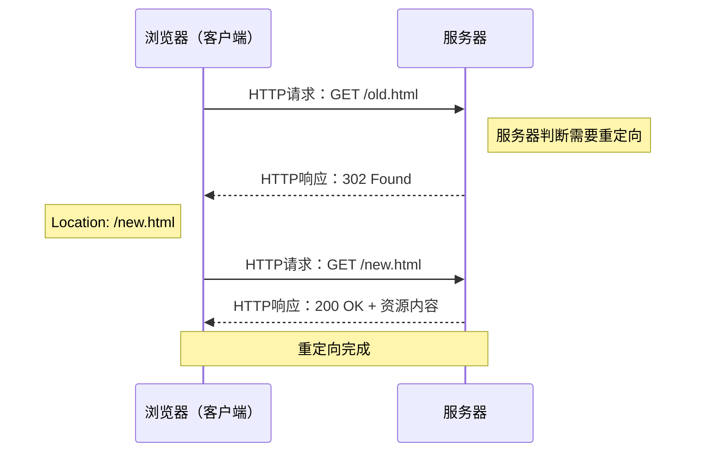

# 一、重定向

## 1. 介绍

在 HTTP 协议中，**临时重定向（301 Temporary Redirect）和永久重定向（302 Permanent Redirect）**的核心区别在于：服务器告知客户端，资源的访问地址是暂时改变了，还是永久改变了。


| 状态码  | 名称               | 永久/临时 | 是否保持原请求方法         | 搜索引擎更新索引 | 说明                                                |
| :------ | :----------------- | :-------- | :------------------------- | :--------------- | :-------------------------------------------------- |
| **301** | Moved Permanently  | 永久      | 否（可能将 POST 改为 GET） | 是               | 资源永久移动到新 URL，后续请求应使用新地址          |
| **302** | Found              | 临时      | 否（可能将 POST 改为 GET） | 否               | 资源临时移动到新 URL，后续请求仍用原地址            |
| **307** | Temporary Redirect | 临时      | 是（严格保持原方法）       | 否               | 与 302 类似，但严格保持原请求方法（POST 仍为 POST） |
| **308** | Permanent Redirect | 永久      | 是（严格保持原方法）       | 是               | 与 301 类似，但严格保持原请求方法（POST 仍为 POST） |

可以简单理解为：

- **302 / 307：** 你先去新地址访问，原地址以后可能还会用。
- **301 / 308：** 原地址已经永久迁移，以后应该使用新地址。

**两种重定向都依赖于`Location`字段，它用于存储新地址的`URI`**。

重定向并不是服务器直接把客户端带到新页面，而是服务器先返回一个重定向响应，**客户端根据 `Location` 再发起一次新的 HTTP 请求**。

最核心的区别是：**临时重定向表示资源暂时换了访问入口，永久重定向表示资源的访问入口已经发生永久性变更。**

## 2. 应用场景

临时重定向和永久重定向对于用户来说，**实际上没什么区别。关键影响的是搜索引擎。**

搜索引擎定期会去更新他保存的那一堆网址。**但是如果公司修改了网址，并且没有在搜索引擎请求的时候返回“301永久重定向”，这样搜索引擎就不会更新他的数据，依然用老的链接。**

所以这就是永久重定向真正并且是最大的价值：**网站换域名后，自动跳转到新域名；搜索引擎更新网站链接时使用！**

## 3. 原理



## 4. 用重定向处理错误请求

一种新的设计思路，我们可以以后如果出错了，本应该跳转到对应的错误页面，需要我们手动构建。
  但是现在我们可以直接重定向，然后二次请求的时候我们返回重定向后的错误页面，这个时候我们就可以返回200状态码了。

```c
SetCode(302);
SetHeader("Location", "目标网址");
return true;
```

# 二、HTTP方法


## 1. 详解GET与POST

在HTTP协议中，GET与POST是最常使用的两种请求方法。通常情况下，GET方法主要用于获取静态资源（如图片、视频、音效、网页等），而POST方法主要用于上传资源。**但在实际应用中，GET既可以获取资源也可以上传资源。**

### 1.1 表单方法提交参数

#### 1.1.1 GET

在网页前端（例如登录页面Login），表单提交参数时默认的方式是GET。**当用户在登录界面输入用户名和密码点击登录时，请求会被发送至后台：**


GET提交参数：**GET 通常将参数放在 URL 中，通过查询字符串（Query String）传递。**提交的参数会以问号（**`?`**）作为分隔符挂在URL的后面（**例如：`http://8.137.19.140:8080`，点击`Login`后：变为``http://8.137.19.140:8080/Login?username=lisi&password=54321``**）。

其请求的方法是`Login`，`?`是查询参数的开始，参数用`&`分隔。

#### 1.1.2 POST

POST提交参数：POST 通常将参数放在 HTTP 请求报文的请求体（Body）中。

```http
POST /login HTTP/1.1
Host: www.example.com
Content-Type: application/x-www-form-urlencoded
Content-Length: 23

username=Tom&password=123
```

**我们在后台制作和注册服务接口**，**客户端就可以以HTTP请求代码的形式来获取这种服务，这种风格的后台服务我们称之为RESTful。**

#### 1.1.3 总结

| 对比维度     | GET                           | POST                                        |
| :----------- | :---------------------------- | :------------------------------------------ |
| **参数位置** | URL 中（明文可见）            | 请求体（Body）中                            |
| **数据长度** | 有限制（受 URL 长度限制）     | 无严格限制                                  |
| **安全性**   | 较低（暴露在 URL/历史记录中） | 相对较高（不在 URL 中暴露，但两者都不安全） |
| **主要用途** | 获取/查询数据                 | 提交/修改数据                               |
| **能否缓存** | 可被浏览器缓存                | 默认不缓存                                  |
| **能否收藏** | 可以（URL 包含所有参数）      | 不可以                                      |

需要特别注意的是，无论GET还是POST，明文传输都不安全，**因为数据都可以被抓包工具截获。要做到真正的安全，必须对报文进行加密，也就是采用==HTTPS协议==。**

### 1.2 抓包工具：费德勒


**通过这样的机制，使用者就可以在Fiddler中清晰地看到拦截到的请求内容，进而得知传输的数据与账号密码信息。**
