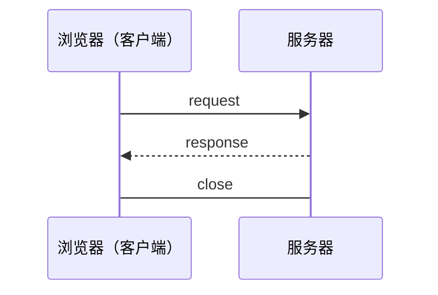
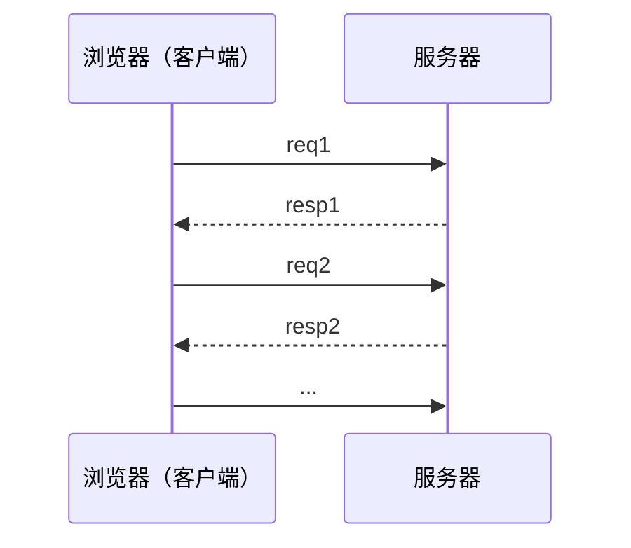
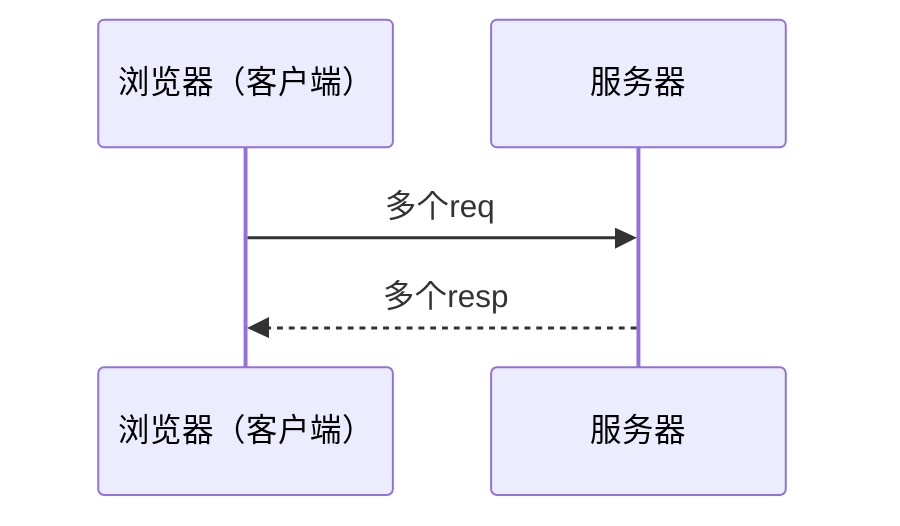

# 一、HTTP方法

接下来简单介绍除了`GET`/`POST`方法以外其余方法：

| 方法        | 主要用途                             | 幂等性 | 安全性（不修改数据） | 常见场景                                        |
| :---------- | :----------------------------------- | :----- | :------------------- | :---------------------------------------------- |
| **PUT**     | **全量更新**或创建资源               | 是     | 否                   | 替换/更新用户信息、上传文件覆盖                 |
| **PATCH**   | **局部更新**资源                     | 否     | 否                   | 仅修改用户的某个字段（如只改昵称）              |
| **DELETE**  | **删除**指定资源                     | 是     | 否                   | 删除某篇文章、删除某个用户                      |
| **HEAD**    | 获取响应的**头部信息**（无 Body）    | 是     | 是                   | 检查资源是否存在、获取文件大小/修改时间         |
| **OPTIONS** | 查询服务器支持的**通信选项**         | 是     | 是                   | CORS 跨域预检请求（Preflight）、查看支持的方法  |
| **TRACE**   | **回显**服务器收到的请求（用于诊断） | 是     | 是                   | 测试/诊断（因安全风险，现代服务器通常禁用）     |
| **CONNECT** | 建立**隧道**连接                     | 否     | 否                   | 用于 HTTPS 代理（客户端通过代理连接目标服务器） |

# 二、短连接与长连接

## 1. HTTP/1.0 短连接的弊端

在 HTTP/1.0 时代，短服务是最常用的一种网络服务。这是因为当时网络上的资源非常少，资源体积也比较小。

>   所谓的短连接，是指浏览器发出请求，服务器接收并处理请求，**随后服务器主动关闭连接。由短连接支持的服务被称为短服务。**



但是，随着网络世界的发展，短连接存在明显的效率弊端：
  比如当前我们需要加载一个包含 1 个 HTML 页面和 3 张图片的网页，浏览器就需要发起 4 次 HTTP 请求。

在短连接的服务器中，我们每次请求该网页都要重新fork、accept、三次握手。这非常影响性能。

## 2. HTTP/1.1 长连接

### 2.1 长连接处理多次请求问题

为了解决短连接的性能瓶颈，HTTP/1.1 引入了长连接方案。
  长连接的核心原理在于：建立一条 TCP 连接后，**就可以通过该连接连续交互非常多的请求和响应。浏览器可以一次性发起多个请求，服务器也可以一次性回复多个响应**，避免了频繁建立和断开连接的开销。



对于HTTP/2，它默认使用持久 TCP 连接，并且支持多路复用。

也就是说，多个 HTTP 请求可以在同一个 TCP 连接上并发传输，而不必像 HTTP/1.1 那样受到单连接请求顺序的限制。




### 2.2 如何确定是否使用长连接

HTTP 通过请求头和响应头中的 **`Connection` 字段**控制连接行为。

对于HTTP/1.0，默认使用短连接，如果需要长连接，需要显式指定：

```http
Connection: Keep-Alive
```

HTTP/1.0是

对于HTTP/1.1，默认采用长连接。如需关闭，则：

```http
Connection: close
```

**除了报文的交换，我们的客户端和服务器还要交换彼此的Connection字段，来选择是否要采用长连接的方式。**

### 2.3 保证报文完整与准确性

我们回过头看请求格式：


依据该格式，只要我们遵循协议，就一定能够读取到一个完整的 HTTP 请求。**能够成功读取一个，自然就能连续且完整地读取多个请求**。之前我们写TCP协议时，也用过长连接的形式。[网络计算器](https://github.com/CHHHHHH081/linux-network-programming/tree/main/TCP/TCPNetCal)

# 三、HTTP的特性

HTTP是一个**无连接、无状态**的协议，即每次请求都要建立新的连接，且服务器不会保存客户端的状态信息。

**注意：我们之前讲的长连接是指让TCP保持长连接。HTTP无关连接概念，HTTP只负责发request与response，在处理请求与响应时，它只关注它们的内容而不是你发多个请求还是一个请求。**

什么叫无状态呢？

**HTTP本质上是一种文件服务器，无状态就是指每次请求时不会保存客户端的状态信息。**比如说，你访问一个网页，你刷新一下，就会去重新请求一次，服务器不会因为“客户已经访问过了”就不受理请求。

> HTTP没有记忆，没有状态，但是不代表浏览器不能坐视不管，**每次请求都要重新请求一次，不行，太浪费资源了**，于是浏览器就会在自己内部内置一些**缓存**。解决这个问题。——他就是cookie。

# 四、cookie与session

## 1. 问题情形


## 2. cookie

HTTP Cookie（也称为Web Cookie、浏览器Cookie或简称Cookie）是服务器发送到用户浏览器并保存在浏览器上的一小块数据，**它会在浏览器之后向同一服务器再次发起请求时被携带并发送到服务器上**。通常，它用于告知服务端两个请求是否来自同一浏览器，如保持用户的登录状态、记录用户偏好等。

### 2.1 cookie原理——version0.1（现实已经被淘汰）


### 2.2 安全隐患


## 3. 引入session


为了一定程度解决安全问题：session **它解决的是“敏感数据暴露”问题，而不是“身份验证拦截”的全部问题。**

在用户登录时，服务器会进行认证，服务端会存储很多session里面存放了用户的私密信息，即用户私密信息在服务端保存了。

认证通过后，服务器在 response 中设置 `Set-Cookie: session_id = 12334214` 返回给客户端，客户端将其保存在本地。

那黑客不是依旧可以拿到sessionid吗？**因此我们需要辅助方案：异常账号检测，ip溯源，地址变更异常。**

==**总结：cookie+session专有名词我们称之为会话管理与会话保持。**==