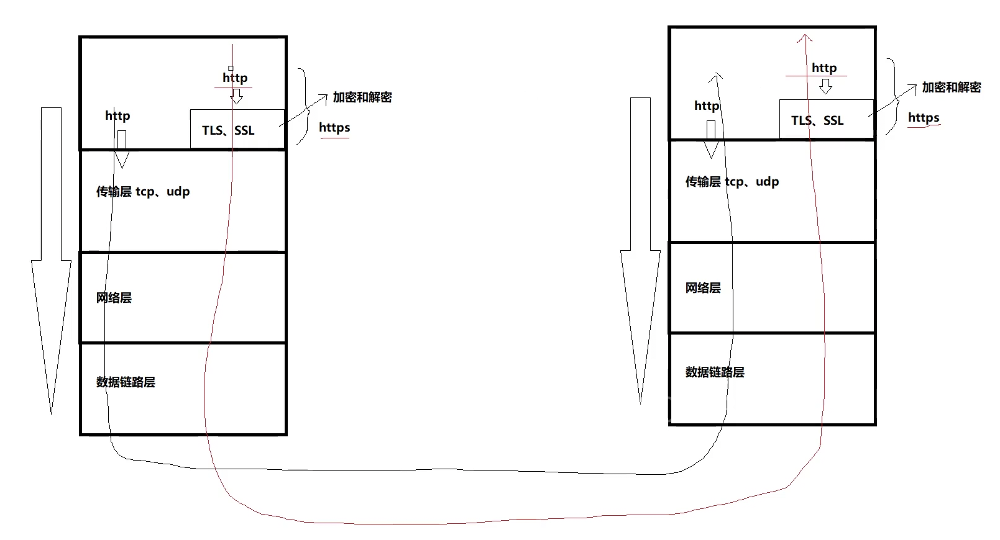
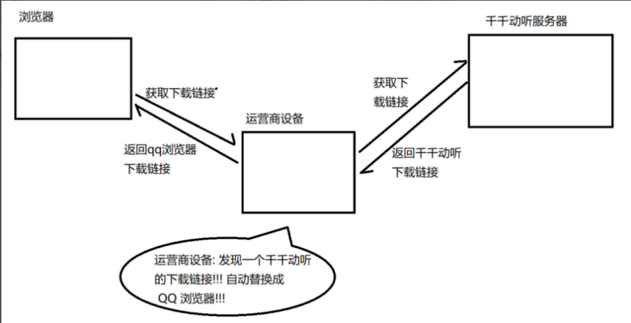
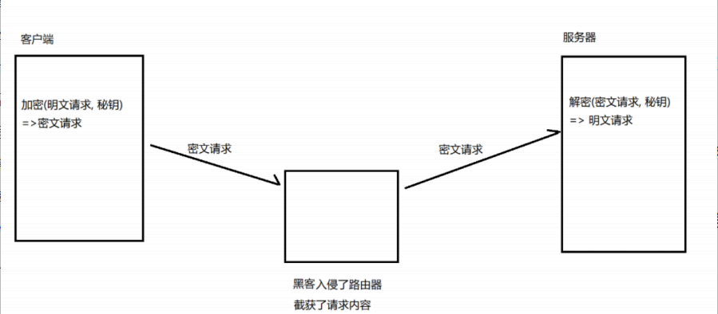
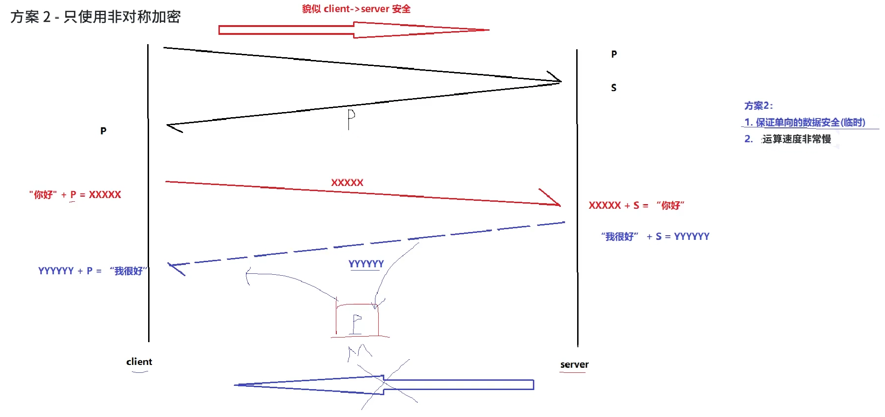
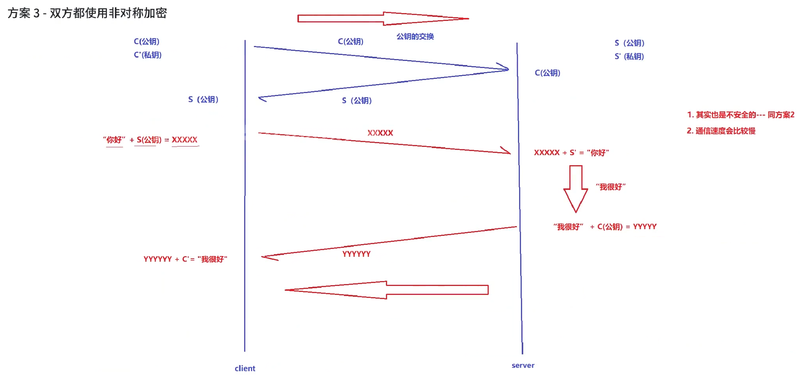
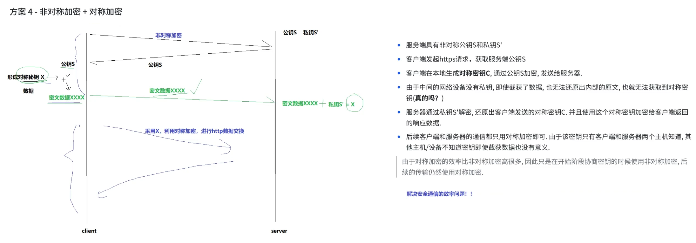
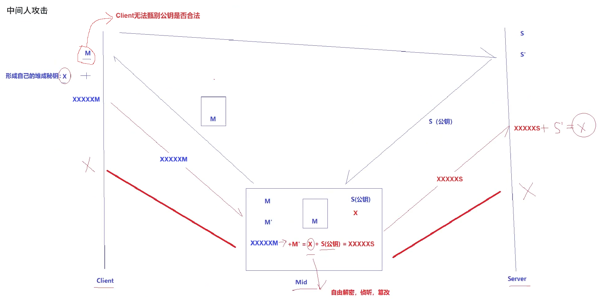
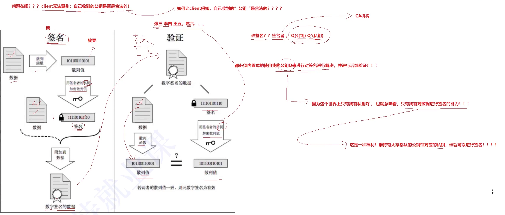
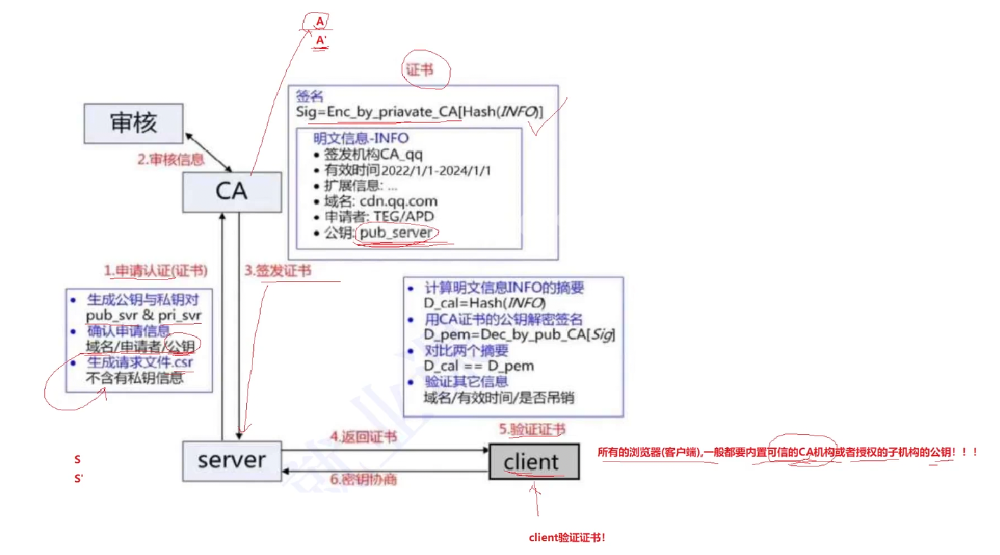
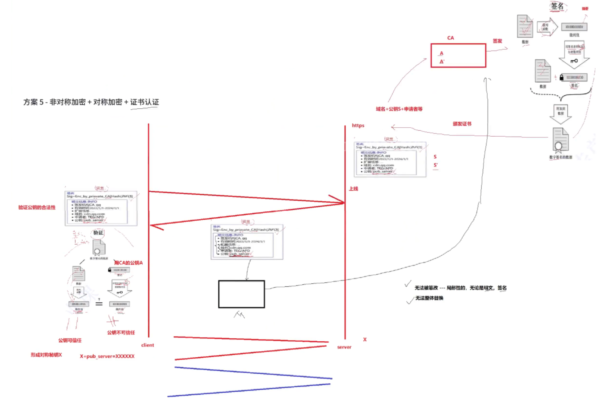

# 一、HTTPS

# 二、加密

## 1. 为什么要加密

这里讲一下臭名昭著的“运营商劫持”：

劫持者可以通过篡改传输信息而不被双方察觉，这就是“中间人攻击”。**明文传输数据是比较危险的。**

## 2. 对称加密

用同一个密钥加密与解密的加密方法，称为对称加密，它的特点是速度快，效率高。

## 3. 非对称加密

需要两个密钥加密与解密，两密钥分别是：公钥与私钥。可以用公钥加密私钥解密，也可以用私钥加密公钥解密，它的特点是算法复杂，运算速度慢。

# 三、四种加密通信方案

## 1. 只使用对称加密

## 2. 只使用非对称加密

## 3. 双方都使用非对称加密

## 4. 对称加密+非对称加密

# 四、中间人攻击

中间人攻击针对的主要漏洞就是：Client无法甄别自己收到的密钥是否是合法的。因此，如果想应对中间人攻击，得让Client知道自己收到的公钥是否是合法的。

# 五、CA证书与签名

## 1. 签名

## 2. CA证书

# 六、方案五：非对称加密+对称加密+证书认证

**总结：**HTTPS 工作过程中涉及到的密钥有三组（**双非一对**）。

**第一组(非对称加密)**: 用于校验证书是否被篡改. 服务器持有私钥(私钥在形成CSR文件与申请证书时获得), 客户端持有公钥(操作系统包含了可信任的 CA 认证机构有哪些, 同时持有对应的公钥). 服务器在客户端请求时, 返回携带签名的证书. 客户端通过这个公钥进行证书验证, 保证证书的合法性, 进一步保证证书中携带的服务端公钥权威性。

**第二组(非对称加密)**: 用于协商生成对称加密的密钥. 客户端用收到的CA证书中的公钥(是可被信任的)给随机生成的对称加密的密钥加密, 传输给服务器, 服务器通过私钥解密获取到对称加密密钥。

**第三组(对称加密)**: 客户端和服务器后续传输的数据都通过这个对称密钥加密解密。