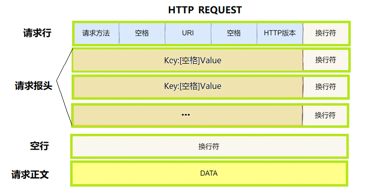
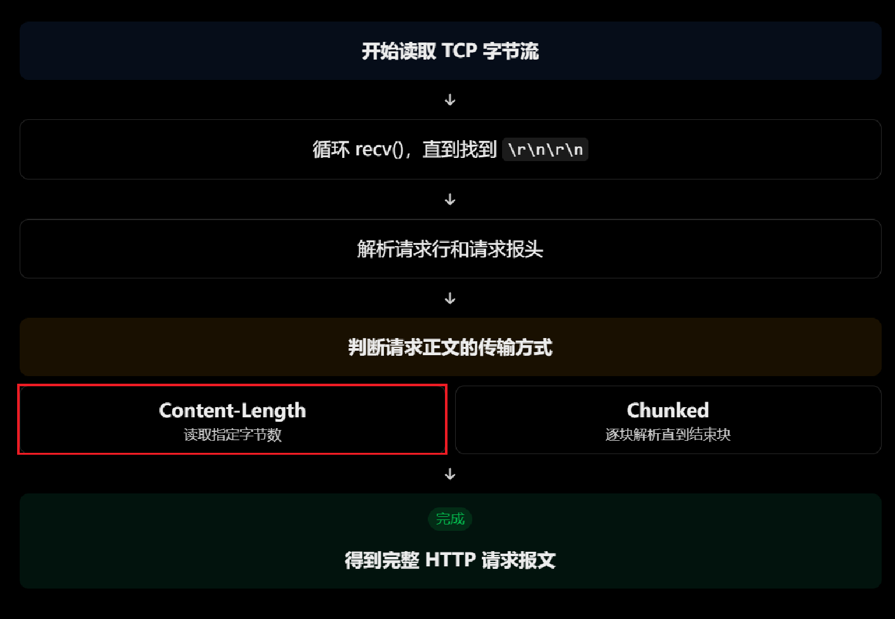
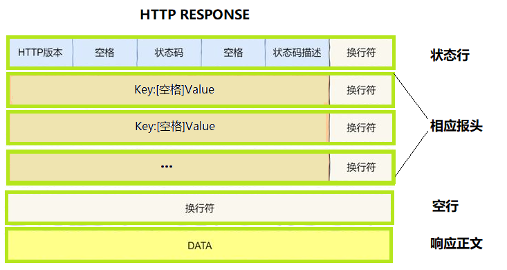
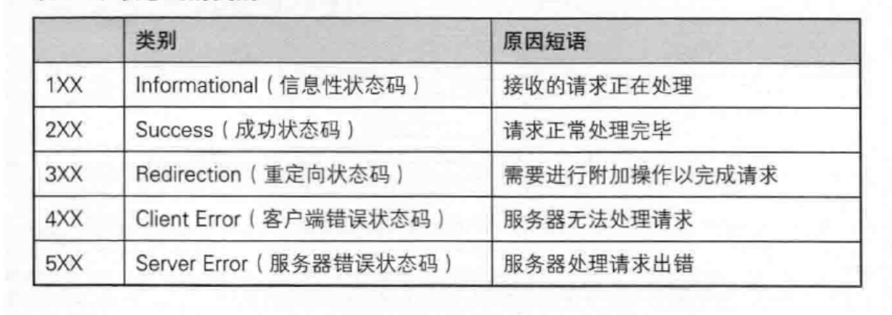
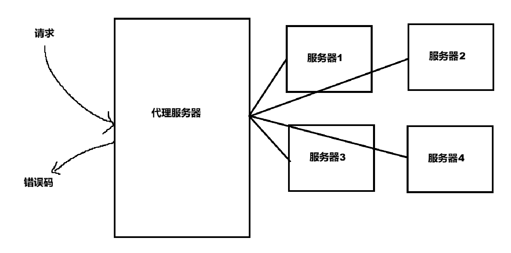

# 一、HTTP请求

## 1. 基本格式



## 2. 三个概念

- **URI（统一资源标识符）**：当浏览器请求 http://1.114.51.4:8080/a/b/c.html 时，服务端收到的请求行如 GET /a/b/c.html HTTP/1.1，其中 /a/b/c.html 即 URI，用于指示请求资源的相对位置。
- **Web 根目录（Web Root）**：代码中定义的资源存储根目录（如 const std::string webroot = “./wwwroot”）。注意：**它并非 Linux 系统的绝对根目录 /，所有静态资源均需放置于此目录下。Web 根目录通常是 Web 服务器存放网站资源的根目录。**
- **资源路径**：资源在服务器磁盘上的真实物理路径，由 Web 根目录与 URI 拼接而成。

## 3. 路径拼接

服务器收到请求后，会根据 URI 情况选择不同的拼接逻辑。存在两种情况。

### 3.1 显式请求具体文件

当请求行为 **GET /a/b/c.html HTTP/1.1**时，服务器直接将 Web 根目录 **webroot（./wwwroot）与 URI（/a/b/c.html）** 拼接，最终得到的真实文件路径为 **./wwwroot/a/b/c.html。**

### 3.2 隐式请求根目录

当请求行为 **GET / HTTP/1.1** 时，服务器无法直接返回目录，需要自动拼接默认首页（如 **index.html**）。服务器通过预设的 **homepage = “/index.html”** 完成拼接：**filename = webroot + homepage**，得到真实路径 **./wwwroot/index.html**，随后读取该文件并返回。

### 3.3 总结

  HTTP 请求的本质，就是请求代码中 **./wwwroot目录**下特定路径的资源，而 URI 中的路径则是**寻找该资源的磁盘索引。**

## 4. 请求行格式详解

### 4.1 基本要素

```http
请求方法  URI  HTTP版本\r\n
```

- **请求方法**：最常用的是GET（请求资源）与POST（上传资源）
- **URI（请求目标、资源标识符**）：URI 表明客户端要请求的资源，目前在请求行中的表现形式为一段相对路径。
- **HTTP版本**：HTTP 版本用于告诉服务器，客户端希望使用哪个版本的 HTTP 协议进行通信。

例如：

```http
GET /index.html HTTP/1.1
```

可以拆分为：

```
GET          /index.html          HTTP/1.1
│                │                    │
请求方法       请求目标             HTTP版本
```

三个部分之间使用空格分隔，行尾使用 `\r\n`（回车 + 换行）表示请求行结束。

### 4.2 为什么请求行要带版本号

在 HTTP 协议的报文设计中，请求和响应都会明确标明版本号。原因在于：**客户端和服务器是两款独立运行的软件！**

在实际的应用场景中，一个厂家给他的服务器进行了软件升级，但是市面上的用户还有很多没有更新他们的客户端，于是就会出现新老版本的客户端和服务器同时在网络中并存的情况。

因此，客户端发送请求必须带上自己的版本号，然后服务器和客户端协商版本号，为客户端提供对应版本的服务。否则，如果缺乏版本协商机制，就会出现客户端解析或处理错误。

### 4.3 关于URI

我们所访问的所有资源都是放在web根目录（`./wwwroot`）下的。

我们在浏览器端发起请求时，首页作为整个站点的入口，本质上一个网站就是一颗多叉树。当用户在网页上点击链接时，浏览器会形成新的访问地址并发起二次请求，进而拼接出新的 URI。我们在服务器端请求的所有资源，最终都是通过 **HTTP Request** 中的 URI 来精准表示的。**URI 是客户端请求资源时使用的标识，Web 服务器负责将 URI 映射到实际资源。**

如，URI为：`/index.html`，资源路径就是：`/wwwroot/index.html`。

### 4.4 如何读取到一个完整的HTTP报文

读取一个完整的 HTTP 报文，核心难点在于：**TCP 是面向字节流的协议，没有消息边界，而 HTTP 报文有自己的格式和结束标志。因此，我们不能简单地认为一次 `recv()` 就能读取一个完整的 HTTP 报文。**

1. 首先读取请求行和请求报头，HTTP 请求头部有一个非常重要的结束标志：`\r\n\r\n`，这就是空行。

2. 判断报文传输方式：有两种传输方式：`Content-Length` / `Transfer-Encoding=Chunked`，报头中，两种传输方式只能选择一种。

3. 如果是`Content-Length`，根据 Content-Length 判断请求正文长度，HTTP 请求头中有一个重要字段：`Content-Length`，该属性明确标明了后续请求正文（有效载荷）的字节长度（我们主要采用这种方法读取报头）。

4. 如果数据是动态产生的，或者需要边生成边发送，那么提前计算整个正文长度就不太方便。这时就可以使用 `Transfer-Encoding: chunked`。

5. 如果是`Transfer-Encoding=Chunked`，就是采用分块传输编码。它的格式是：第一行为块的长度，第二行为块正文。以此类推，直到0为止正文结束。如：

    ```http
    POST /upload HTTP/1.1
    Host: example.com
    Transfer-Encoding: chunked
    
    2
    Hi
    5
    World
    0
    ```

​	这种方法我们暂时不采用。

6. 根据提取到的 **Content-Length** 数值，继续从剩余的字符流缓冲区中精准提取对应字节数的字符，从而拼接出完整的 HTTP 请求正文。



# 二、HTTP响应与异常处理机制

在 Web 服务器完成请求解析与业务逻辑处理后，需要向客户端返回 HTTP 响应报文。**状态行中的状态码与状态码描述，是服务器向客户端表达请求处理结果与进行异常处理的核心。**



## 1. HTTP状态码



| 状态码             | 含义                 | 应用样例                                                     |
| :----------------- | :------------------- | :----------------------------------------------------------- |
| **1xx 信息性**     |                      |                                                              |
| 100                | 继续处理             | 上传大文件前发 `Expect: 100-continue` 询问服务器是否接收，避免浪费带宽 |
| **2xx 成功**       |                      |                                                              |
| 200                | 请求成功             | 正常打开网页、API 返回数据                                   |
| 201                | 已创建新资源         | 注册成功，`Location` 头返回新资源 URI                        |
| 204                | 成功但无返回内容     | DELETE 删除成功，无需返回主体                                |
| 206                | 返回部分内容         | 视频拖动进度条，按 `Range` 返回分片                          |
| **3xx 重定向**     |                      |                                                              |
| 301                | 永久重定向           | 旧域名永久跳转新域名，传递 SEO 权重                          |
| 302                | 临时重定向           | 未登录访问个人中心，临时跳登录页                             |
| 304                | 资源未修改，用缓存   | 二次访问携带 `If-Modified-Since`，返回 304 省带宽            |
| **4xx 客户端错误** |                      |                                                              |
| 400                | 请求语法/参数错误    | 表单漏传必填字段、JSON 格式错误                              |
| 401                | 未认证               | Token 过期调用 API，引导重新登录                             |
| 403                | 已认证但无权限       | 普通用户访问管理员后台                                       |
| 404                | 资源不存在           | URL 路径或接口地址拼写错误                                   |
| 405                | 请求方法不支持       | 对只允许 GET 的接口发 DELETE                                 |
| 429                | 请求频率超限         | 同一 IP 短时间大量请求被限流                                 |
| **5xx 服务器错误** |                      |                                                              |
| 500                | 服务器内部错误       | 后端未捕获异常、数据库连接失败                               |
| 502                | 网关收到无效上游响应 | Nginx 后端服务崩溃未启动                                     |
| 503                | 服务暂时不可用       | 流量过载或停机维护，`Retry-After` 提示恢复时间               |
| 504                | 网关等待上游超时     | 后端查询过慢超过 Nginx 超时阈值                              |

## 2. 常见服务器处理异常场景解析

### 2.1 代理服务器传递请求与错误码

大型公司内部通常会由代理服务器与机房中的多台服务器共同组成负载均衡系统。**如果其中某台后端服务器因过载等原因发生异常，该服务器会向代理服务器返回错误码，最终由代理服务器统一将错误信息返回给终端用户。**



### 2.2 异常捕获与回调机制

**500** 错误的一种可能是服务器创建子进程失败。但是子进程创建都失败了，如何给我们的网页发送 **500** 呢？有一种方法可以处理：如果 **fork** 错误，可以在进程退出前调用一下回调函数 **excepter()**，可以执行回调由服务器自己发送一个网页回去。

```c
pid_t id = fork();
if (id < 0)
{
    LOG(LogLevel::FATAL) << "fork error ...";
    // excepter(sock); //
    exit(FORK_ERR);
}
```

如果连父进程都没了，那真没招了，不会返回。
