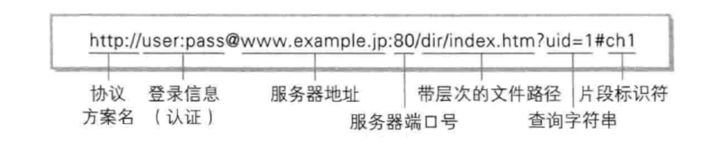
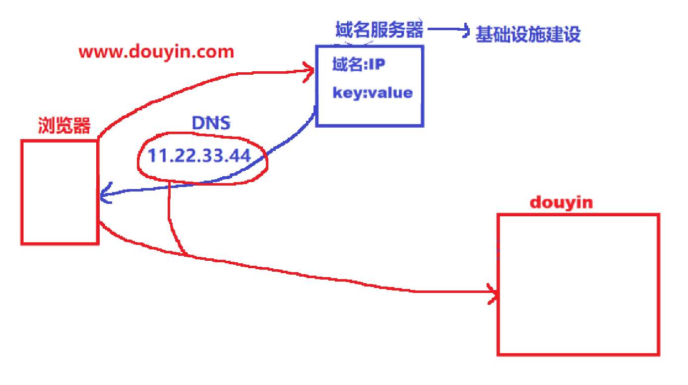
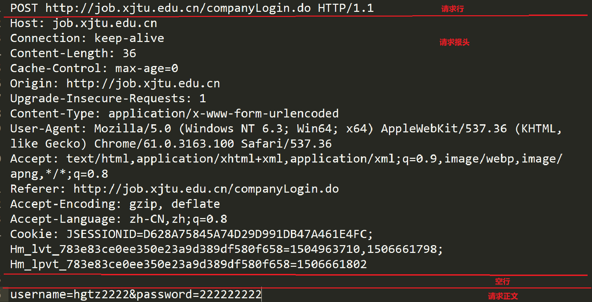
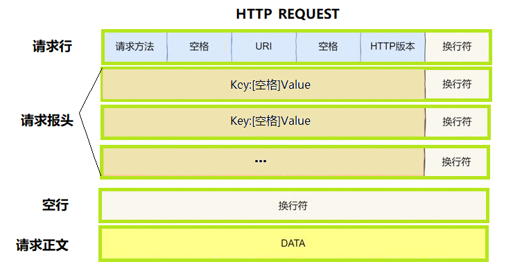
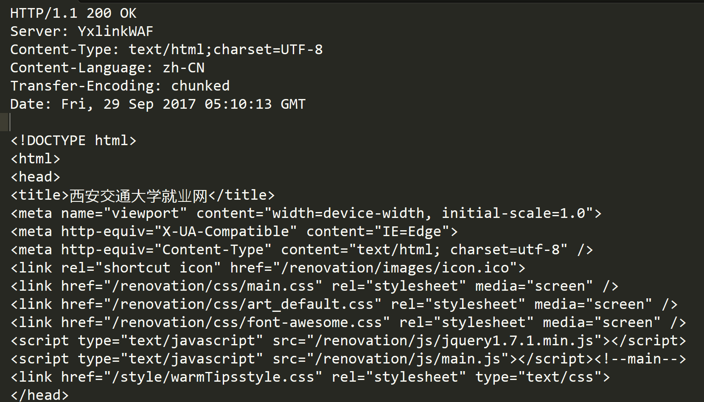
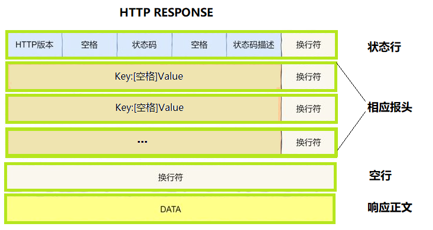

# 序

本章我们要开始学习应用层协议，**HTTP(超文本传输协议)就是其中之一。**

# 一、HTTP协议

给一个课本定义：在互联网世界中，HTTP（HyperText Transfer Protocol，超文本传输协议）是一个至关重要的协议。它定义了客户端（如浏览器 ）与服务器之间如何通信，以交换或传输超文本（如HTML文档）。
  HTTP协议是客户端与服务器之间通信的基础。**客户端通过HTTP协议向服务器发送请求，服务器收到请求后处理并返回响应。HTTP协议是一个无连接、无状态的协议，即每次请求都需要建立新的连接，且服务器不会保存客户端的状态信息。**

# 二、URL

## 1. 协议

前面这个https（http）表示获取资源采用的协议。**像一些成熟的协议，端口号都是固定的**，比如：https: 443，http: 80，ssh: 22。这也印证了：0~1023的端口号不能随便用。

## 2. 域名

 你可以简单的理解，域名就是IP地址 。**域名转化为IP地址访问，就是去访问这个公司的服务器**。直接用这个公司的IP为什么不好？因为IP地址只是一串数字，没有表意性。

## 3. 资源访问路径

我们上网，无非就是两种情况：需要从网上获取数据、需要向网上传输数据。而这些数据都存在哪里呢？

**答案是：Linux 服务器内部** 。以什么形式存在呢？**答案是：一个文件就是“资源”。**上述URL带有很多`/`，这个就是Web根目录，**它不是Linux根目录**。

访问的过程如下：

首先，运营商给我们建设了域名服务器。我们用浏览器输入URL访问这个域名服务器，域名服务器解析域名，返回一个IP地址。**然后浏览器就可以拿着这个IP地址 + 端口号（取决于你采用的协议HTTP或是HTTPS）访问对应的服务器**，根据域名后面的资源访问路径获取对应的资源。

**总结：**

- 从 HTTP 的角度来看，“资源”本质上就是存储在 Linux 服务器特定路径下的文件。
- 我们在 URL 中看到的协议与端口号（http/https:port）、域名（映射具有唯一性的 IP 地址）以及路径（目标机器上特定路径的文件），这三者共同构成了全网内唯一的文件定位。
- 因此，**超文本传输协议的本质就是用来传递文件的，其底层依然是基于 Socket 实现的网络通信**！

# 三、HTTP协议请求与响应格式

## 1. 请求

- 首行: [方法] + [url] + [版本]。
- Header: 请求的属性, 冒号分割的键值对; 每组属性之间使用 \r\n 分隔; 遇到空行表示 Header 部分结束。
- Body: 空行后面的内容都是Body. Body允许为空字符串. 如果Body存在, 则在Header中会有一个Content-Length属性来标识Body的长度。（后面详细讲）

## 2. 响应

- 首行: [版本号] + [状态码] + [状态码解释]。
- Header: 请求的属性, 冒号分割的键值对;每组属性之间使用\r\n分隔;遇到空行表示Header部分结束。
- Body: 空行后面的内容都是Body. Body允许为空字符串. 如果Body存在, 则在Header中会有一个Content-Length属性来标识Body的长度; 如果服务器返回了一个html页面, 那么html页面内容就是在body中。

