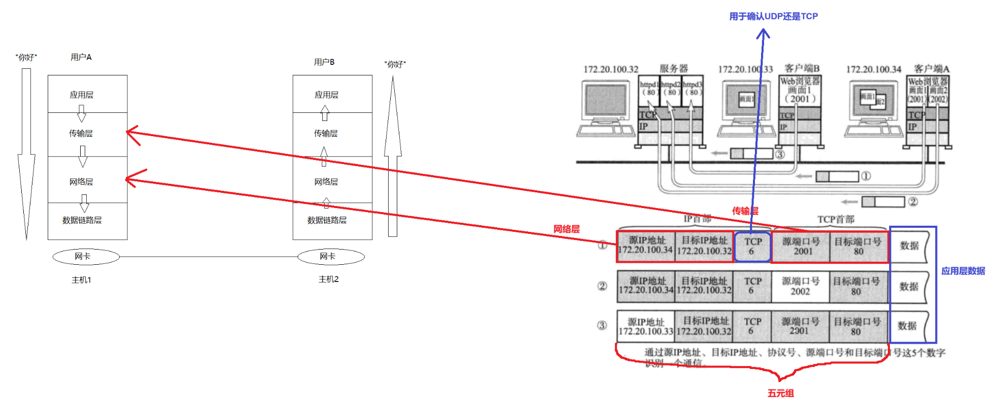
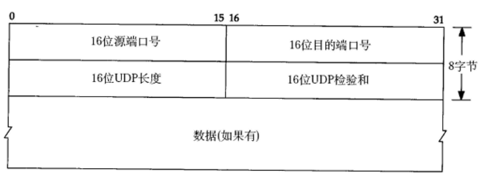

# 序

前面我们已经讲了HTTP/HTTPS应用层协议，本文将围绕传输层协议展开。**本文接续以前对UDP协议的理解，介绍UDP协议的原理与性质。**

# 一、端口号与五元组

端口号(Port)我们都知道，他标识了一个主机上进行通信的不同的应用程序；

## 1. 五元组

在TCP/IP协议中,用 **“源IP”,“源端口号”,“目的IP”,“目的端口号”,“协议号”** 这样一个五元组来标识一个通信(可以通过netstat -n查看)。

## 2. 端口号范围划分

- 0 - 1023: 知名端口号, HTTP, FTP, SSH等这些广为使用的应用层协议, 他们的端口号都是固定的。
- 1024 - 65535: 操作系统动态分配的端口号. 客户端程序的端口号, 就是由操作系统从这个范围分配。

## 3. 知名端口号

有些服务器是非常常用的, 为了使用方便, 人们约定一些常用的服务器, 都是用以下这些固定的端口号:

- ssh服务器, 使用22端口
- ftp服务器, 使用21端口
- telnet服务器, 使用23端口
- http服务器, 使用80端口
- https服务器, 使用443

使用`cat /etc/services`查看知名端口号

# 二、UDP协议格式

## 1. 协议格式

- 共64位定长报头。
- 16位UDP长度：表示**整个数据报(UDP首部+UDP数据)的最大长度;**
- 16位UDP检验和：如果校验和出错, 就会直接丢弃;
- 16位目的端口号：我们得到一个结论，为什么我们以前说端口号为16位？因为内核协议是16位的。

## 2. 核心问题

1. **如何分离**：UDP采用定长报头，直接将报头去掉就能精准定位到有效载荷。
2. **如何分用**：通过读取报头中的 16 位目的端口号，将数据正确分发（分用）给应用层中绑定了该端口号的具体进程/套接字。

同时我们也明白了，为什么 `sendto` 有这三个参数：`server_socket`、`serverip`、`serverport`。（**UDP 是无连接的，底层不知道目标是谁，因此发送数据时必须显式提供完整的对端定位信息。**）

# 三、UDP的特点

## 1. 特点

**UDP传输的过程类似于寄信.**

- 无连接: 知道对端的IP和端口号就直接进行传输, 不需要建立连接；
- 不可靠: 没有确认机制, 没有重传机制; 如果因为网络故障该段无法发到对方, UDP协议层也不会给应用层返回任何错误信息；
- 面向数据报: 不能够灵活的控制读写数据的次数和数量；

## 2. 面向数据报

应用层交给UDP多长的报文, UDP原样发送, 既不会拆分, 也不会合并；

用UDP传输100个字节的数据：

如果发送端调用一次sendto，发送100个字节，那么接收端也必须调用对应的一次recvfrom，接收100个字节；而不能循环调用10次recvfrom，每次接收10个字节。

## 3. UDP缓冲区

**UDP没有真正意义上的发送缓冲区。**调用sendto会直接交给内核，由内核将数据传给网络层协议进行后续的传输动作；

**UDP具有接收缓冲区。**但是这个接收缓冲区不能保证收到的UDP报的顺序和发送UDP报的顺序一致；如果缓冲区满了，再到达的UDP数据就会被丢弃。
  **UDP的socket既能读，也能写，这个概念叫做全双工。**

# 四、其余问题

## 1. UDP使用注意事项

我们注意到, UDP协议首部中有一个16位的最大长度。也就是说一个UDP能传输的数据最大长度是64K(包含UDP首部)。

然而64K在当今的互联网环境下, 是一个非常小的数字。

如果我们需要传输的数据超过64K，就需要在应用层手动的分包，多次发送，并在接收端手动拼装。

## 2. 基于UDP的应用层协议

- NFS: 网络文件系统
- TFTP: 简单文件传输协议
- DHCP: 动态主机配置协议
- BOOTP: 启动协议(用于无盘设备启动)
- DNS: 域名解析协议

**当然, 也包括你自己写UDP程序时自定义的应用层协议。**