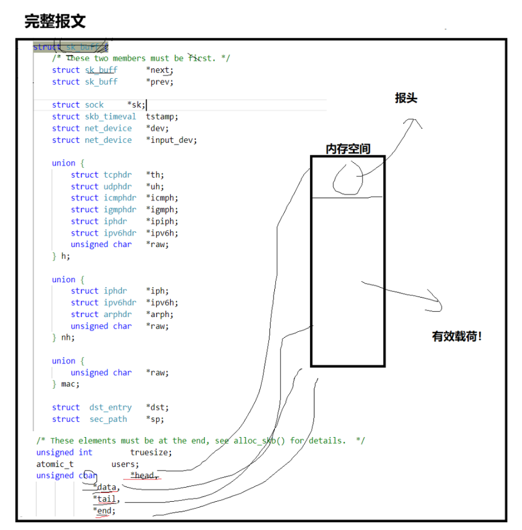
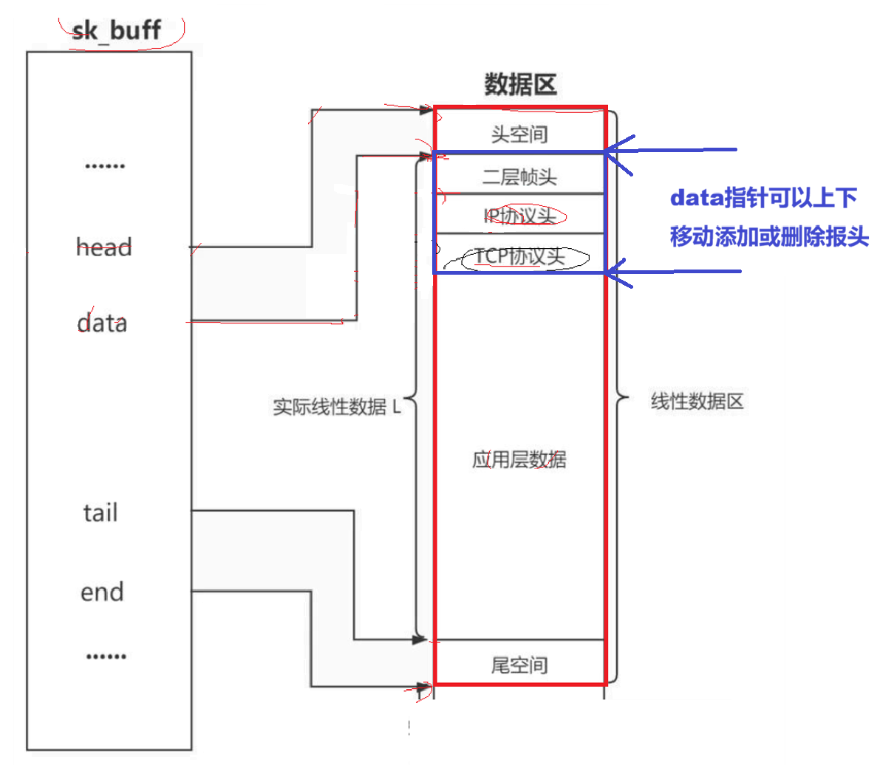
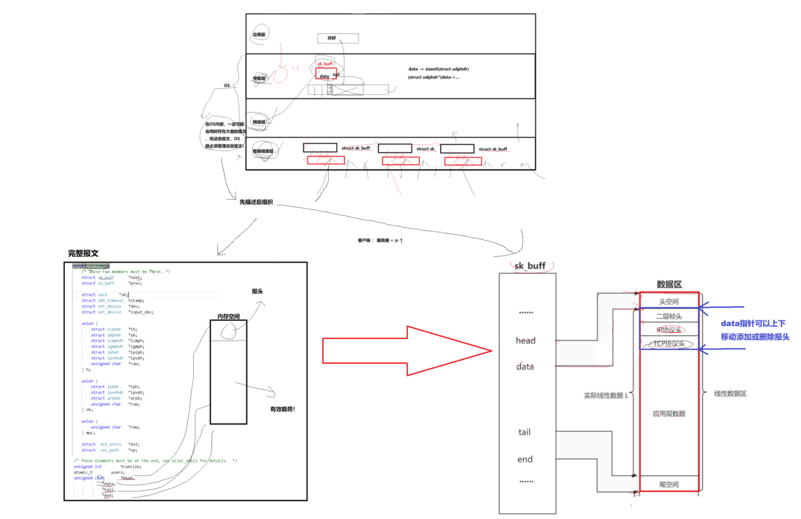
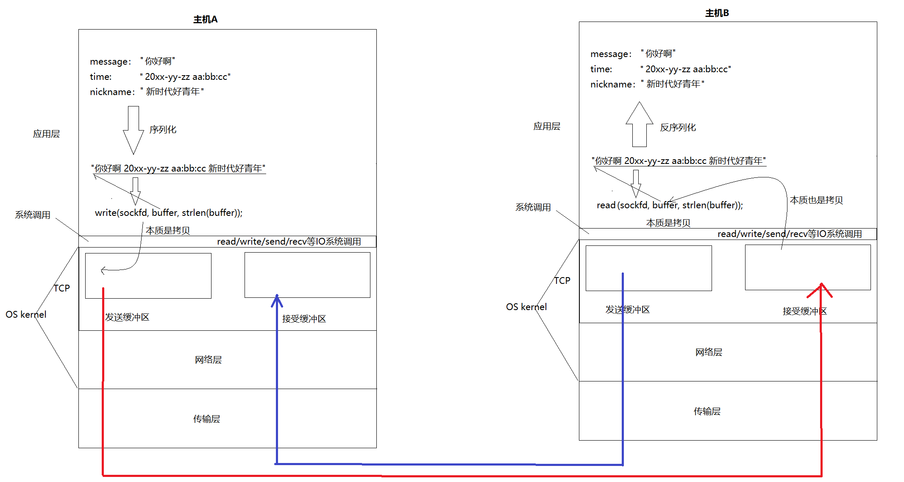
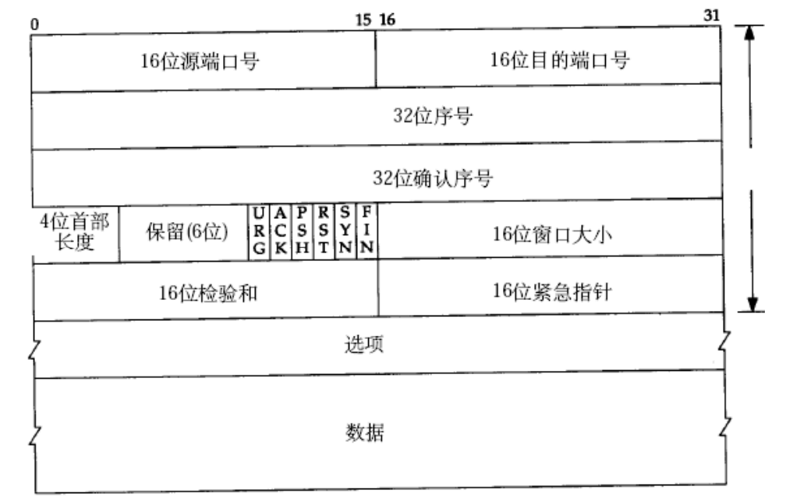

# 一、理解报文

这里先引出一个核心问题：**如果应用层正在进行报文的解析、处理，会不会影响 OS 从网络中读取报文？为什么？**

答案是：**不会！**因为不论是应用层的数据操作还是系统层的数据接收，本质上都是响应硬件中断 或时钟中断，在逻辑上不分先后。

我们要知道，在网络通信中，客户端与服务器的比例是n比1的关系。这意味着在操作系统（OS）内部，必然会同时存在着海量的报文——**既然存在海量报文，OS 就必须管理这些报文！**

## 1. 管理方式：先描述，后组织

操作系统管理报文的核心思路，依然是“先描述，再组织”：

在 Linux 内核中，通过 `struct sk_buff` 结构体来描述报文。结构体内包含了` struct sk_buff *next` 和 `struct sk_buff *prev`指针，用以构建报文之间的双向链表连接。

完整的报文是由它的**结构体**与其对应的**内存缓冲区**构成的。

- `sk_buff` 结构体内部包含 `head`、`data`、`tail`、`end` 指针。
- 指针指向的是一块连续的内存数据区（分为头空间、二层帧头、IP协议头、TCP/UDP协议头、应用层数据、尾空间）。

**在图中我们也可以看出，所谓的封装与解包就是data指针的移动与赋值。**

# 二、TCP协议

TCP 全称为“传输控制协议”（Transmission Control Protocol）。**人如其名，它的核心职责就是要对数据的传输进行一个详细且精确的控制。**

从系统的角度来看 TCP 传输：以我们以前学习的文件系统为例，文件 `struct file` 有一个缓冲区，我们调用写入操作时是向缓冲区写入，而不是直接向外设写入。TCP 传输也是同样的道理，**`write` 系统调用只需要往缓冲区写入，不需要阻塞等待报文被发送到目标，而是可以直接继续执行应用层的工作。**我们可以把报文发送理解为：“一次比较复杂的刷新”。这样可以显著提升效率。
  为了深入理解 TCP 是如何控制数据传输的，我们必须先理清协议设计中的基本问题。

## 1. 报文格式

## 2. 核心问题：如何交付，如何分离

**报头和有效载荷如何分离？**

**关键在4位首部长度，它表明了包括选项在内的报头长度。**选项是可变的，前面的报头部分固定为20字节，因此只需将总长度减去20字节就能得到数据长度。

4 位二进制能表示的数字范围是0000~1111（即 0~15）。如果一个数字代表 1 个字节，那么首部最大只能表示 15 个字节，这显然是不够用的。

因此我们约定：**基本单位一定是 4 个字节，即 1 个数值代表 4 个字节。同时，报文必须是 4 字节的整数倍。**
  由此可以推算出 TCP 报头的长度逻辑：

理论范围是[0,60]，但**报头最小20字节**，再加上可变长度的选项部分。

所以报头实际大小范围被缩小为 **20~60 字节**。映射到 4 位首部长度的二进制取值，就是 **0101~1111**（即 5~15）。

关于**如何交付**：直接提取 TCP 报头中的 **16位目的端口号**，操作系统就知道该把数据交付给哪一个应用层进程了。

## 3. 问题：为什么 TCP 报头中没有报文大小的字段？

有人可能会问：会不会出现上面的有效载荷和下一个报头混在一起的情况？
  答案是：**不存在！** 因为在系统的底层，我们的每一个报文都是一个**独立的 `sk_buf`**！

**为什么 TCP 报头不需要设计“报文大小”或“数据长度”的字段，这源于 TCP 的核心设计理念：**

**TCP 是面向字节流的传输层协议**，它只负责将字节序列可靠、有序地送达接收缓冲区。**TCP 不关心也不理解应用层业务报文的边界（即无“报文界限”）。**它也无法准确获取报文总长度。

应用层数据的拆分与拼装（粘包/半包处理），完全需要由应用层协议自行定义和解析。

