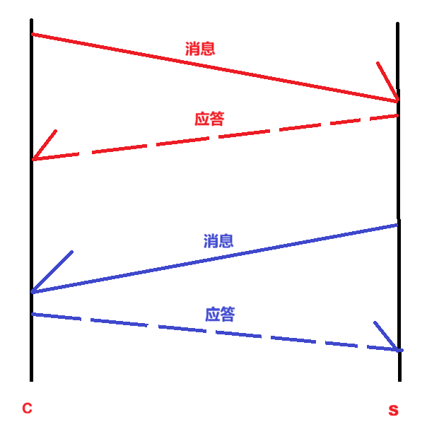
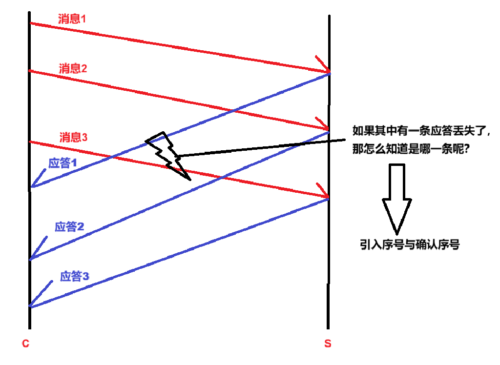
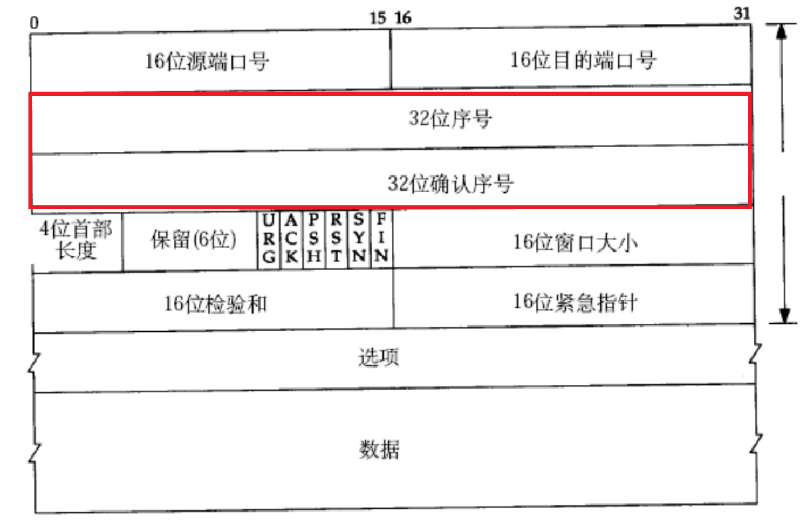
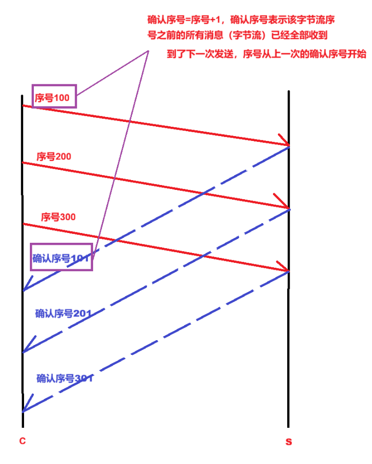

# 一、TCP可靠性的本质

**先说结论：世界上不存在 100% 绝对保证可靠的通信系统**，但网络协议 可以通过设计来最大程度地确保可靠性。

我们需要正确理解可靠性：

1. **具有应答（ACK）机制，可以保证历史消息的可靠性。** 只有当发送方收到接收方的回应时，才能确信上一条发送给对方的消息已经成功到达。
2. **在通信过程中，最新的报文永远没有应答，因此最新消息的可靠性无法直接保证。**

**如果要保证可靠性，处于核心地位的是TCP的确认应答机制。**

# 二、TCP传递报文过程

## 1. TCP一般通信过程

客户端给服务器发消息，服务器给客户端应答；服务器给客户端发消息，客户端给服务器应答。**只要有应答，就代表上一条消息一定收到**，不用对应答做应答。

这种互相发送并等待确认的机制，我们称之为：**确认应答机制**。但是，这种一应一答（发一条、等一条确认、再发下一条）的方式，**在实际网络传输中效率太低下了。我们引出传递报文更通用的过程。**

## 2. 更通用的过程

可以发多条消息，收多条应答：

**这时候就会面临一个核心问题：在并发发送的情况下，到底是谁丢包了呢？**

> **是时候引出32位序号与32位确认序号了。**

## 3. 序号与确认序号【重点📌】

在讲这两个字段之前，我们需要明确：**通信的时候，双方传递的全都是 TCP 报文，最少也得是一个报头！**

### 3.1 序号含义与丢包容忍

在报头中有**一个32位序号和一个32位确认序号**，确认序号对应的报文表示对其对应的序号所对应的报文的应答，**比如发出时序号为100，收到应答，确认序号就得是序号+1，即100+1=101。**

假设在传输过程中200对应的消息丢包了，那就只会有101确认序号，因为**确认序号表示：该序号之前的所有消息都已经收到了。**这种机制允许一定程度的应答报文丢失，即使前面的应答丢了，只要收到最新的 301，就能证明前面的数据都收到了。

### 3.2 乱序问题

有了序号和确认序号，我们还可以顺便解决**接收乱序问题**。

乱序问题产生的原因很简单：你先发出去的报文不一定先到达。就像从浙江到西藏有很多条路可以走，先出发的人不一定先到。乱序问题本质上也是一种不可靠问题。

但是有了序号和确认序号，接收方在收到数据后，通过对序号进行排序就可以完美解决乱序问题。

### 3.3 两个序号的根本原因【重点📌】

**问题来了：明明一个序号也可以表示发送与确认序号，那为什么要设计两个序号呢？**

如果这两个字段不分开，只设一个字段，那么在双方同时发送数据时，**这个字段就无法同时兼顾“标记我发出的数据”和“确认我收到的数据”。**

**服务器在做应答的同时，==自己也要发送数据==，既然要发送数据，那一定就得有数据对应的序号，只采用一个序号就无法区分需要的两个序号。**

如果把应答和服务器要发送的消息结合在一起，传输效率无疑会更高，这就是**捎带应答**。应答不一定没有有效载荷，捎带应答就是带有有效载荷的应答。

> **所以这就是为什么我们要有两个序号的根本原因：==既需要对对方报文做确认，自己的报文也需要有序号！==**