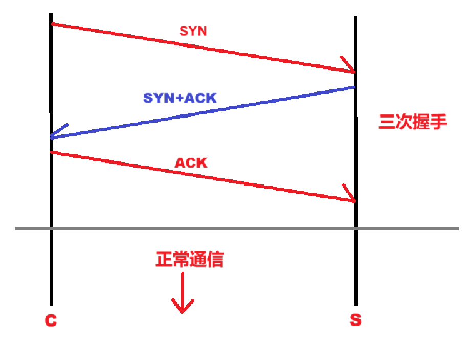
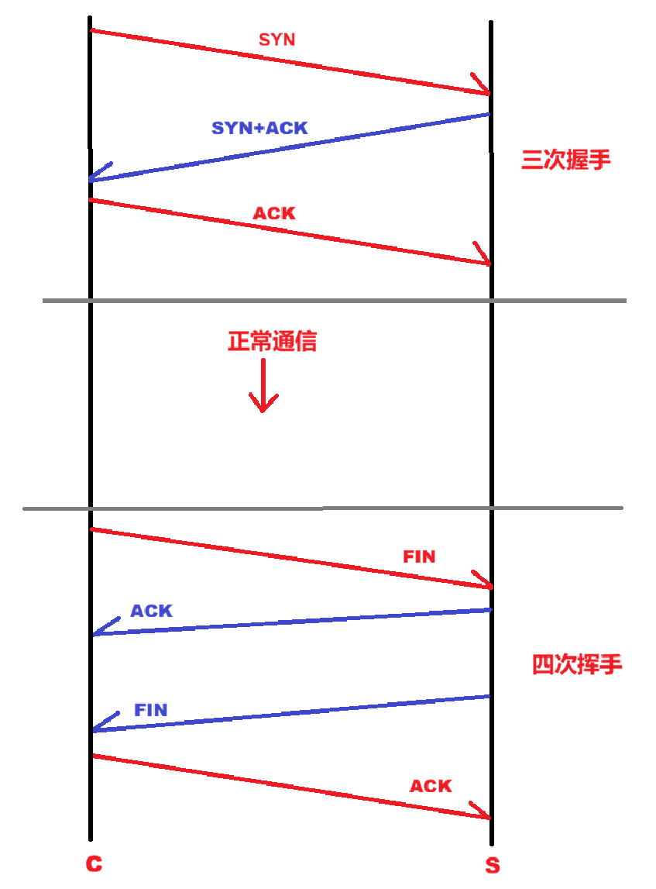
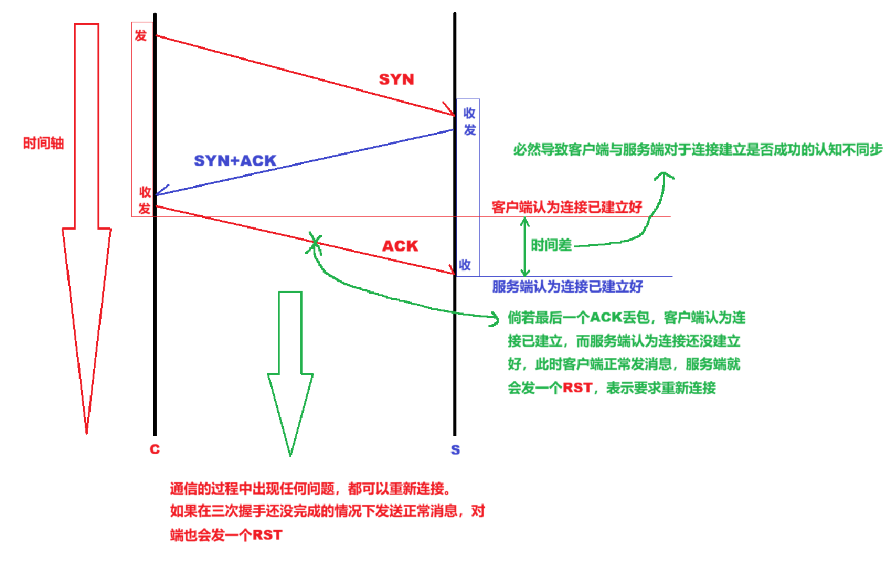

# 一、16位窗口大小与流量控制

## 1. 16位窗口大小

**首先，一台机器接收报文的能力，由这台机器==接收缓冲区“剩余空间的大小”==决定！**

如果客户端不断给服务端发消息，服务端的接收缓冲区很快就满了，那客户端发来的消息不就浪费了吗？发一条消息的成本也不小，怎么解决呢？

此时就要引入**16位窗口大小**了，我们可以**把==自己的“接收缓冲区“剩余空间的大小==填入16位窗口大小**。发给对端，对端就知道了，对端接收报文能力的大小，于是调整自己发送报文的速度，或者直接阻塞不发送。

## 2. 流量控制

这种根据对端接收能力来动态调整发送报文速度的机制，我们称之为**流量控制**。

# 二、6个标志位

## 1. 标志位

**标志位：本质就是报头中的比特位！！**

在TCP报头结构中，这些标志位并不是单独占用了几字节的空间，而是通过C/C++中的**位段（bit-field）** 语法来实现的。像 `xxx: x` 这种语法就是标准的**位段**表达方式。

**我们直接看一下 Linux 内核中 `struct tcphdr` 的源码定义：**

```c
struct tcphdr {
	__be16 source;
	__be16 dest;
	__be32 seq;
	__be32 ack_seq;
#if defined(__LITTLE_ENDIAN_BITFIELD)
	__u16 res1:4,
		doff:4,
		fin:1,
		syn:1,
		rst:1,
		psh:1,
		ack:1,
		urg:1,
		ece:1,
		cwr:1;
#elif defined(__BIG_ENDIAN_BITFIELD)
	__u16 doff:4,
		res1:4,
		cwr:1,
		ece:1,
		urg:1,
		ack:1,
		psh:1,
		rst:1,
		syn:1,
		fin:1;
#else
#error "Adjust your <asm/byteorder.h> defines"
#endif
	__be16 window;
	__sum16 check;
	__be16 urg_ptr;
};
```

## 2. 为什么要有标志位

我们在理解了标志位本质是位段之后，紧接着就需要思考一个更核心的问题：**TCP报头里为什么一定要设计这些标志位呢？**
  对于接收方（Server端）来说，在整个通信过程中收到的 TCP 报文，一定存在**不同的类型**。针对**不同报文类型**，接收方要有**不同的做法**！

因此就要有**标志位来区分TCP报文的类型**。

## 3. ACK

**ACK表示确认号是否有效，ACK==1时，确认序号有效，即表明报文是一个应答报文。**

**ACK标志位几乎是被常设为1的。**

## 4. SYN与三次握手

**SYN为同步标志位，表明自己是建立连接相关的报文。**



在建立连接（三次握手）时，双端发送的不是单纯的什么SYN、ACK，**它们发的都是报文，只是包头中相应的标志位被置1了。**

**在三次握手时，前两次握手时，不能携带数据，因为三次握手还没有完成，它们发的只是TCP报头。**

**在三次握手的时候，已经可以进行双方接受能力的协商了！**

## 5. FIN与四次挥手

FIN通知对方本端要关闭了，携带FIN标识的为**结束报文段**。



**面试会考：** 为什么要四次挥手？是因为客户端和服务器之间建立的是各自的发送缓冲区到对方的接收缓冲区的**单向信道**。**一共两条构成全双工。必须全部断开，而四次挥手是谋求共识的过程。**

## 6. PSH

**PSH提示接收端应用程序立刻从TCP缓冲区把数据读走。**

我方发送数据给对方，并**要求对方操作系统 提示对方应用层立即读取数据**。**至于对方应用层如何读取何时读取，这个不归我管！**

## 7. RST

看一下比较极端的情况：



RST要求对端重新建立连接，携带RST标识的报文为**复位报文段**。

如果在三次握手还没完成的情况下发送正常消息，对端也会发一个RST，要求重置。

**一般情况下，在通信的过程中，连接出现任何问题，都可以进行重置。**

## 8. URG

URG表示16位紧急指针是否可用，它不是很常用。

TCP是面向字节流，按序到达是它的特点，但如果我们有数据需要优先被读取（只针对特殊情况，不是主流），那我们就需要设定URG与16位紧急指针。

16位紧急指针表示当前报文有效载荷中，特定**偏移量**出处，有紧急数据。**紧急数据只有一个字节。**这一个字节往往可以用来设置各种状态码。

