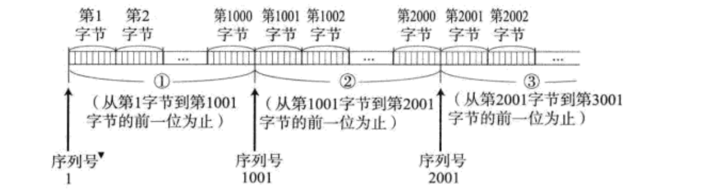
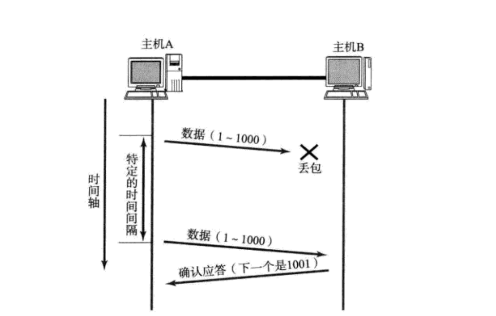
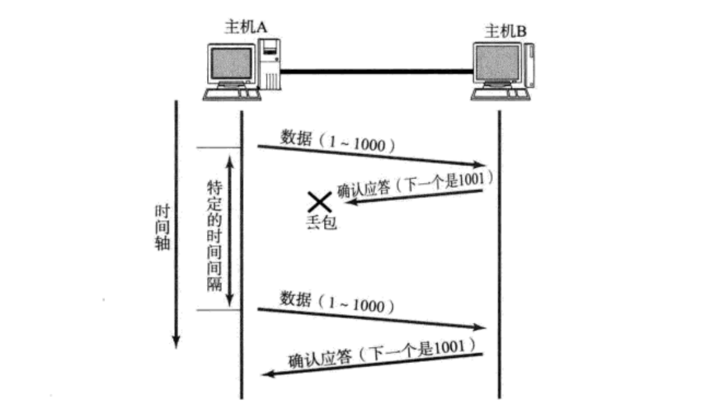

# 一、序列号的理解

## 1. 序列号

我们把发送缓冲区看成是一个字符数组，数组的下标就是字节的编号。这就有了序列号。

TCP将每个字节的数据都进行了编号，**即为序列号**。

我们之前讲过，当我们进行数据发送时，从序列化到调用 `write` 等 IO 系统调用，**本质上都是内存拷贝**。数据被写入发送缓冲区中。

TCP报头中32位序号就是发送数据最后一个字节的下标。当然这种解释不是很合理，但能帮助我们非常直观地理解序列号与缓冲区的对应关系。

## 2. 32位确认序号

每一个ACK都**带有对应的确认序列号**，意思告诉发送者，我已经收到了哪些数据；下一次你从哪里开始发。

下一次就从哪里开始发送**不是**指下一次的编号是什么，因为还要加上**下一次发送报文的长度**！

比如说：发1000个字节，ACK返回1001，下一次就要从1001开始发，假设又发了1000字节，那么这一次的ACK就是2001；假设这次只发了1字节，那么这一次的ACK就是1002。

# 二、丢包

## 1. 丢包的情况

丢包有两种情况：

数据丢包：

应答丢包：

因此，发送方没有收到ACK，意味着可能是**要么数据丢失**、**要么应答丢失**。

## 2. 超时重传与报文重复问题

如果发送方在**一段特定的时间段后，没有收到应答，即可判定为报文丢失**，随即重传报文，这就是超时重传。

发送方超时重传给接收方，接收方有可能接收到两份一样的报文，**引发报文重复问题。**

此时，序号又派上用场了，因此，序号又多了一种功能：**去重**。序号目前有三种功能：确认应答、按序到达、去重。

## 3. 时间间隔

应该是多长时间间隔？为什么？超时重传的时间间隔是变化的。超时的重传时间如何确定？

- 最理想的情况下，找到一个最小时间间隔，保证“确认应答”在这个时间内返回。

- 但是这个时间的长短，随着网络状态不同，是有变化的。

- 如果超时时间设得太长，会影响整体重传效率；

- 如果超时时间设得太短，有可能会频繁发送重复的报文。

TCP为了保证无论在任何环境下都能比较高性能的通信，因此重传超时时间是动态计算出来的。

**Linux中（BSD Unix和Windows也是如此），以500ms为一个单位进行控制，每次判定超时重发的超时时间是500ms的整数倍。**

如果重发一次之后，仍然得不到应答，等待 2 * 500ms 后进行重发。
  如果仍然得不到应答，等待 4 * 500ms 进行重发，依次类推，以指数形式递增。
  **累计到一定重传次数，TCP认为网络或者对端主机出现故障，强行关闭连接。**