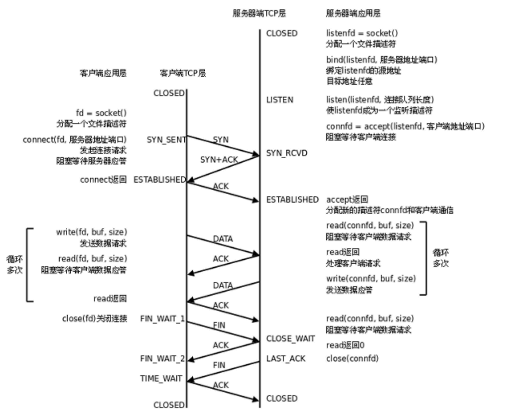
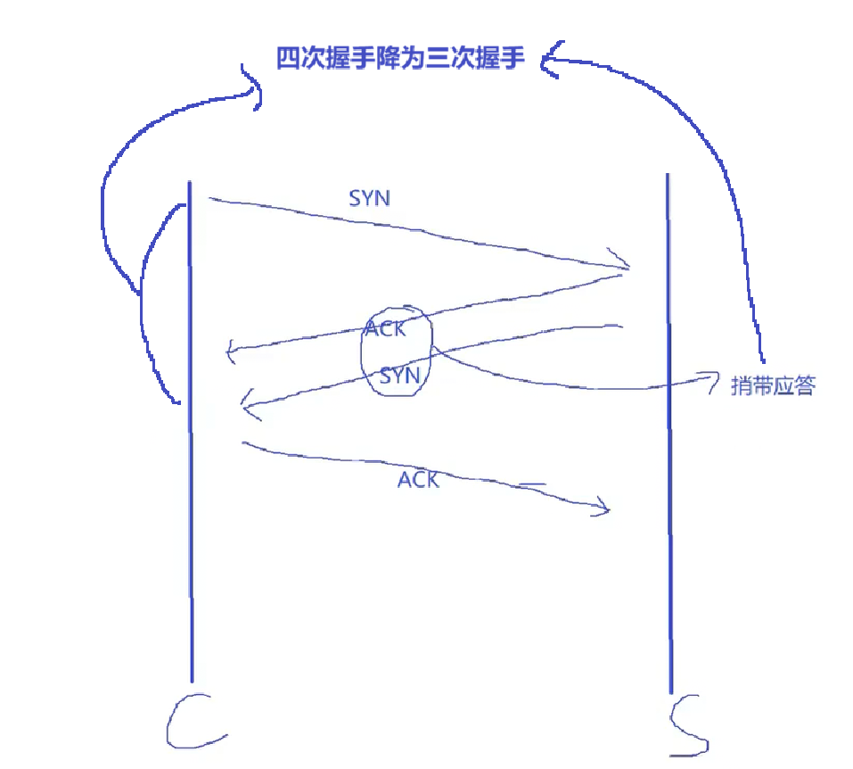
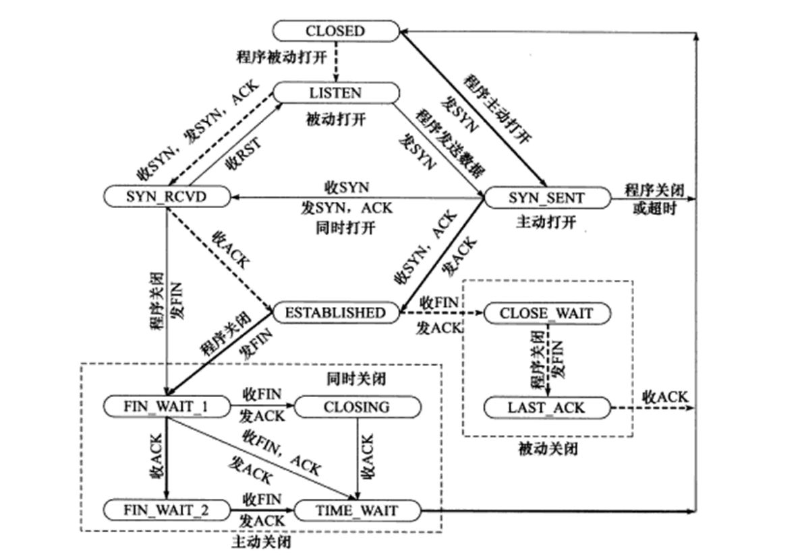

# 一、深入理解三次握手、四次挥手

## 1. 连接过程



**（注：使用`netstat -natp`可以查看当前TCP连接的详细信息）**

服务器会与多个客户端建立连接，那么这么多个连接也是需要被管理起来的，先描述、再组织，**内核中有一个`struct Link`结构体保存连接的属性**。

通信过程中，**由`connect`发起三次握手，而三次握手具体的过程由客户端操作系统自主完成，完成后给`connect`返回值，`connect`不参与三次握手的具体内容。**

**`accept`不参与三次握手，==三次握手由客户端与服务端操作系统共同完成==，`accept`只负责获取把已有的连接。**

`read`与`write`只负责把用户数据拷贝到内核，而不负责收发数据，至于什么时候收发数据，收发多少，由操作系统自己决定。这也是生产者消费者模型，支持忙闲不均。

## 2. 为什么要三次握手（重点📌面试高频）

核心原因：

**第一、三次握手是最短实现全双工的方式。验证全双工本质是：验证双方所处网络环境通畅。**

**第二、以最小成本，100%确认双方通信意愿。**



**其实建立连接本来是四次握手，通过捎带应答，四次握手可以降至三次握手。**

建立连接时，客户端与服务器**很容易达成共识**：双方都要确认对方的接收与发送能力，面对客户端的请求，服务器都无脑接受。服务器收到SYN后，**由于自己也需要发起建立连接，并且顺便确认客户端的请求（发送 ACK）**，这两件事在逻辑上是同时发生的。因此，TCP 协议从底层规范上就把它们设计在同一个报头文段里（**SYN+ACK 标志位同时置1**），**这本身就是单次原子操作，而不是被迫把两次通信“拼凑”在一起。**

## 3. 四次挥手

### 3.1 断开过程

断开连接的本质：**建立双方断开连接的共识。**

C端发送FIN，S端发送ACK之后，**S端可能还有报文没发完**，S端还能发送正常报文，发送完了，S端再发FIN，C端发ACK，完成四次挥手。

**为什么“四次挥手”通常不能合并成三次？**

- 半关闭状态（Half-Close）：TCP 是全双工通信。当客户端发送 FIN 断开连接时，只代表客户端不再发送数据了；但此时服务器**可能还有没发完的数据**要继续传给客户端。
- 拆分机制：服务器必须先**立即回复一个 ACK**（告诉客户端：“你的断开请求我收到了”），**随后继续传输剩余数据**。等服务器把所有数据发完后，才会单独再发一个 FIN 给客户端。因此，挥手过程天然被拆成了 4 个阶段（FIN -> ACK -> FIN -> ACK）。

### 3.2 shutdown接口

系统还提供了一个系统调用 `shutdown`，**它可以根据你传递的选项自由选择关闭文件描述符的读端、写端或者是全部关闭**。例如设置为 `SHUT_WR` 时，客户端可以关闭写的单向信道，保留读端读取服务器发送过来的剩余消息，即将全双工变成半双工。

### 3.3 CLOSE_WAIT状态

在四次挥手过程中，如果客户端主动发起断开请求（发送 FIN），服务端 在收到后会回应 ACK，此时服务端就会进入 **CLOSE_WAIT** 状态。

如果C已经退出或关闭，而S一直不退，那么它会一直处于`CLOSE_WAIT`状态，占用文件fd，连接没有释放。

这会导致**文件描述符泄露**问题。

### 3.4 TIME_WAIT状态

#### 3.4.1 概念

即便四次挥手完成，主动关闭方也不会立刻回到 CLOSED 状态。主动断开连接的一方，在完成四次挥手后，要进入一个状态，叫做**TIME_WAIT**。

#### 3.4.2 MSL时间

**TCP 协议规定，主动关闭连接的一方要处于 TIME_WAIT 状态，等待两个 MSL（Maximum Segment Lifetime，最大报文生存时间）的时间后才能回到 CLOSED 状态。**

MSL 是 TCP 报文的最大生存时间，因此 TIME_WAIT 持续存在 2MSL 的话，就能**保证在两个传输方向上的尚未被接收或迟到的报文段都已经消失**（**否则服务器立刻重启，可能会收到来自上一个进程的迟到数据，导致数据混乱**）。

#### 3.4.3 TIME_WAIT引起bind失败问题

主动断开连接的一方，在断开后马上再次绑定与上次相同的端口，会引起`bind error`。

因为它在断开连接后，上次的连接还处于`TIME_WAIT`状态，还没有释放close，导致绑定失败。

**`TIME_WAIT`是为了保证历史报文一定已经消散**，即使再次建立连接时，它们还没有消散，`TIME_WAIT`也会阻止连接的建立，使绑定失败。

#### 3.4.4 对于bind失败问题的解决方案

我们有解决方案：使用 **`SO_REUSEADDR`** 选项！它允许套接字强制绑定并重用处于 TIME_WAIT 状态的已有 IP  和端口（**支持服务器挂掉后以完全相同的 IP/端口立即重启**）：

```c
int opt = 1;
setsockopt(listenfd, SOL_SOCKET, SO_REUSEADDR, &opt, sizeof(opt));
```

#### 3.4.5 辅助方案解决bind失败

客户端和服务器通信的时候，报文的**起始序号**，**起始时非固定的**！比如我这一次启动，客户端发送的报文的起始序号是1000，下一次起始序号就是1428。如果接收方发现接收到的报文的序号与当前通信过程中的报文序号存在巨大出入，那么就会丢弃它。

比如我的缓冲区大小是 5000，我和对面协商好它从 1000 开始发送，但是这个时候突然出来一个 7000 序号的报文，于是这个时候这个报文必须丢弃！

## 4. 连接状态


### 4.1 服务端状态变化

- **[CLOSED -> LISTEN]** 服务器端调用 listen 后进入 LISTEN 状态，等待客户端连接；
- **[LISTEN -> SYN_RCVD]** 一旦监听收到连接请求(同步报文段)，就会将该连接放入内核等待队列中，并向客户端发送 SYN 确认报文。

- **[SYN_RCVD -> ESTABLISHED]** 服务端一旦收到客户端的确认报文，就进入 ESTABLISHED 状态，可以进行读写数据了。

- **[ESTABLISHED -> CLOSE_WAIT]** 当客户端主动关闭连接(调用 close)，服务器会收到结束报文段，服务器返回确认报文段并进入 CLOSE_WAIT；

- **[CLOSE_WAIT -> LAST_ACK]** 进入 CLOSE_WAIT 后说明服务器准备关闭连接(需要处理完之前的数据)；当服务器真正调用 close 关闭连接时，会向客户端发送 FIN，此时服务器进入LAST_ACK 状态，等待最后一个 ACK 到来(这个 ACK 是客户端确认收到了 FIN)

- **[LAST_ACK -> CLOSED]** 服务器收到了对 FIN 的 ACK，彻底关闭连接。

### 4.2 客户端状态变化

- **[CLOSED -> SYN_SENT]** 客户端调用 connect，发送同步报文段；
- **[SYN_SENT -> ESTABLISHED]** connect 调用成功，则进入 ESTABLISHED 状态，开始读写数据；

- **[ESTABLISHED -> FIN_WAIT_1]** 客户端主动调用 close 时，向服务器发送结束报文段，同时进入 FIN_WAIT_1；

- **[FIN_WAIT_1 -> FIN_WAIT_2]** 客户端收到服务器对结束报文段的确认，则进入 FIN_WAIT_2，开始等待服务器的结束报文段；

- **[FIN_WAIT_2 -> TIME_WAIT]** 客户端收到服务器发来的结束报文段，进入 TIME_WAIT，并发出 LAST_ACK；

- **[TIME_WAIT -> CLOSED]** 客户端要等待一个 2MSL(Max Segment Life, 报文最大生存时间)的时间，才会进入 CLOSED 状态。



- 较粗的虚线表示服务端的状态变化情况；
- 较粗的实线表示客户端的状态变化情况；
- CLOSED是一个假想的起始点，不是真实状态；
