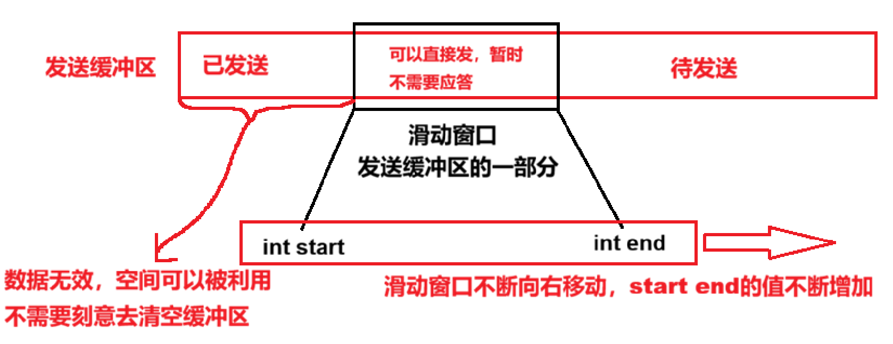
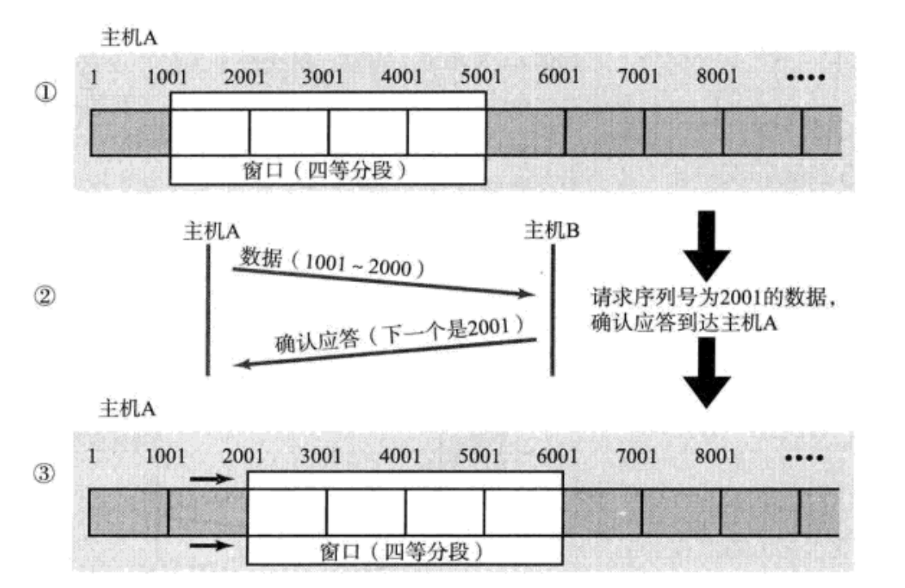
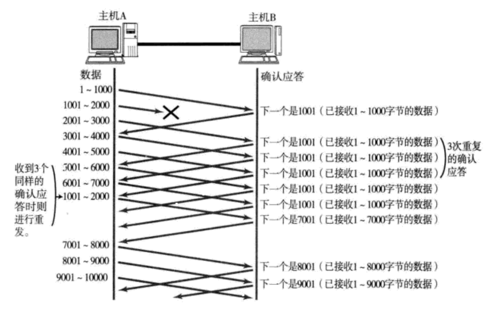
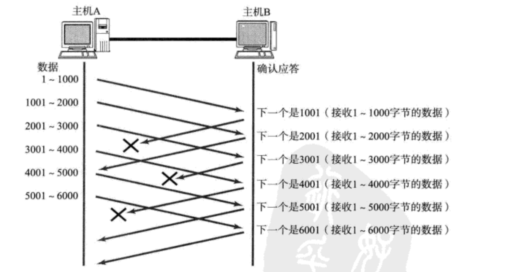
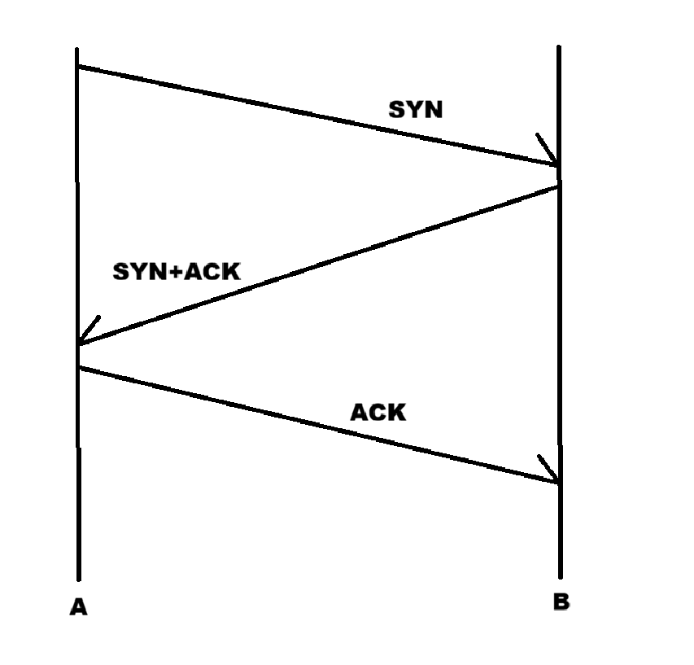
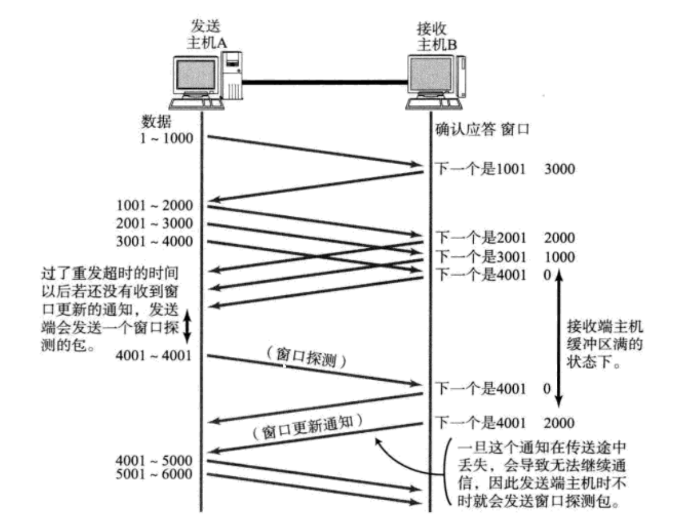

# 一、滑动窗口

我们在前面的章节中讲过，发送方和接收方“你一句、我一句”地单报文发送与确认效率太低。一般情况下，为了提升传输效率，我们会让发送方一次性发送多个报文，接收方也可以一次性接收并确认多个报文。

## 1. 概念

主机A会向主机B一次性发送多条报文，那么窗口大小就指的是**无需等待确认应答**而可以继续发送数据的最大值。

发送方一次向对方发送多少数据由**窗口大小**决定。

我们可以向将发送缓冲区看作一个数组。那么数组就可以分为三个部分：

- **已发送已确认**：这部分数据已经完成可靠传输，其内存空间可以被重用或覆盖。
- **可以直接发送（暂时不接收 ACK）**：这部分空间即为滑动窗口的范围。
- **待发送**：尚未进入窗口范围，需等待窗口滑动后才能发送。

滑动窗口本质上是**发送缓冲区的一部分**，你可以直接理解为由下标 `start` 到 `end` 的一段区间，即窗口大小等于 `end - start`。

由于序号在发送缓冲区中是依次递增的，因此随着确认应答的不断返回，滑动窗口在宏观上是**基本向右滑动**的。滑动窗口移动的本质，就是 `start` 与 `end` 指针（下标）的增加。

## 2.窗口大小

滑动窗口的大小究竟由什么决定？
  暂且可以认为，滑动窗口的大小由 **对方的接收能力（即收到报文中的 win 字段大小）** 决定。

TCP 报文中的 `win` **字段（Window）** 表示接收窗口大小，也就是**接收方当前还能接收多少字节的数据**。

> **`start`=报文确认序号**
>
> **`end`=`start`+`win`**

如果对方反馈的 `win = 0`，那么滑动窗口将不移动（**窗口大小变为 0**），此时发送方停止发送数据。

由此，我们可以通过滑动窗口大小来进行流量控制，窗口大多发，窗口小少发。

**总结：==滑动窗口的本质，就是TCP 流量控制的具体实现方案！==**

# 二、相关问题

## 1. 滑动窗口可以向左滑动吗

**不会向左滑动**，结合确认序号的定义，确认序号表示的是“该序号之前的数据已经全部成功接收”。发送方发出的数据是连续确认的，因此滑动窗口只能向右滑动，绝对不能跳跃或倒退。

## 2. 滑动窗口大小可以改变吗

可以改变，接收方给发送方应答的报文中会有`win`字段，下一次窗口的大小由`win`决定，即取决于接收方的接受能力。

## 3. 如果丢包了怎么办【重点📌】

丢包可以细分为三种情况，我们来分类讨论：

假设有4条报文，分别是1001-2000、2001-3000、3001-4000、4001-5000。

- **最左侧丢失：**

    - 最左侧**报文数据**丢了：那么即使接收端收到2001-3000及后面的，应答报文依旧是1001，==**核心是要理解：确认序号表示在其之前的所有报文均已收到**==，因为**1001开头的报文还没收到，因此后面的确认序号都是1001**。因此，**滑动窗口左侧不动**。

    

    - 最左侧**报文对应的应答**丢了：那么发送方会**收到2001、3001等确认序号**，该序号已经表明**在其之前所有的报文都已经收到**。因此**滑动窗口正常工作**。

    

    ### 快重传 VS 超时重传

    **快速重传（快重传）**：当发送方连续收到 3 次相同的确认应答（例如连续收到 3 个 ACK 1001）时，TCP 就会认为该报文段已经丢失，并在定时器超时前**立即重发**丢失的数据段 **（补发 1001~2000）。这极大地提高了传输效率。**

    ***

    **超时重传**：如果在规定时间内没有触发快速重传（例如发包数量较少，无法凑齐 3 次重复 ACK），定时器超时后也会兜底触发重传。

    **两种重传机制是同时存在的，如果在丢失报文后还有数据，那就是快重传；如果没有数据了，那就是超时重传。快重传是提升效率，超时重传是兜底。**

    ***

    TCP发出报文后，如果暂时没有收到应答，会把报文保存起来，那保存在哪里呢？

    答案是：**保存在滑动窗口中**，发送端没有收到应答，滑动窗口不会移动，**所谓的保存就是保持滑动窗口不动**；等到需要重传的时候，再对窗口中的报文进行重传，如果收到应答，滑动窗口就移动，就会删除掉那些报文。

- **中间丢失**：如果最左侧报文正常，那么**滑动窗口自然会滑到中间报文丢失的位置**，因为`start`的定义就是报文的确认序号，从而**转化为最左侧丢失的情况**。

- 最右侧丢失：滑动窗口自然也会滑到丢失报文的位置，比如上面的报文，如果后面有数据，那么后面的数据全部都是4001，触发快重传；如果后面没数据了，那就是超时重传，自然也会**转化为最左侧丢失的情况**。

**因此，滑动窗口不会对跳过报文，进行应答，确认序号表示它之前的所有报文均已收到**，确认消息一定是连续确认的，发送必须连续发送，这决定了滑动窗口不能跳跃。

## 4. 滑动窗口一直向右滑动，会不会溢出

不会溢出，我们可以把发送缓冲区理解为一个**环形的数据结构**（或环形队列）。当滑动窗口移动到缓冲区的末尾时，会自动绕回头部继续循环使用，因此不需要频繁创建新的空间或担心越界问题。

# 三、流量控制补充

==**前面已经讲过，流量控制的底层是滑动窗口**==，现在我们来对它进行补充。

TCP在进行三次握手时，第三次握手能不能携带数据呢？

**肯定是可以的**，前两次不能携带数据，因为前两次连接还没建立完成，在第三次的时候，当 A 把报文发出的一瞬间，B 就认为连接已经建立了，那么这次报文当然可以携带数据。

- **那如果第三次发送的数据太大，对方接受不了呢？**
    - **这种情况是不可能存在的，因为前两次双方已经交换了各自的缓冲区大小**，且没有发送任何数据，第三次发送的数据不可能超过对方缓冲区大小。

- **如果在发送时，对方来得及接收，对方缓冲区增大了怎么办？**
    - **那 A 端就会被对方告知，从而调整滑动窗口大小，提高速度。**
- **如果对方缓冲区变为0了怎么办？**
    - **我们可以将滑动窗口大小设为0，停止发送。至此，双方的操作系统不再发送消息，操作系统就会去处理其他事情了，直到对端上方应用层把数据读走。**
    - B 缓冲区变为0后， A 为了得知 B 端缓冲区大小，**每隔一段超时重传的时间，如果还没收到窗口更新的通知，A 端会发送一个窗口探测的报文**，它只有序号，没有数据，以得到 B 端的应答，获取缓冲区大小。
    - 因为TCP 通信双方地位是对等的，因此，同样地，**B 缓冲区更新时，也会给 A 发送窗口更新通知**。
    - 如果 A 多次询问 B 得到的都是缓冲区大小为0，那 A 就可以将 PSH 标志位置 1 ，要求对方层尽快读取数据；如果长时间得到的都是0，那么A就会主动断开连接。

在 TCP 首部中，还包含了一个16位窗口大小，因此，TCP窗口大小默认就是2^16^-1=65535字节。

在TCP首部选项中还包含了一个窗口扩大因子 M ，可以通过它来改变窗口大小，实际窗口大小就是原窗口大小左移 M 位。这个选项基本上非常少用。
