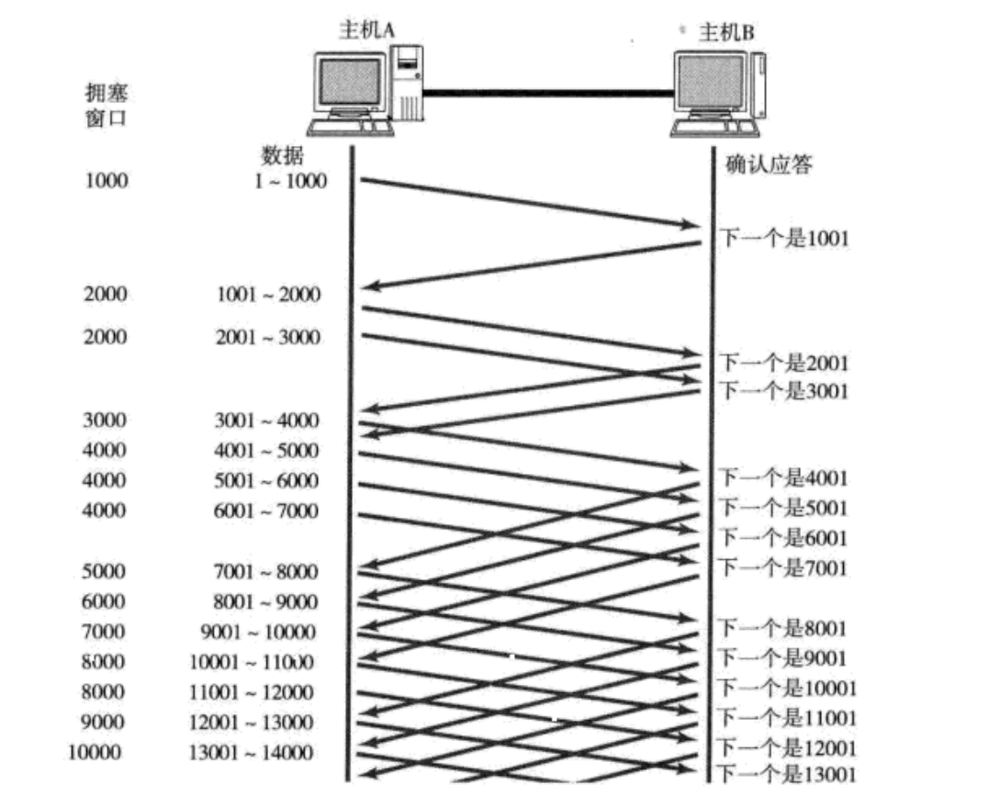
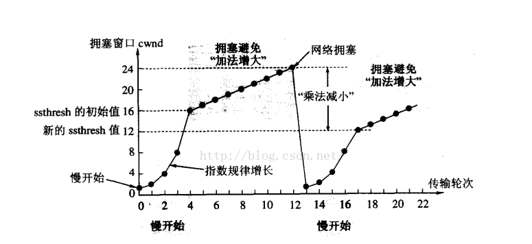
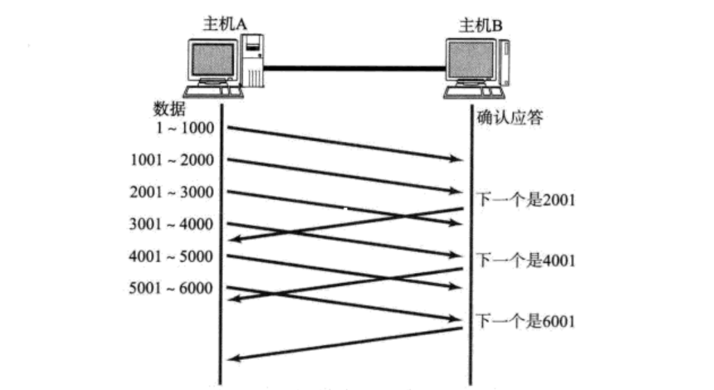

TCP 协议不仅考虑了传输两端主机的接收能力 **，还必须考量中间网络环境本身的状况——拥塞控制**。

# 一、拥塞控制

## 1. 为什么要进行拥塞控制

在网络通信时，如果遇到少量数据包丢失，属于正常现象；但如果是80-90%的报文都丢包了，那就是非常规现象了，说明当前**网络链路存在异常**。

当出现大面积丢包时，发送方会判定这是**网络拥塞**所导致的问题。此时如果盲目地立即重发数据，不仅无法解决问题，反而会进一步增加网络的负载，导致网络更加拥塞。

网络是由成千上万个客户端和服务端共同共享的。如果每个主机都认为自己的数据量小而选择立即重发，就会加速整个网络的瘫痪。

因此，我们需要**拥塞控制**机制。拥塞控制的作用在于统一管理和协调发送端的多个主机，让所有主机在面对网络拥塞时都采用相同的策略，以共同维护网络环境的稳定。

## 2. 慢启动算法

既然在网络发生拥塞时不能立即重发大量报文，TCP 采取的解决方案就是：**慢启动算法**。报文数量呈指数级增长，所有主机前期慢，后期快。
  慢启动的策略是先发少量的数据探探路，摸清当前网络的拥塞程度，然后再决定按照多大的速度发送数据。

前期较慢，是的网络有足够时间恢复。网络恢复了，发送速度也就上来了。

## 3. 拥塞窗口

问题来了，之前不是说了，发送多少数据由滑动窗口决定吗？

因此，我们引入一个新的概念：==**拥塞窗口（cwnd）**==。

拥塞窗口就是一个临界值，值以内，网络大概率不拥堵，值以上，网络可能拥堵。因为网络时变化的，这就决定了这个拥塞窗口一定要进行更新变化。

概念更正：**滑动窗口大小=min(对方win , 拥塞窗口大小)**。

因此，滑动窗口既考虑了网络拥堵问题，又考虑了对方接受能力的问题。

## 4. 拥塞窗口控制

拥塞窗口肯定不能一直保持指数增长，否则后期报文数量就太多了。

为什么前期需要指数增长？——前期慢，后期快，为了尽快探测并恢复网络通信。

拥塞窗口是我们当前计算机内衡量网络是否会拥堵的一个指标。拥塞窗口一定是会变化的。

TCP 的拥塞控制过程主要分为三个阶段：

1. **前期（慢启动阶段）**：拥塞窗口初始值较小，数据量按指数规律增长，目的是前期慢发、减少网络压力，并快速探测网络状况。
2. **中期（拥塞避免阶段）**：为了防止拥塞窗口增长过快导致网络拥塞，TCP 引入了一个阈值——==**慢启动阈值（ssthresh）**==。
    - 当`cwnd`低于`ssthresh`时，`cwnd`呈指数增长。
    - 当`cwnd`高于`ssthresh`时，`cwnd`不再按指数增长，而是转变为**线性增长**（每次增加 1），这种方式被称为**“加法增大”**，**本质是为了探测网络的通畅程度。**
3. **后期（乘法减小与重新开始）**：
    - 随着拥塞窗口不断增大，当网络再次出现拥塞，即出现大面积丢包时，TCP 会采取“乘法减小”策略：将新的 `ssthresh` 降低为当前拥塞窗口的一半，将`cnwd`降为初始值，重新慢启动。

**加法增大是慢慢试探网络承载能力，乘法减小是在发生拥塞时迅速降低发送压力。**

***

**那拥塞窗口在线性探测的过程中会一直增大吗？**

从逻辑上讲，它应该一直增大；但理论上它不应该一直增大，它会受到**通信带宽硬件层面**的影响。

所谓的网络卡顿，其实是TCP在进行拥塞控制。

# 二、延迟应答

在 TCP 传输过程中，如果接收数据的主机立刻返回 ACK 应答，这时候返回的通告窗口可能相对比较小。

当接收方收到数据时，**先不着急应答，可以先等一会**，等上层把数据读走后，再给发送方应答，这样就**会有较大的概率给发送方一个更大的窗口**，这样就有**较大概率更新出一个更大的滑动窗口**，从而能够使发送方**单次发更多数据**。

一定要记得：**窗口越大，网络吞吐量就越大，传输效率就越高**。我们的目标是在保证网络不拥塞的情况之下，尽量提高传输效率。

这种机制叫做**延迟应答**。这只是一种提高效率策略，而并非一定发生。

这种策略肯定会有一定的触发机制：

> - 数量限制：每隔 N 个包就应答一次。
> - 时间限制：超过最大延迟时间就应答一次。

这些限制跟具体的操作系统有关。一般上述的 N 取 2 ，超时时间取200ms。

# 三、粘包问题

**TCP 是面向字节流的**，这意味着 TCP 不会保留应用层每次发送数据的边界，**TCP 只负责可靠地传输字节，不关心应用层一次发送了多少数据。**

因此容易发生**两次数据边界不清楚**的情况。

注意：**这里的「粘包」并不是 TCP 把多个数据包真的粘在了一起，而是接收端读取数据时，无法区分发送端原本的数据边界。**

我们之前也已经实现过，为了解决粘包问题，我们就需要在**应用层来自定义一套协议+序列与反序列化**来区分不同报文。我们之前的做法就是给数据前添加长度与换行符，数据后添加换行符。这种字段称为**自描述字段**。

# 四、TCP总结

为什么 TCP 协议 这么复杂？因为 TCP 既要保证数据的可靠性，同时又要在保证可靠性的前提下尽可能地提高性能。

**可靠性：**

1. 校验和
2. 序列号（按序到达）
3. 确认应答
4. 超时重发
5. 连接管理
6. 流量控制
7. 拥塞控制

**提高性能：**

1. 滑动窗口
2. 快速重传
3. 延迟应答
4. 捎带应答

**其他：**

1. 定时器（超时重传定时器、保活定时器、TIME_WAIT 定时器等）