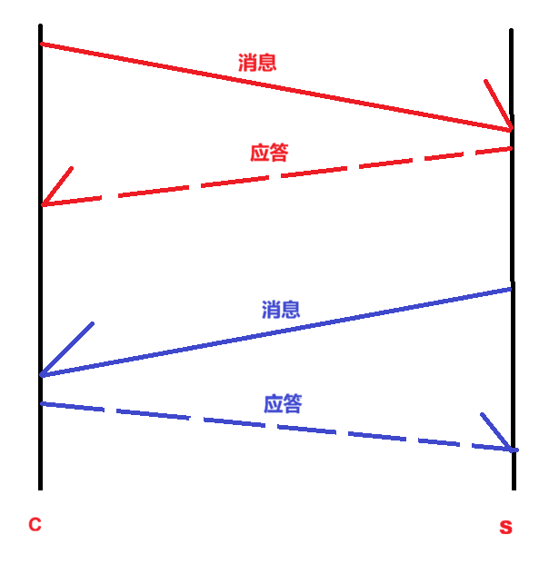
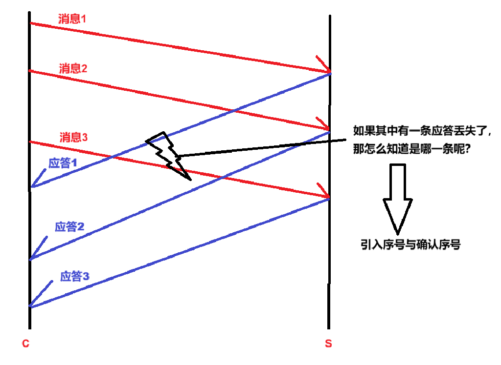

# 一、TCP可靠性的本质

**先说结论：世界上不存在 100% 绝对保证可靠的通信系统**，但网络协议 可以通过设计来最大程度地确保可靠性。

我们需要正确理解可靠性：

1. **具有应答（ACK）机制，可以保证历史消息的可靠性。** 只有当发送方收到接收方的回应时，才能确信上一条发送给对方的消息已经成功到达。
2. **在通信过程中，最新的报文永远没有应答，因此最新消息的可靠性无法直接保证。**

**如果要保证可靠性，处于核心地位的是TCP的确认应答机制。**

# 二、TCP传递报文过程

## 1. TCP一般通信过程

客户端给服务器发消息，服务器给客户端应答；服务器给客户端发消息，客户端给服务器应答。**只要有应答，就代表上一条消息一定收到**，不用对应答做应答。

这种互相发送并等待确认的机制，我们称之为：**确认应答机制**。但是，这种一应一答（发一条、等一条确认、再发下一条）的方式，**在实际网络传输中效率太低下了。我们引出传递报文更通用的过程。**

## 2. 更通用的过程

可以发多条消息，收多条应答：

**这时候就会面临一个核心问题：在并发发送的情况下，到底是谁丢包了呢？**

> **是时候引出32位序号与32位确认序号了。**