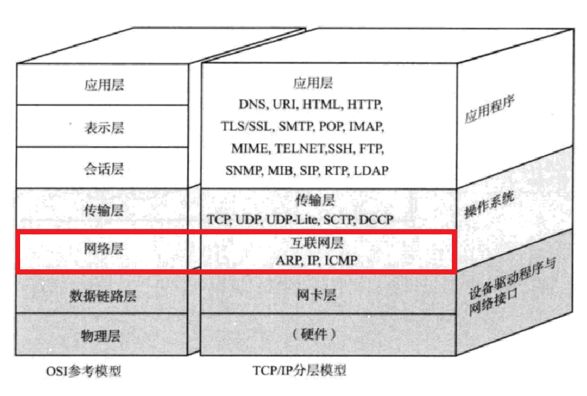
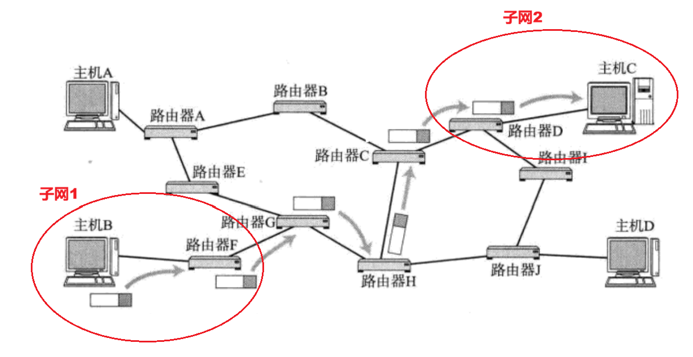
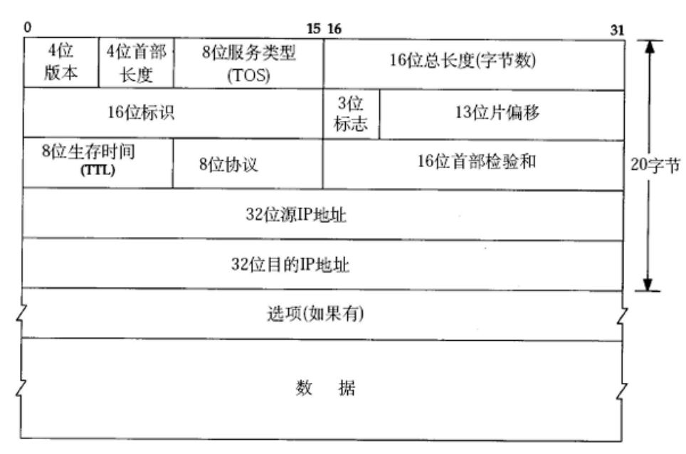

# 序

我们现在处于：




# 一、传输层与网络层的关系

 IP协议：提供一种**把数据报从A主机跨网络送到B主机**的能力。
  **所谓“能力”，在字典意义上可以解释为：有非常大的概率，能做到某件事情。但是有能力不代表这件事情一定可以办成！**

如果A主机没有将数据报送到B主机，**那就需要传输层提供一种策略**，使数据报百分之百送到B主机，此策略就是我们之前 TCP 所讲的流量控制、拥塞控制、重传机制等等。

**因此，传输层提供策略，网络层提供能力。TCP / IP协议的核心功能：报数据100%可靠地从A主机送到B主机。**

# 二、IP协议核心作用与构成

## 1. IP核心作用

IP协议要提供一种**把数据报从A主机跨网络送到B主机**的能力。那么就必须要有**标识通信两端主机唯一性**的方式，因此，**每台主机都必须设置IP地址（公网IP）**。

**IP协议解决的是主机到主机的问题。TCP对上，解决的是另一个问题，当它拿到数据包后，需要交给哪个进程处理，这是进程到进程的问题，因为传输层引入了端口号。**

## 2. IP的组成

IP = 目标网络 + 目标主机。例如 `128.26.34.144`，其中前段表示子网，后段表示主机。



路由的本质理解：**路上的时候，本质是在进行从一个子网，进入另一个子网。**

主机：配有IP地址，也要进行路由控制的设备；

路由器：即配有IP地址，又能进行路由控制；工作在**网络层**。

当代路由器，已经是一台小型计算机了！是可以工作在应用层的！

**节点：主机和路由器的统称。**

# 三、IP协议

## 1. IP报头




```c
struct iphdr {
#if defined(__LITTLE_ENDIAN_BITFIELD)
	__u8	ihl:4,
		version:4;
#elif defined (__BIG_ENDIAN_BITFIELD)
	__u8	version:4,
  		ihl:4;
#else
#error	"Please fix <asm/byteorder.h>"
#endif
	__u8	tos;
	__be16	tot_len;
	__be16	id;
	__be16	frag_off;
	__u8	ttl;
	__u8	protocol;
	__sum16	check;
	__be32	saddr;
	__be32	daddr;
	/*The options start here. */
};
```

### 1.1 报头解析

- **大小**：报头长度与TCP相同，都是看4位首部长度，**范围是[20,60]**。
- **解包**：**选项长度=4位首部长度 - 20；有效载荷（数据）长度=16位总长度 - 4位首部长度。封装问题也随之解决。**
- **分用**：**8位协议表明有效载荷是什么数据**，UDP/TCP还是其他的。

## 1.2 8位服务类型TOS

**IP 从一主机到另一主机可以走的路线不只有一条，因此路由器会根据TOS来选择路线。**

**8位服务类型（TOS）**：由3位优先权字段（已经弃用）、4位TOS字段和1位保留字段（必须置0）组成。4位TOS分别表示：最小延时、最大吞吐量、最高可靠性、最小成本。这四者相互冲突，只能选择一个。**对于ssh/telnet这样的应用程序，最小延时比较重要；对于ftp这样的程序，最大吞吐量比较重要。**

### 1.3 8位生存时间TTL

由于某些原因，一个报文可能会在多个路由器之间不断被环形转发，一直发不出去，如果一直让该报文转下去，那么像这样的报文可能就会越来越多，占用网络资源。

TTL本质是一个计数器，表示报文的最大报文生存时间，转发过程中不断 - - ，一定次数后，TTL小于0，报文自动丢弃。

### 1.4 16位首部校验和

在信号传输过程中，由于受到电磁感应的影响，部分数据的比特位可能会发生翻转，这就需要16位首部校验和进行校验。