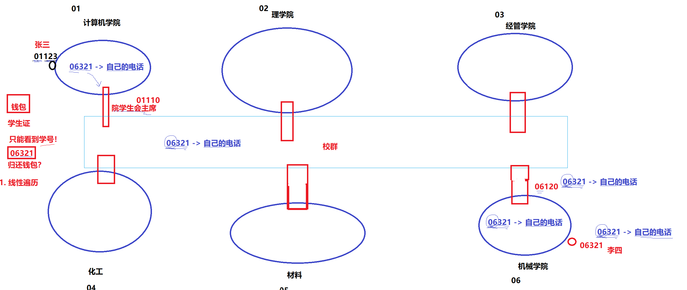
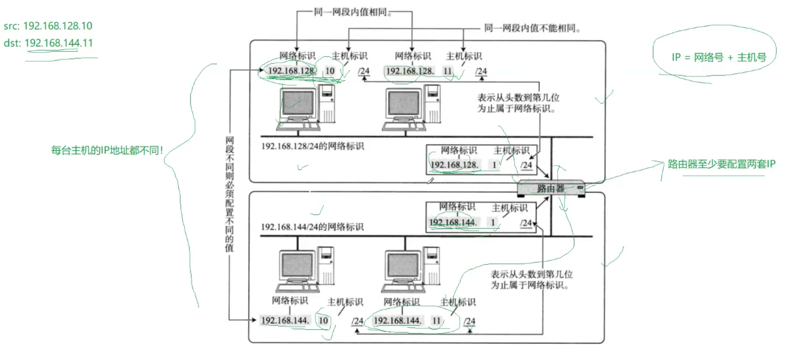
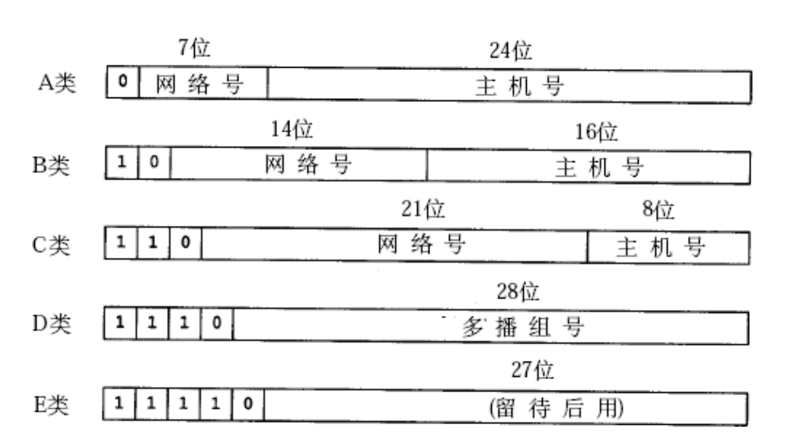

# 一、子网划分

**首先要建立一个共识：网络本身是几十年发展的产物，网络建设是经历了几十年的。**

**因此网络一定是会被设计过的。这里的设计指存在某种规律。**就比如说我们的学号是被设计过的，学号=入学年份+专业+班内序号等等。IP = 目标网络 + 目标主机。

**那么要进行报文路由时，我们最核心的关注点应该是理解网络是如何被设计的。**

## 1.为什么要进行子网划分

### 1.1 讲个故事

假设一个大学有很多学院，每一个学院都有一个编号。**学生的学号是学院号加学生号组成。每一个学院都有各自的群聊，每一个学院的学生会主席都有一个学校群群聊。**假设01：计算机，06：机械。

有一天，张三在路上发现了一个钱包，里面有一张学生证。学生证上只有学号，学号名为06321。张三马上可以得出第一个结论：**06不是计算机学院，丢钱包一定不是计算机学院的学生！**

张三于是就把照片连带自己的电话发到了院群，然后@了自己的学生会主席李四。李四收到消息后，一看，是06开头的，知道是机械学院的，于是把消息发送到了校主席群，然后@了机械学院的主席王五。王五收到消息后得知了06321，**321就是我们院里面的赵六呀，于是把照片发给赵六，让他去找张三。**

### 1.2 对应关系

1. 学生会主席对应**出入口路由器**。
2. 张三把照片发给李四属于**内网转发**。
3. 李四在校主席群发给王五属于**公网转发**。
4. 学院号对应**网络号**。
5. 学生号对应**主机号**。
6. 学号即**IP，由网络号和主机号组成**。
7. 校主席群对应**公网**。
8. 各学院对应**子网划分后的子网**。
9. 学校对应**运营商**。
10. 划分学院对应**子网划分**，为什么要子网划分？为什么要划分各种学院？？

在我们没有上大学的时候，上面的学院、院号等概念，已经被学校精心设计过了！！**划分学院的过程称为子网划分。**

路由报文本质是查找主机的问题。查找的本质是淘汰的过程。只要我淘汰的效率高，那么查找的效率就高！！！

**未来查找目标主机，先必须查找目标网络；本质就可以淘汰其他网络，可以在全网中提高查找目标主机的效率！**

# 二、IP分配、网段划分

## 1. IP分配

我们的主机自带的IP地址不是我们访问用的IP地址，我们的主机的IP地址实际上是由路由器 分配的。在主机没有连接网线，没有连接wifi等等的时候，你的主机是没有IP的，只有在连接上网线（有线/无线）才能够拥有IP地址。

路由器内部的嵌入式设备可以按照一种算法，保证你被分配到的**IP地址不重复**。这种由你的路由器给你家里的设备动态分配IP地址的做法叫做**DHCP协议**，是一种应用层协议。它可以自动构建子网。**路由器是一种构建在应用层设备**。

## 2. 网段划分

一种非常古老的划分网络的方式：

1. A类网络有7位网络号，24位主机号，主机号太多了浪费。
2. B类网络有14位网络号，16位主机号。
3. C类网络有21位网络号，8位主机号，主机号太小了不够。
4. D类网络有28位多播组号。
5. E类网络有27位留作后用。